# CVE cards

One card per source entry (Openwall, NIST/NVD or CVE.org). PNG links are plain text; use the clickable links below.

## CVE-2023-0645: libjxl/cjxl out-of-bounds read in EXIF metadata parsing

[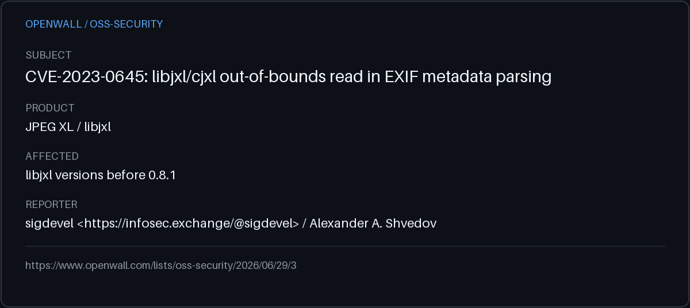](https://www.openwall.com/lists/oss-security/2026/06/29/3)

[PoC and References (TXT)](openwall-2026-06-29-3/openwall-2026-06-29-3.txt)

Source: <https://www.openwall.com/lists/oss-security/2026/06/29/3>

**PoC:**

- <https://github.com/sigdevel/pocs/blob/main/res/libjxl/2022_01_25/sig_11_src_000122_poc>

**References:**

- <https://nvd.nist.gov/vuln/detail/CVE-2023-0645>
- <https://github.com/libjxl/libjxl/issues/2100>
- <https://github.com/libjxl/libjxl/pull/2101>
- <https://github.com/libjxl/libjxl/pull/2101/commits/d95b050c1822a5b1ede9e0dc937e43fca1b10159>

## CVE-2025-70103: Heap-based Buffer Overflow in libjxl/cjxl via jxl::extras::DecodeImagePNM on crafted PBM file

[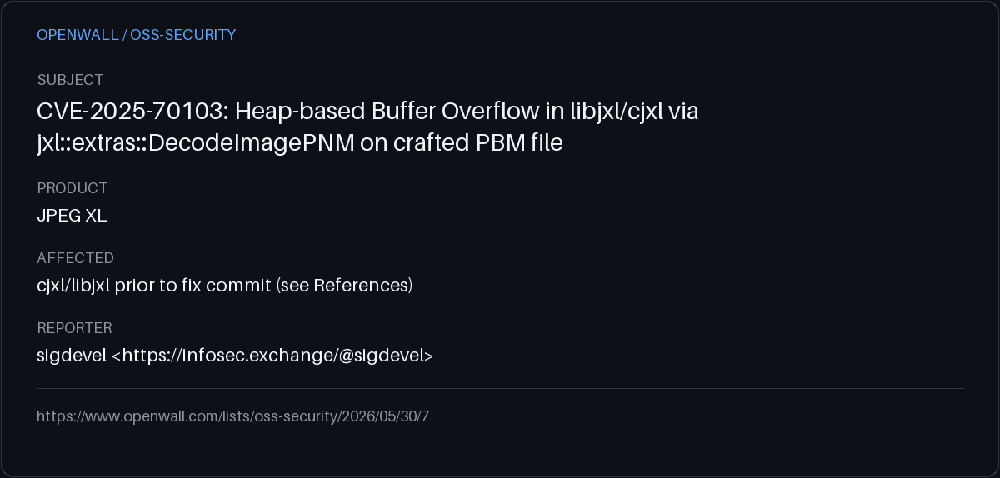](https://www.openwall.com/lists/oss-security/2026/05/30/7)

[PoC and References (TXT)](openwall-2026-05-30-7/openwall-2026-05-30-7.txt)

Source: <https://www.openwall.com/lists/oss-security/2026/05/30/7>

**PoC:**

- <https://github.com/sigdevel/pocs/blob/main/res/libjxl/2025/2/2_PBM_lib_extras_dec_pnm_cc_554>

**References:**

- <https://github.com/libjxl/libjxl/issues/4337>
- <https://nvd.nist.gov/vuln/detail/CVE-2025-70103>
- <https://infosec.exchange/@sigdevel/116642233929409910>

## CVE-2025-70099: lwext4 NULL pointer dereference in ext4_dir_en_get_name_len

[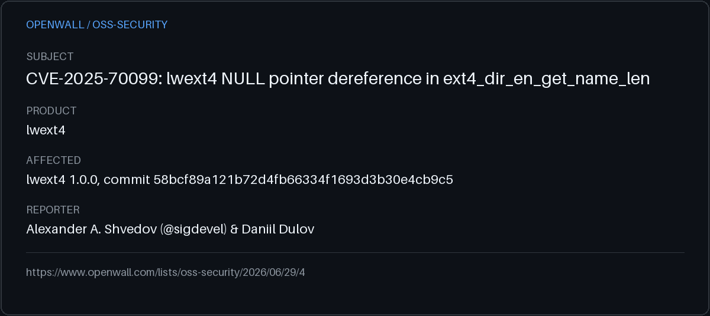](https://www.openwall.com/lists/oss-security/2026/06/29/4)

[PoC and References (TXT)](openwall-2026-06-29-4/openwall-2026-06-29-4.txt)

Source: <https://www.openwall.com/lists/oss-security/2026/06/29/4>

**PoC:**

- <https://github.com/sigdevel/pocs/blob/main/res/lwext4/1/sig11_2_1_lwext4_ext4_dir_h_126>

**References:**

- <https://github.com/gkostka/lwext4/issues/89>
- <https://github.com/sigdevel/pocs/blob/main/res/lwext4/1/sig11_2_1_lwext4_ext4_dir_h_126>
- <https://github.com/Aladdin-R-D/lwext4/releases/tag/v1.0.1>
- <https://www.cve.org/CVERecord?id=CVE-2025-70099>
- <https://nvd.nist.gov/vuln/detail/CVE-2025-70099>
- <https://infosec.exchange/@sigdevel/116668939725424227>
- <https://bdu.fstec.ru/vul/2025-15477>

## CVE-2025-70100: lwext4 divide-by-zero in ext4_block_set_lb_size

[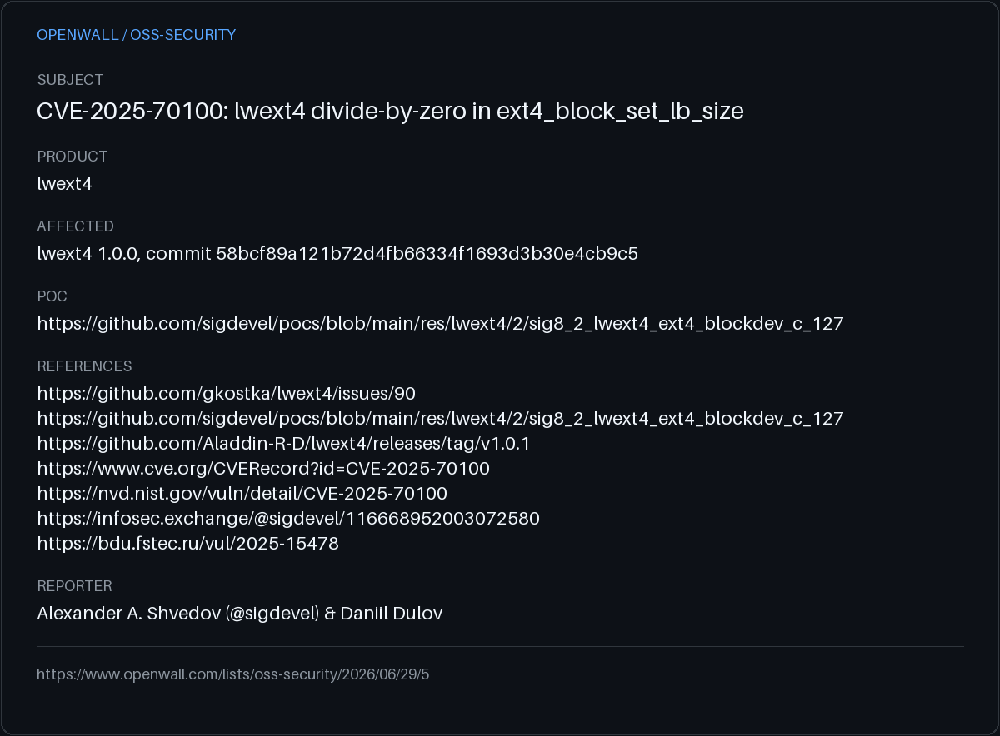](https://www.openwall.com/lists/oss-security/2026/06/29/5)

[PoC and References (TXT)](openwall-2026-06-29-5/openwall-2026-06-29-5.txt)

Source: <https://www.openwall.com/lists/oss-security/2026/06/29/5>

**PoC:**

- <https://github.com/sigdevel/pocs/blob/main/res/lwext4/2/sig8_2_lwext4_ext4_blockdev_c_127>

**References:**

- <https://github.com/gkostka/lwext4/issues/90>
- <https://github.com/sigdevel/pocs/blob/main/res/lwext4/2/sig8_2_lwext4_ext4_blockdev_c_127>
- <https://github.com/Aladdin-R-D/lwext4/releases/tag/v1.0.1>
- <https://www.cve.org/CVERecord?id=CVE-2025-70100>
- <https://nvd.nist.gov/vuln/detail/CVE-2025-70100>
- <https://infosec.exchange/@sigdevel/116668952003072580>
- <https://bdu.fstec.ru/vul/2025-15478>

## CVE-2025-70101: lwext4 out-of-bounds read in ext4_ext_binsearch_idx

[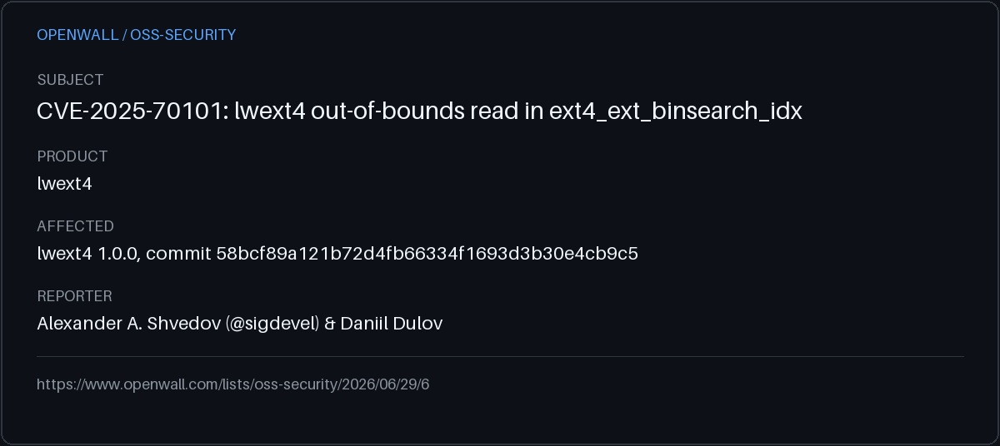](https://www.openwall.com/lists/oss-security/2026/06/29/6)

[PoC and References (TXT)](openwall-2026-06-29-6/openwall-2026-06-29-6.txt)

Source: <https://www.openwall.com/lists/oss-security/2026/06/29/6>

**PoC:**

- <https://github.com/sigdevel/pocs/blob/main/res/lwext4/3/sig11_lwext4_ext4_extent_815>

**References:**

- <https://github.com/gkostka/lwext4/issues/91>
- <https://github.com/sigdevel/pocs/blob/main/res/lwext4/3/sig11_lwext4_ext4_extent_815>
- <https://github.com/Aladdin-R-D/lwext4/releases/tag/v1.0.1>
- <https://www.cve.org/CVERecord?id=CVE-2025-70101>
- <https://nvd.nist.gov/vuln/detail/CVE-2025-70101>
- <https://infosec.exchange/@sigdevel/116668958927817708>
- <https://bdu.fstec.ru/vul/2025-15479>

## CVE-2025-71474: lwext4 through 1.0.0 Out-of-Bounds Write via ext4_fs_init_block_bitmap

[PoC and References (TXT)](cve-cve-2025-71474-95013befe19b/cve-cve-2025-71474-95013befe19b.txt)

Source: <https://www.cve.org/CVERecord?id=CVE-2025-71474>

**PoC:**

- <https://github.com/gkostka/lwext4/issues/92>

**References:**

- <https://www.cve.org/CVERecord?id=CVE-2025-71474>
- <https://raw.githubusercontent.com/CVEProject/cvelistV5/main/cves/2025/71xxx/CVE-2025-71474.json>
- <https://github.com/gkostka/lwext4/issues/92>
- <https://github.com/gkostka/lwext4/pull/111>
- <https://github.com/gkostka/lwext4/commit/b9c842f168e6044bd03fe34e1237eda33c299908>
- <https://github.com/Aladdin-R-D/lwext4/commit/2f5714d42f729fbdf3e65fd24d57149619fa1f33>
- <https://github.com/gkostka/lwext4/blob/v1.0.0/src/ext4_fs.c#L322-L334>
- <https://github.com/gkostka/lwext4/blob/v1.0.0/include/ext4_bitmap.h#L53-L56>
- <https://github.com/gkostka/lwext4>
- <https://www.vulncheck.com/advisories/lwext4-through-1.0.0-out-of-bounds-write-via-ext4-fs-init-block-bitmap>

## CVE-2025-71473: lwext4 through 1.0.0 Heap Buffer Overflow via ext4_fs_init_inode_bitmap

[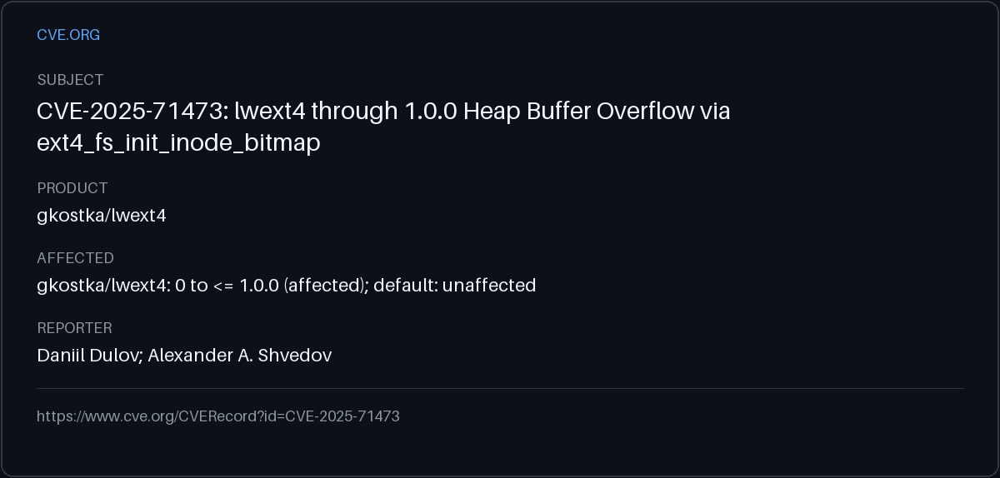](https://www.cve.org/CVERecord?id=CVE-2025-71473)

[PoC and References (TXT)](cve-cve-2025-71473-13bf0392cbe0/cve-cve-2025-71473-13bf0392cbe0.txt)

Source: <https://www.cve.org/CVERecord?id=CVE-2025-71473>

**PoC:**

Not provided in source.

**References:**

- <https://www.cve.org/CVERecord?id=CVE-2025-71473>
- <https://raw.githubusercontent.com/CVEProject/cvelistV5/main/cves/2025/71xxx/CVE-2025-71473.json>
- <https://github.com/gkostka/lwext4/issues/93>
- <https://github.com/gkostka/lwext4/pull/111>
- <https://github.com/gkostka/lwext4/commit/b9c842f168e6044bd03fe34e1237eda33c299908>
- <https://github.com/Aladdin-R-D/lwext4/commit/2f5714d42f729fbdf3e65fd24d57149619fa1f33>
- <https://github.com/gkostka/lwext4/blob/v1.0.0/src/ext4_fs.c#L401-L405>
- <https://github.com/gkostka/lwext4>
- <https://www.vulncheck.com/advisories/lwext4-through-1.0.0-heap-buffer-overflow-via-ext4-fs-init-inode-bitmap>

## CVE-2025-71470: MicroQuickJS: Out-of-Bounds Read in build_backtrace via Crafted JavaScript Input

[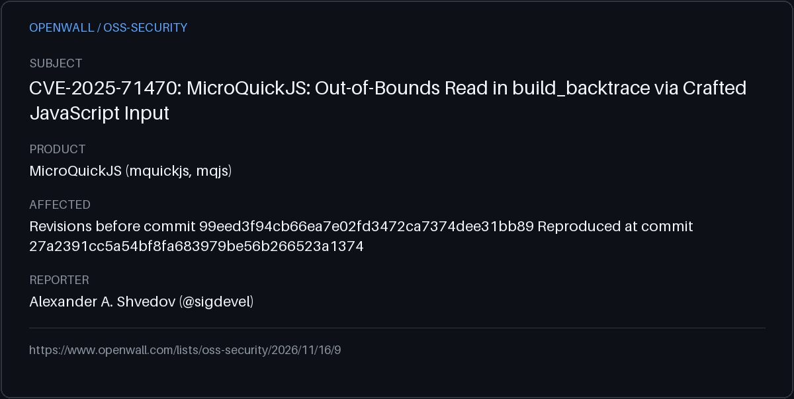](https://www.openwall.com/lists/oss-security/2026/11/16/9)

[PoC and References (TXT)](openwall-2026-11-16-9/openwall-2026-11-16-9.txt)

Source: <https://www.openwall.com/lists/oss-security/2026/11/16/9>

**PoC:**

- <https://github.com/sigdevel/pocs/blob/main/res/mquickjs/1/mquickjs_c_3981>

**References:**

- <https://github.com/bellard/mquickjs/issues/24>
- <https://github.com/bellard/mquickjs/commit/99eed3f94cb66ea7e02fd3472ca7374dee31bb89>
- <https://www.cve.org/CVERecord?id=CVE-2025-71470>
- <https://raw.githubusercontent.com/CVEProject/cvelistV5/main/cves/2025/71xxx/CVE-2025-71470.json>

## CVE-2026-129490: littlefs: Type Confusion and Stack Out-of-Bounds Read in lfs_dir_traverse via Crafted v1 Image Migration

[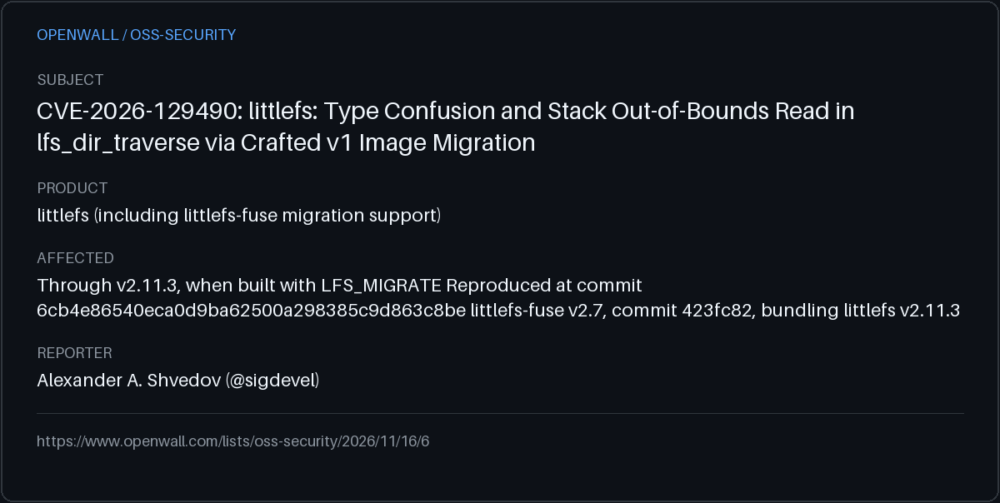](https://www.openwall.com/lists/oss-security/2026/11/16/6)

[PoC and References (TXT)](openwall-2026-11-16-6/openwall-2026-11-16-6.txt)

Source: <https://www.openwall.com/lists/oss-security/2026/11/16/6>

**PoC:**

- <https://github.com/sigdevel/pocs/blob/main/res/littlefs/1/1_lfs_dir_traverse_lfs_c_1059.img>

**References:**

- <https://github.com/littlefs-project/littlefs/issues/1213>
- <https://github.com/littlefs-project/littlefs/pull/1224>
- <https://github.com/littlefs-project/littlefs/blob/v2.11.3/lfs.c#L1056-L1063>
- <https://github.com/sigdevel/pocs/blob/main/res/littlefs/1/fuzz_migrate.c>
- <https://www.cve.org/CVERecord?id=CVE-2026-129490>
- <https://raw.githubusercontent.com/CVEProject/cvelistV5/main/cves/2026/129xxx/CVE-2026-129490.json>

## CVE-2025-52291: Public CVE record unavailable (HTTP 404)

[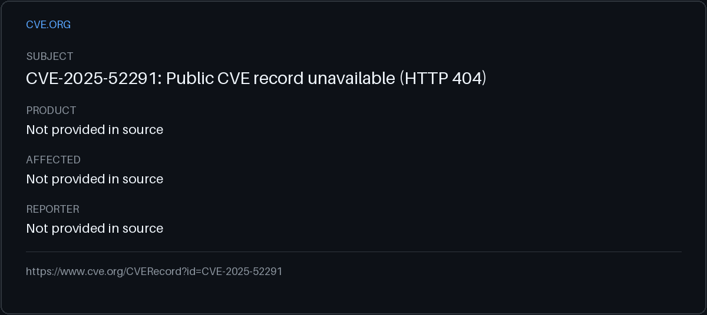](https://www.cve.org/CVERecord?id=CVE-2025-52291)

[PoC and References (TXT)](cve-cve-2025-52291-e12bb2feef4a/cve-cve-2025-52291-e12bb2feef4a.txt)

Source: <https://www.cve.org/CVERecord?id=CVE-2025-52291>

**PoC:**

Not provided in source.

**References:**

- <https://www.cve.org/CVERecord?id=CVE-2025-52291>
- <https://raw.githubusercontent.com/CVEProject/cvelistV5/main/cves/2025/52xxx/CVE-2025-52291.json>

## CVE-2025-60470: Public CVE record unavailable (HTTP 404)

[PoC and References (TXT)](cve-cve-2025-60470-d87bf5ea5cd7/cve-cve-2025-60470-d87bf5ea5cd7.txt)

Source: <https://www.cve.org/CVERecord?id=CVE-2025-60470>

**PoC:**

Not provided in source.

**References:**

- <https://www.cve.org/CVERecord?id=CVE-2025-60470>
- <https://raw.githubusercontent.com/CVEProject/cvelistV5/main/cves/2025/60xxx/CVE-2025-60470.json>

## CVE-2025-71468: GPAC before 26.02.0 NULL Pointer Dereference via gf_dash_group_get_audio_channels

[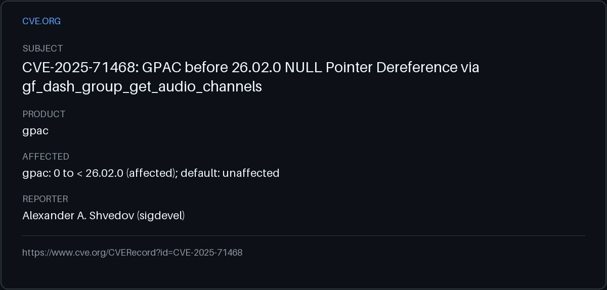](https://www.cve.org/CVERecord?id=CVE-2025-71468)

[PoC and References (TXT)](cve-cve-2025-71468-25b6873fddb3/cve-cve-2025-71468-25b6873fddb3.txt)

Source: <https://www.cve.org/CVERecord?id=CVE-2025-71468>

**PoC:**

Not provided in source.

**References:**

- <https://www.cve.org/CVERecord?id=CVE-2025-71468>
- <https://raw.githubusercontent.com/CVEProject/cvelistV5/main/cves/2025/71xxx/CVE-2025-71468.json>
- <https://github.com/gpac/gpac/issues/3269>
- <https://github.com/gpac/gpac/issues/3270>
- <https://github.com/gpac/gpac/commit/62714f27c64a3d1eb7e880f9eed2d38673cb43ce>
- <https://github.com/gpac/gpac/blob/v2.4.0/src/media_tools/dash_client.c#L10160-L10165>
- <https://www.vulncheck.com/advisories/gpac-before-26.02.0-null-pointer-dereference-via-gf-dash-group-get-audio-channels>
- <http://www.openwall.com/lists/oss-security/2026/11/17/21>

## CVE-2025-55639: NULL Pointer Dereference in GPAC/MP4Box via gf_isom_add_track_kind on crafted MP4 file

[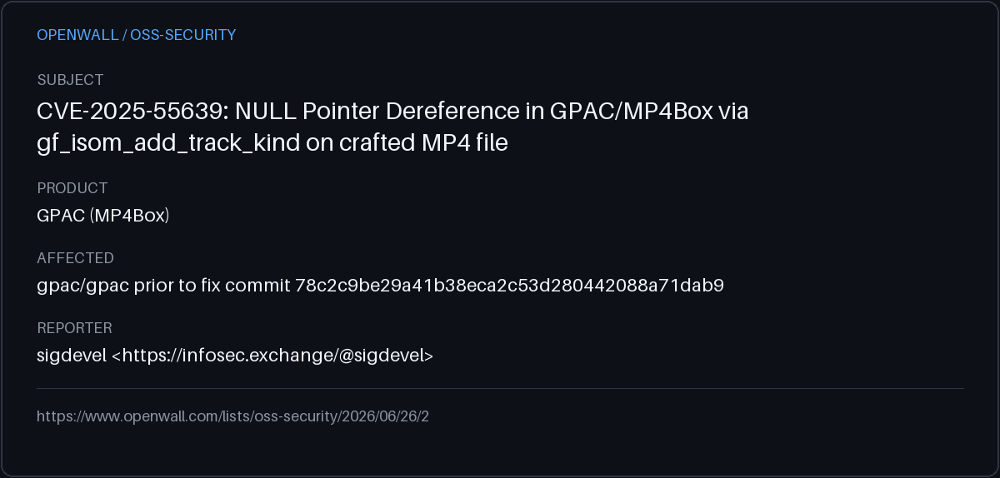](https://www.openwall.com/lists/oss-security/2026/06/26/2)

[PoC and References (TXT)](openwall-2026-06-26-2/openwall-2026-06-26-2.txt)

Source: <https://www.openwall.com/lists/oss-security/2026/06/26/2>

**PoC:**

- <https://github.com/sigdevel/pocs/blob/main/res/gpac/MP4Box/23/23_poc.mp4>

**References:**

- <https://github.com/gpac/gpac/issues/3260>
- <https://www.cve.org/CVERecord?id=CVE-2025-55639>
- <https://infosec.exchange/@sigdevel/116769184815236865>

## CVE-2025-60471: Use-After-Free in GPAC/MP4Box via gf_filter_pid_reconfigure_task_discard on crafted MPEG-2 TS file

[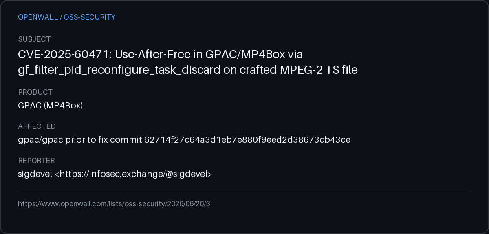](https://www.openwall.com/lists/oss-security/2026/06/26/3)

[PoC and References (TXT)](openwall-2026-06-26-3/openwall-2026-06-26-3.txt)

Source: <https://www.openwall.com/lists/oss-security/2026/06/26/3>

**PoC:**

- <https://github.com/sigdevel/pocs/blob/main/res/gpac/MP4Box/31/31_gf_filter_pid_reconfigure_task_discard_filter_core_filter_pid_c_1341>

**References:**

- <https://github.com/gpac/gpac/issues/3279>
- <https://www.cve.org/CVERecord?id=CVE-2025-60471>
- <https://infosec.exchange/@sigdevel/116778301425195980>

## CVE-2025-60464: NULL Pointer Dereference in GPAC/MP4Box via gf_sei_load_from_state_internal on crafted MPEG-2 TS file

[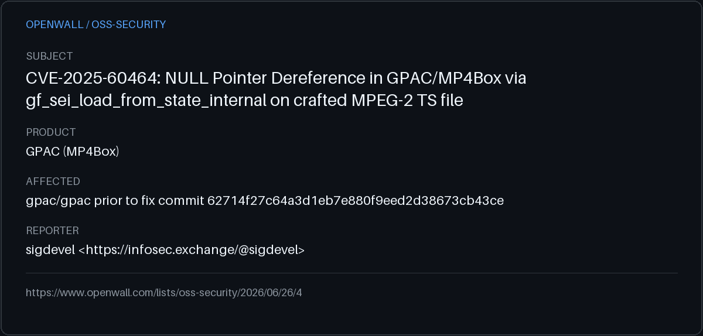](https://www.openwall.com/lists/oss-security/2026/06/26/4)

[PoC and References (TXT)](openwall-2026-06-26-4/openwall-2026-06-26-4.txt)

Source: <https://www.openwall.com/lists/oss-security/2026/06/26/4>

**PoC:**

- <https://github.com/sigdevel/pocs/blob/main/res/gpac/MP4Box/32/32_filters_sei_load_c_225_in_gf_sei_load_from_state_internal>

**References:**

- <https://github.com/gpac/gpac/issues/3278>
- <https://www.cve.org/CVERecord?id=CVE-2025-60464>
- <https://infosec.exchange/@sigdevel/116778370895014131>

## CVE-2025-60474: Heap-based Buffer Overflow in GPAC/MP4Box via gf_media_import on crafted MPEG-2 TS file

[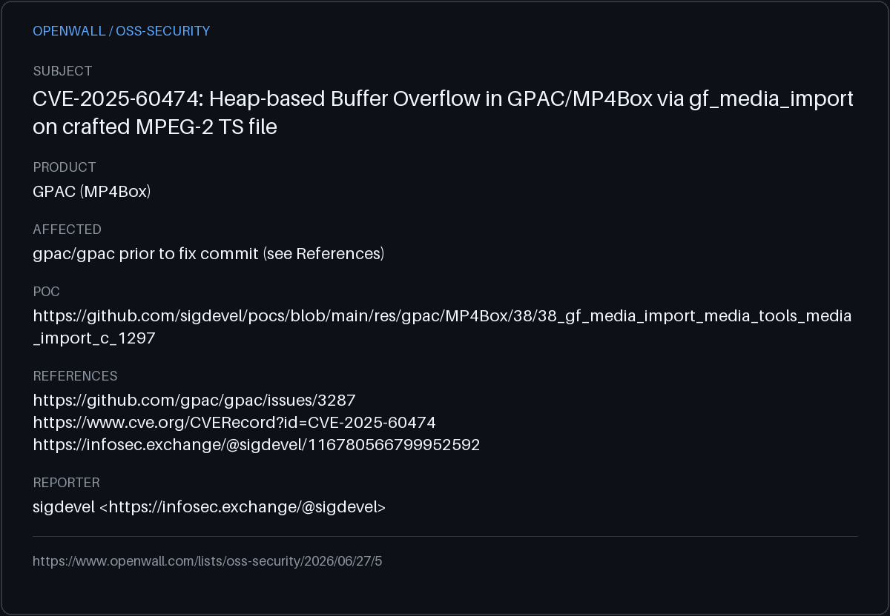](https://www.openwall.com/lists/oss-security/2026/06/27/5)

[PoC and References (TXT)](openwall-2026-06-27-5/openwall-2026-06-27-5.txt)

Source: <https://www.openwall.com/lists/oss-security/2026/06/27/5>

**PoC:**

- <https://github.com/sigdevel/pocs/blob/main/res/gpac/MP4Box/38/38_gf_media_import_media_tools_media_import_c_1297>

**References:**

- <https://github.com/gpac/gpac/issues/3287>
- <https://www.cve.org/CVERecord?id=CVE-2025-60474>
- <https://infosec.exchange/@sigdevel/116780566799952592>

## CVE-2025-60466: Expired Pointer Dereference in GPAC/MP4Box via gf_filter_pid_get_packet on crafted MPEG-2 TS file

[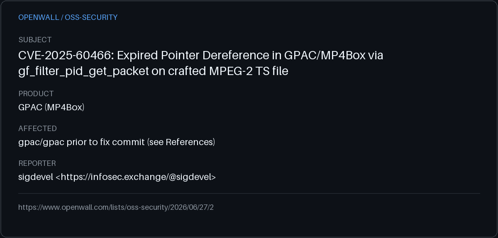](https://www.openwall.com/lists/oss-security/2026/06/27/2)

[PoC and References (TXT)](openwall-2026-06-27-2/openwall-2026-06-27-2.txt)

Source: <https://www.openwall.com/lists/oss-security/2026/06/27/2>

**PoC:**

- <https://github.com/sigdevel/pocs/blob/main/res/gpac/MP4Box/35/35_gf_filter_pid_get_packet_filter_core_filter_pid_c_6827>

**References:**

- <https://github.com/gpac/gpac/issues/3284>
- <https://www.cve.org/CVERecord?id=CVE-2025-60466>
- <https://infosec.exchange/@sigdevel/116780402249845037>

## CVE-2025-60473: NULL Pointer Dereference in GPAC/MP4Box via gf_filter_in_parent_chain on crafted MPEG-2 TS file

[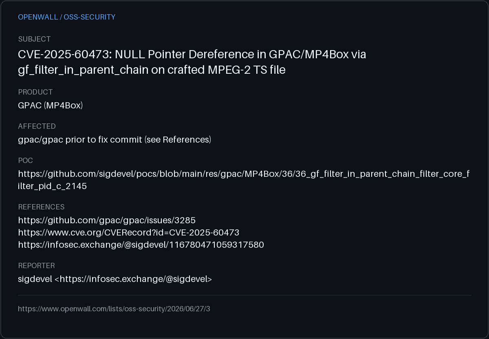](https://www.openwall.com/lists/oss-security/2026/06/27/3)

[PoC and References (TXT)](openwall-2026-06-27-3/openwall-2026-06-27-3.txt)

Source: <https://www.openwall.com/lists/oss-security/2026/06/27/3>

**PoC:**

- <https://github.com/sigdevel/pocs/blob/main/res/gpac/MP4Box/36/36_gf_filter_in_parent_chain_filter_core_filter_pid_c_2145>

**References:**

- <https://github.com/gpac/gpac/issues/3285>
- <https://www.cve.org/CVERecord?id=CVE-2025-60473>
- <https://infosec.exchange/@sigdevel/116780471059317580>

## CVE-2025-60467: Use-After-Free in GPAC/MP4Box via gf_filter_pid_inst_swap_delete_task on crafted MPEG-2 TS file

[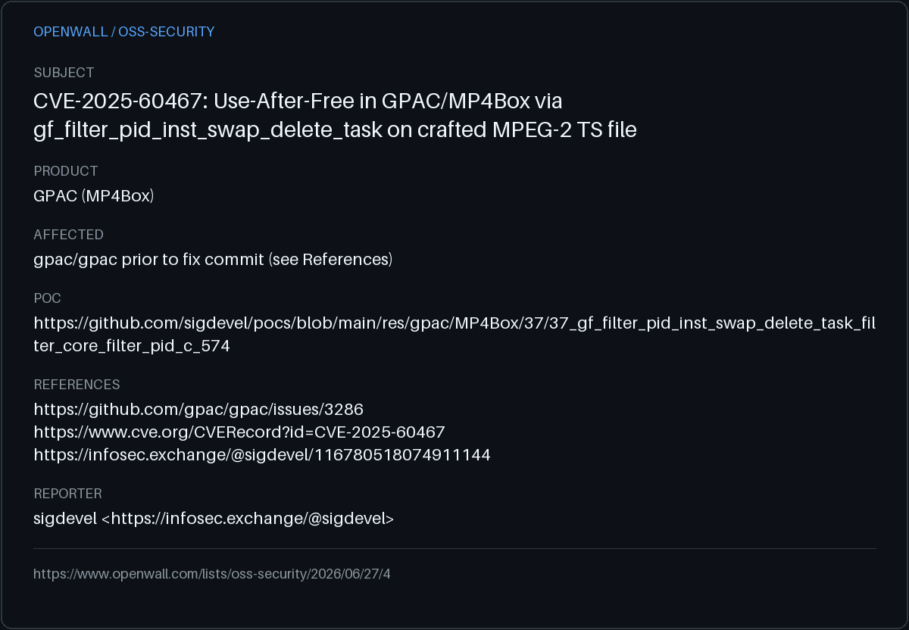](https://www.openwall.com/lists/oss-security/2026/06/27/4)

[PoC and References (TXT)](openwall-2026-06-27-4/openwall-2026-06-27-4.txt)

Source: <https://www.openwall.com/lists/oss-security/2026/06/27/4>

**PoC:**

- <https://github.com/sigdevel/pocs/blob/main/res/gpac/MP4Box/37/37_gf_filter_pid_inst_swap_delete_task_filter_core_filter_pid_c_574>

**References:**

- <https://github.com/gpac/gpac/issues/3286>
- <https://www.cve.org/CVERecord?id=CVE-2025-60467>
- <https://infosec.exchange/@sigdevel/116780518074911144>

## CVE-2025-52292: Stack-based Buffer Overflow in GPAC/MP4Box via filein_process on crafted MP4 file during DASH segmentation

[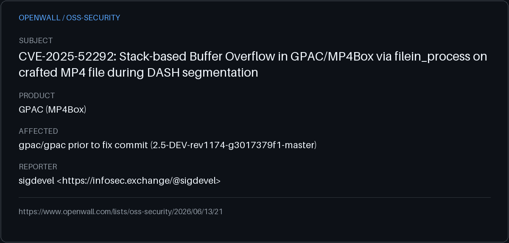](https://www.openwall.com/lists/oss-security/2026/06/13/21)

[PoC and References (TXT)](openwall-2026-06-13-21/openwall-2026-06-13-21.txt)

Source: <https://www.openwall.com/lists/oss-security/2026/06/13/21>

**PoC:**

- <https://github.com/sigdevel/pocs/blob/main/res/gpac/MP4Box/1/1_poc.mp4>

**References:**

- <https://github.com/gpac/gpac/issues/3129>
- <https://www.cve.org/CVERecord?id=CVE-2025-52292>
- <https://infosec.exchange/@sigdevel/116707273214520860>

## CVE-2025-55662: Divide by Zero in GPAC/MP4Box via gf_opus_parse_packet_header on crafted MP4 file with malformed Opus header

[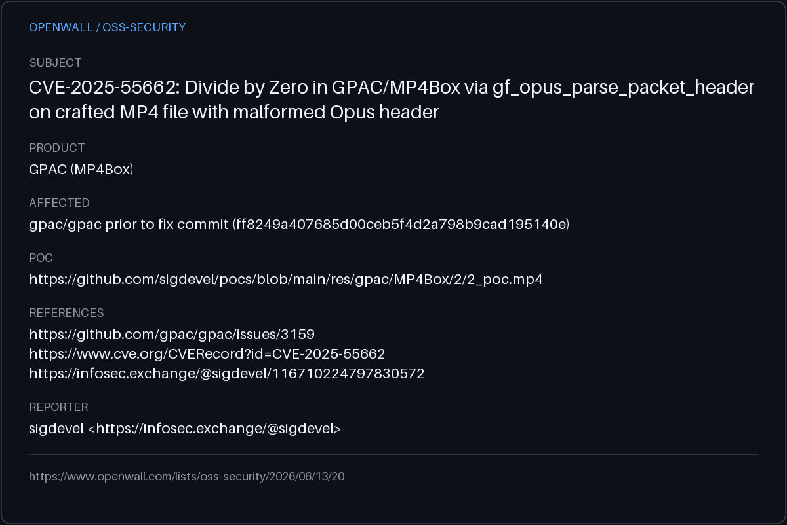](https://www.openwall.com/lists/oss-security/2026/06/13/20)

[PoC and References (TXT)](openwall-2026-06-13-20/openwall-2026-06-13-20.txt)

Source: <https://www.openwall.com/lists/oss-security/2026/06/13/20>

**PoC:**

- <https://github.com/sigdevel/pocs/blob/main/res/gpac/MP4Box/2/2_poc.mp4>

**References:**

- <https://github.com/gpac/gpac/issues/3159>
- <https://www.cve.org/CVERecord?id=CVE-2025-55662>
- <https://infosec.exchange/@sigdevel/116710224797830572>

## CVE-2025-52293: Out-of-bounds Read in GPAC/MP4Box via gf_hevc_read_sps_bs_internal on crafted HEVC SPS in MP4 file

[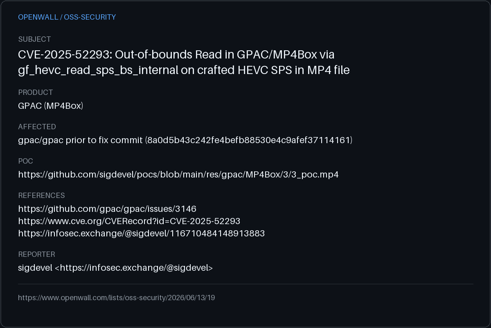](https://www.openwall.com/lists/oss-security/2026/06/13/19)

[PoC and References (TXT)](openwall-2026-06-13-19/openwall-2026-06-13-19.txt)

Source: <https://www.openwall.com/lists/oss-security/2026/06/13/19>

**PoC:**

- <https://github.com/sigdevel/pocs/blob/main/res/gpac/MP4Box/3/3_poc.mp4>

**References:**

- <https://github.com/gpac/gpac/issues/3146>
- <https://www.cve.org/CVERecord?id=CVE-2025-52293>
- <https://infosec.exchange/@sigdevel/116710484148913883>

## CVE-2025-55651: NULL Pointer Dereference in GPAC/MP4Box via gf_isom_get_user_data_count on truncated MP4 input

[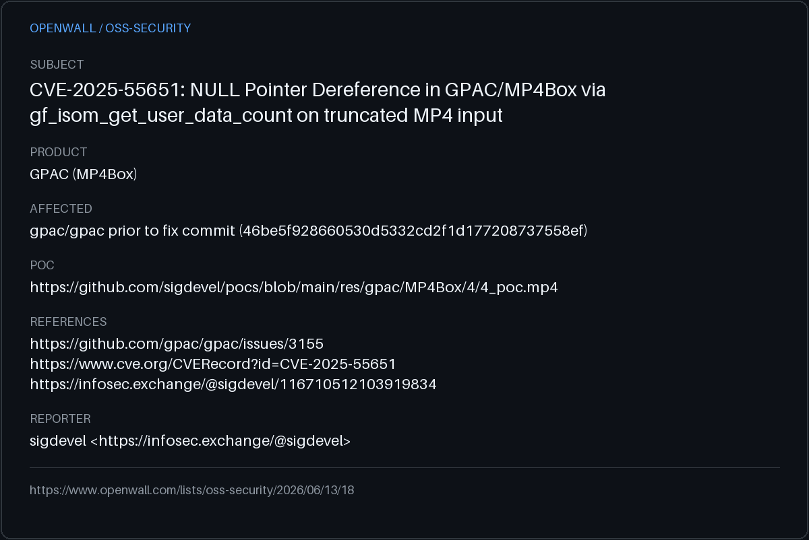](https://www.openwall.com/lists/oss-security/2026/06/13/18)

[PoC and References (TXT)](openwall-2026-06-13-18/openwall-2026-06-13-18.txt)

Source: <https://www.openwall.com/lists/oss-security/2026/06/13/18>

**PoC:**

- <https://github.com/sigdevel/pocs/blob/main/res/gpac/MP4Box/4/4_poc.mp4>

**References:**

- <https://github.com/gpac/gpac/issues/3155>
- <https://www.cve.org/CVERecord?id=CVE-2025-55651>
- <https://infosec.exchange/@sigdevel/116710512103919834>

## CVE-2025-55659: NULL Pointer Dereference in GPAC/MP4Box via ctts_box_write on crafted MP4 file with negative timestamps

[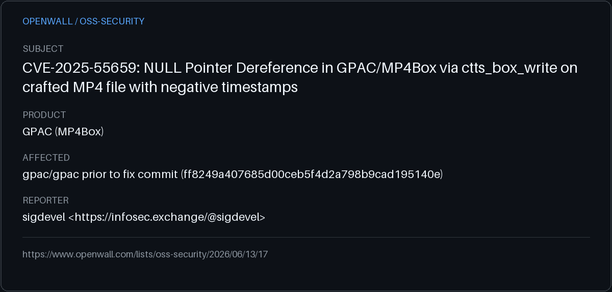](https://www.openwall.com/lists/oss-security/2026/06/13/17)

[PoC and References (TXT)](openwall-2026-06-13-17/openwall-2026-06-13-17.txt)

Source: <https://www.openwall.com/lists/oss-security/2026/06/13/17>

**PoC:**

- <https://github.com/sigdevel/pocs/blob/main/res/gpac/MP4Box/5/5_poc.mp4>

**References:**

- <https://github.com/gpac/gpac/issues/3156>
- <https://www.cve.org/CVERecord?id=CVE-2025-55659>
- <https://infosec.exchange/@sigdevel/116710743410087676>

## CVE-2025-55657: NULL Pointer Dereference in GPAC/MP4Box via gf_odf_vvc_cfg_write_bs on crafted MP4 file with unsupported vvc16 box

[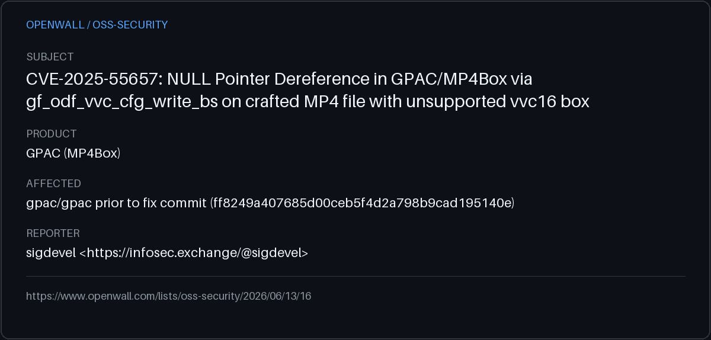](https://www.openwall.com/lists/oss-security/2026/06/13/16)

[PoC and References (TXT)](openwall-2026-06-13-16/openwall-2026-06-13-16.txt)

Source: <https://www.openwall.com/lists/oss-security/2026/06/13/16>

**PoC:**

- <https://github.com/sigdevel/pocs/blob/main/res/gpac/MP4Box/6/6_poc.mp4>

**References:**

- <https://github.com/gpac/gpac/issues/3157>
- <https://www.cve.org/CVERecord?id=CVE-2025-55657>
- <https://infosec.exchange/@sigdevel/116710754169365223>

## CVE-2025-55660: Stack-based Buffer Overflow in GPAC/MP4Box via gf_opus_read_length on crafted MP4 file with malformed Opus packet

[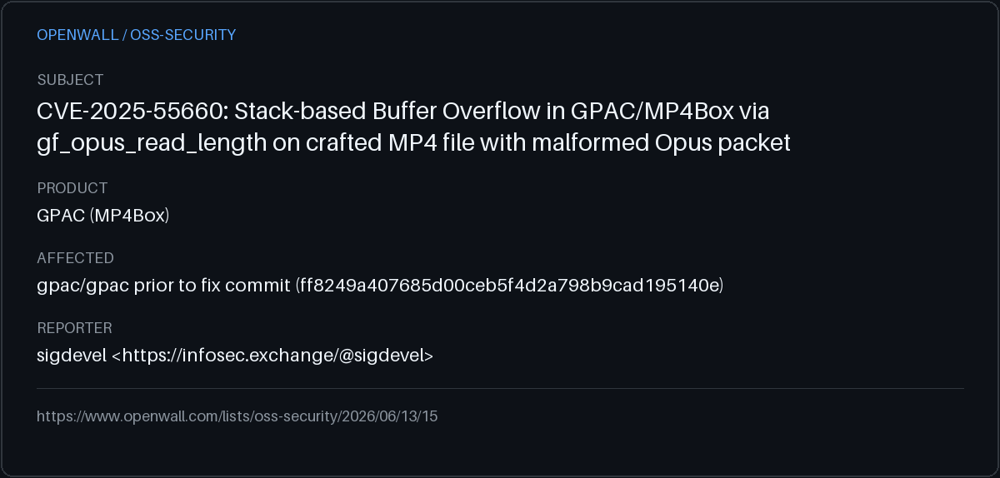](https://www.openwall.com/lists/oss-security/2026/06/13/15)

[PoC and References (TXT)](openwall-2026-06-13-15/openwall-2026-06-13-15.txt)

Source: <https://www.openwall.com/lists/oss-security/2026/06/13/15>

**PoC:**

- <https://github.com/sigdevel/pocs/blob/main/res/gpac/MP4Box/7/7_poc.mp4>

**References:**

- <https://github.com/gpac/gpac/issues/3161>
- <https://www.cve.org/CVERecord?id=CVE-2025-55660>
- <https://infosec.exchange/@sigdevel/116733892068649310>

## CVE-2025-55663: NULL Pointer Dereference in GPAC/MP4Box via Track_SetStreamDescriptor on crafted MP4 with unknown svcC box in av01

[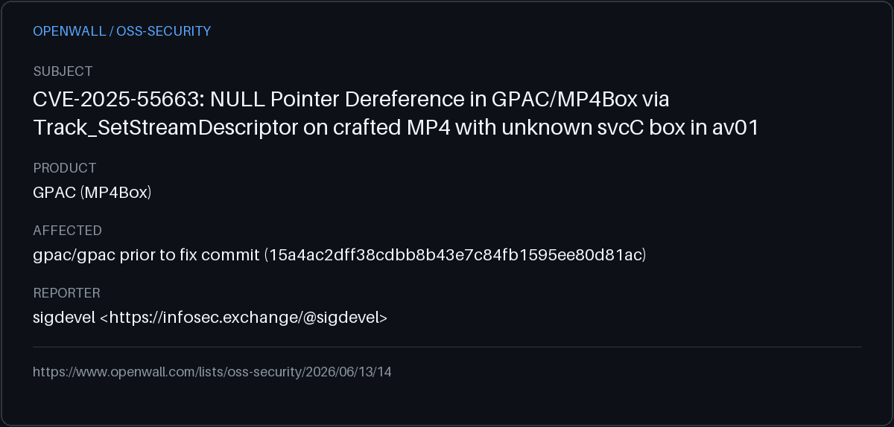](https://www.openwall.com/lists/oss-security/2026/06/13/14)

[PoC and References (TXT)](openwall-2026-06-13-14/openwall-2026-06-13-14.txt)

Source: <https://www.openwall.com/lists/oss-security/2026/06/13/14>

**PoC:**

- <https://github.com/sigdevel/pocs/blob/main/res/gpac/MP4Box/8/8_poc.mp4>

**References:**

- <https://github.com/gpac/gpac/issues/3143>
- <https://www.cve.org/CVERecord?id=CVE-2025-55663>
- <https://infosec.exchange/@sigdevel/116733899601128471>

## CVE-2025-55661: Heap-based Buffer Overflow in GPAC/MP4Box via gf_opus_parse_packet_header on crafted MP4 file with malformed Opus packet

[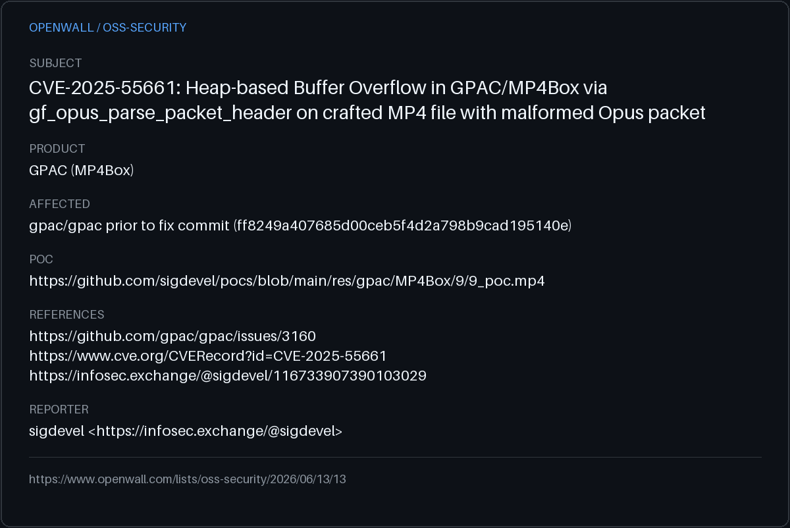](https://www.openwall.com/lists/oss-security/2026/06/13/13)

[PoC and References (TXT)](openwall-2026-06-13-13/openwall-2026-06-13-13.txt)

Source: <https://www.openwall.com/lists/oss-security/2026/06/13/13>

**PoC:**

- <https://github.com/sigdevel/pocs/blob/main/res/gpac/MP4Box/9/9_poc.mp4>

**References:**

- <https://github.com/gpac/gpac/issues/3160>
- <https://www.cve.org/CVERecord?id=CVE-2025-55661>
- <https://infosec.exchange/@sigdevel/116733907390103029>

## CVE-2025-55650: Use-After-Free in GPAC/MP4Box via gf_svg_node_del on crafted MP4 file processed with -svg

[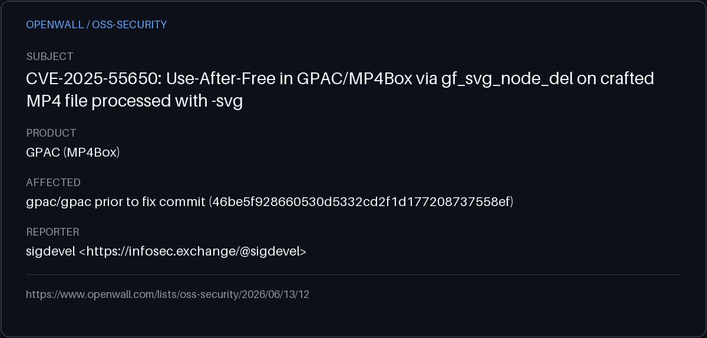](https://www.openwall.com/lists/oss-security/2026/06/13/12)

[PoC and References (TXT)](openwall-2026-06-13-12/openwall-2026-06-13-12.txt)

Source: <https://www.openwall.com/lists/oss-security/2026/06/13/12>

**PoC:**

- <https://github.com/sigdevel/pocs/blob/main/res/gpac/MP4Box/10/10_poc.mp4>

**References:**

- <https://github.com/gpac/gpac/issues/3162>
- <https://www.cve.org/CVERecord?id=CVE-2025-55650>
- <https://infosec.exchange/@sigdevel/116733923605483597>

## CVE-2025-55649: NULL Pointer Dereference in GPAC/MP4Box via gf_media_map_esd on crafted MP4 with corrupted ESD data

[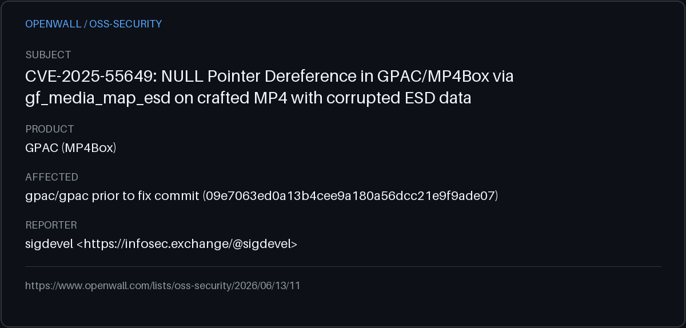](https://www.openwall.com/lists/oss-security/2026/06/13/11)

[PoC and References (TXT)](openwall-2026-06-13-11/openwall-2026-06-13-11.txt)

Source: <https://www.openwall.com/lists/oss-security/2026/06/13/11>

**PoC:**

- <https://github.com/sigdevel/pocs/blob/main/res/gpac/MP4Box/11/11_poc.mp4>

**References:**

- <https://github.com/gpac/gpac/issues/3183>
- <https://www.cve.org/CVERecord?id=CVE-2025-55649>
- <https://infosec.exchange/@sigdevel/116736730620435563>

## CVE-2025-55648: Heap-based Buffer Overflow in GPAC/MP4Box via gf_opus_parse_packet_header on crafted MP4 with corrupted stsz data

[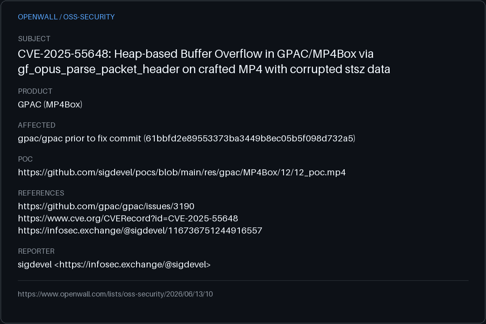](https://www.openwall.com/lists/oss-security/2026/06/13/10)

[PoC and References (TXT)](openwall-2026-06-13-10/openwall-2026-06-13-10.txt)

Source: <https://www.openwall.com/lists/oss-security/2026/06/13/10>

**PoC:**

- <https://github.com/sigdevel/pocs/blob/main/res/gpac/MP4Box/12/12_poc.mp4>

**References:**

- <https://github.com/gpac/gpac/issues/3190>
- <https://www.cve.org/CVERecord?id=CVE-2025-55648>
- <https://infosec.exchange/@sigdevel/116736751244916557>

## CVE-2025-55641: NULL Pointer Dereference in GPAC/MP4Box via gf_isom_copy_sample_info on crafted MP4 file with corrupted SAI metadata

[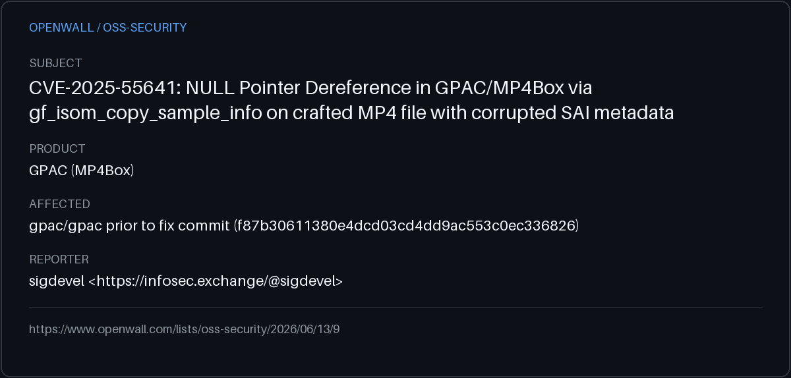](https://www.openwall.com/lists/oss-security/2026/06/13/9)

[PoC and References (TXT)](openwall-2026-06-13-9/openwall-2026-06-13-9.txt)

Source: <https://www.openwall.com/lists/oss-security/2026/06/13/9>

**PoC:**

- <https://github.com/sigdevel/pocs/blob/main/res/gpac/MP4Box/13/13_poc.mp4>

**References:**

- <https://github.com/gpac/gpac/issues/3195>
- <https://www.cve.org/CVERecord?id=CVE-2025-55641>
- <https://infosec.exchange/@sigdevel/116736775314270129>

## CVE-2025-55642: Divide by Zero in GPAC/MP4Box via avidmx_process on crafted AVI input with zero declared frames

[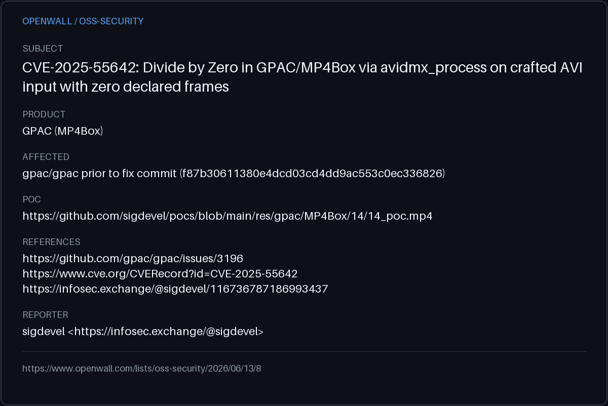](https://www.openwall.com/lists/oss-security/2026/06/13/8)

[PoC and References (TXT)](openwall-2026-06-13-8/openwall-2026-06-13-8.txt)

Source: <https://www.openwall.com/lists/oss-security/2026/06/13/8>

**PoC:**

- <https://github.com/sigdevel/pocs/blob/main/res/gpac/MP4Box/14/14_poc.mp4>

**References:**

- <https://github.com/gpac/gpac/issues/3196>
- <https://www.cve.org/CVERecord?id=CVE-2025-55642>
- <https://infosec.exchange/@sigdevel/116736787186993437>

## CVE-2025-55647: Integer Overflow in GPAC/MP4Box via mp4_mux_cenc_insert_pssh on crafted MP4 with oversized PSSH metadata

[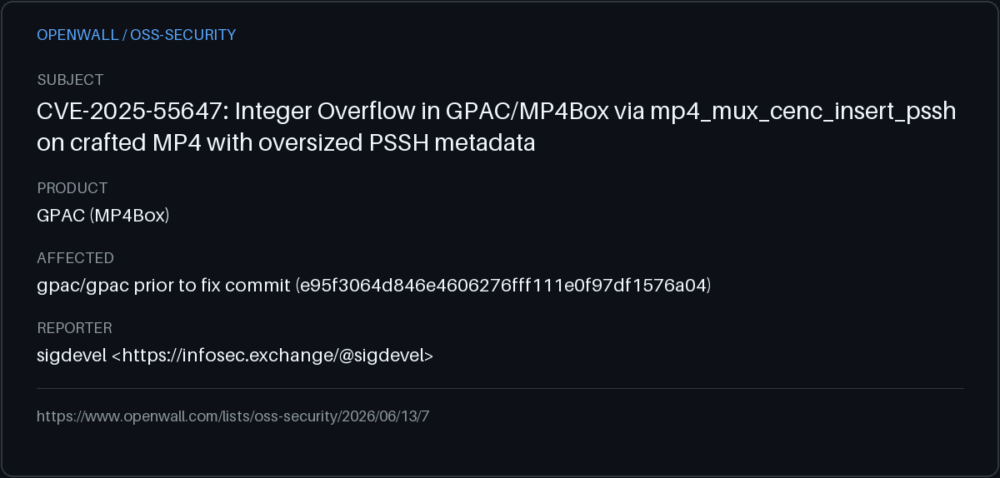](https://www.openwall.com/lists/oss-security/2026/06/13/7)

[PoC and References (TXT)](openwall-2026-06-13-7/openwall-2026-06-13-7.txt)

Source: <https://www.openwall.com/lists/oss-security/2026/06/13/7>

**PoC:**

- <https://github.com/sigdevel/pocs/blob/main/res/gpac/MP4Box/15/15_poc.mp4>

**References:**

- <https://github.com/gpac/gpac/issues/3235>
- <https://www.cve.org/CVERecord?id=CVE-2025-55647>
- <https://infosec.exchange/@sigdevel/116736795058798433>

## CVE-2025-55645: Heap-based Buffer Overflow in GPAC/MP4Box via gf_cenc_set_pssh on crafted MP4 with oversized PSSH payload

[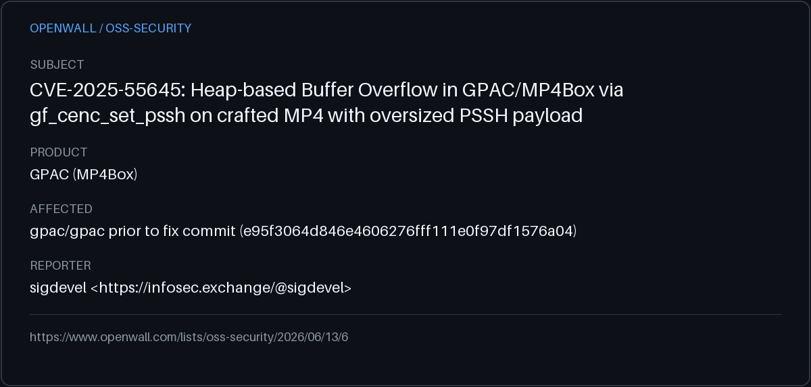](https://www.openwall.com/lists/oss-security/2026/06/13/6)

[PoC and References (TXT)](openwall-2026-06-13-6/openwall-2026-06-13-6.txt)

Source: <https://www.openwall.com/lists/oss-security/2026/06/13/6>

**PoC:**

- <https://github.com/sigdevel/pocs/blob/main/res/gpac/MP4Box/16/16_poc.mp4>

**References:**

- <https://github.com/gpac/gpac/issues/3236>
- <https://www.cve.org/CVERecord?id=CVE-2025-55645>
- <https://infosec.exchange/@sigdevel/116736802253007654>

## CVE-2025-55643: NULL Pointer Dereference in GPAC/MP4Box via TrackWriter handling on crafted MP4 with malformed mvcC/stsz metadata during DASH segmentation

[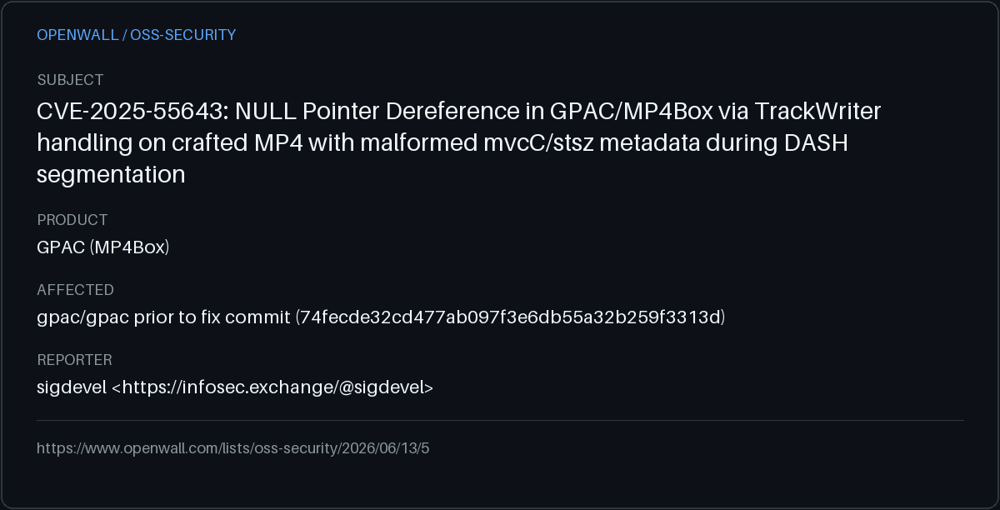](https://www.openwall.com/lists/oss-security/2026/06/13/5)

[PoC and References (TXT)](openwall-2026-06-13-5/openwall-2026-06-13-5.txt)

Source: <https://www.openwall.com/lists/oss-security/2026/06/13/5>

**PoC:**

- <https://github.com/sigdevel/pocs/blob/main/res/gpac/MP4Box/17/17_poc.mp4>

**References:**

- <https://github.com/gpac/gpac/issues/3240>
- <https://www.cve.org/CVERecord?id=CVE-2025-55643>
- <https://infosec.exchange/@sigdevel/116736819671963019>

## CVE-2025-55652: Heap-based Buffer Overflow in GPAC/MP4Box via gf_isom_vp_config_new on crafted MP4 with malformed VP codec configuration

[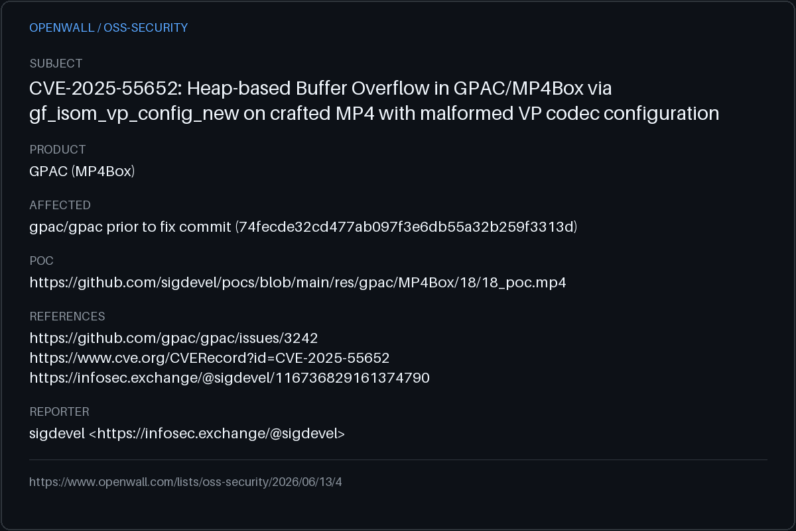](https://www.openwall.com/lists/oss-security/2026/06/13/4)

[PoC and References (TXT)](openwall-2026-06-13-4/openwall-2026-06-13-4.txt)

Source: <https://www.openwall.com/lists/oss-security/2026/06/13/4>

**PoC:**

- <https://github.com/sigdevel/pocs/blob/main/res/gpac/MP4Box/18/18_poc.mp4>

**References:**

- <https://github.com/gpac/gpac/issues/3242>
- <https://www.cve.org/CVERecord?id=CVE-2025-55652>
- <https://infosec.exchange/@sigdevel/116736829161374790>

## CVE-2025-55644: Use-After-Free in GPAC/MP4Box via gf_node_get_tag on crafted MP4 file with invalid BIFS GlobalQuantizer command

[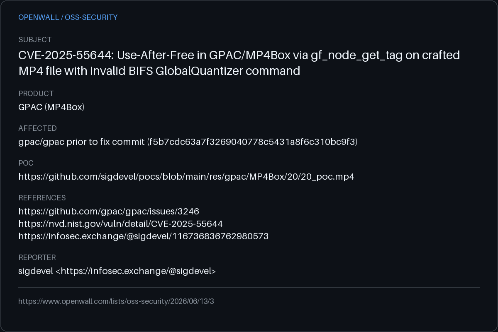](https://www.openwall.com/lists/oss-security/2026/06/13/3)

[PoC and References (TXT)](openwall-2026-06-13-3/openwall-2026-06-13-3.txt)

Source: <https://www.openwall.com/lists/oss-security/2026/06/13/3>

**PoC:**

- <https://github.com/sigdevel/pocs/blob/main/res/gpac/MP4Box/20/20_poc.mp4>

**References:**

- <https://github.com/gpac/gpac/issues/3246>
- <https://nvd.nist.gov/vuln/detail/CVE-2025-55644>
- <https://infosec.exchange/@sigdevel/116736836762980573>

## CVE-2025-70116: NULL Pointer Dereference in GPAC/MP4Box via gf_media_map_esd on truncated MP4 input

[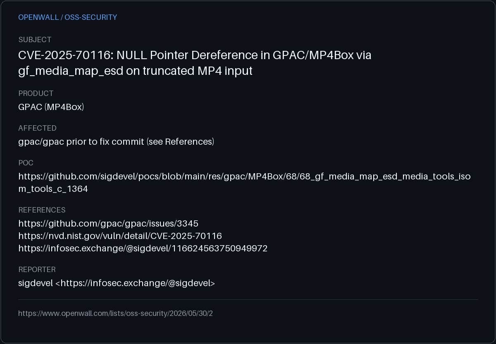](https://www.openwall.com/lists/oss-security/2026/05/30/2)

[PoC and References (TXT)](openwall-2026-05-30-2/openwall-2026-05-30-2.txt)

Source: <https://www.openwall.com/lists/oss-security/2026/05/30/2>

**PoC:**

- <https://github.com/sigdevel/pocs/blob/main/res/gpac/MP4Box/68/68_gf_media_map_esd_media_tools_isom_tools_c_1364>

**References:**

- <https://github.com/gpac/gpac/issues/3345>
- <https://nvd.nist.gov/vuln/detail/CVE-2025-70116>
- <https://infosec.exchange/@sigdevel/116624563750949972>

## CVE-2025-60481: NULL Pointer Dereference in GPAC/MP4Box via gf_odf_ac4_cfg_dsi_v1 on crafted AC-4 stream

[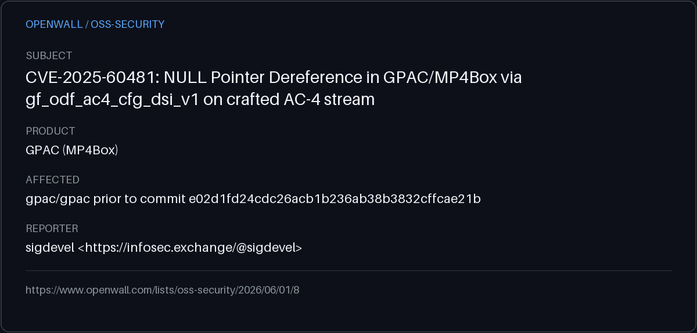](https://www.openwall.com/lists/oss-security/2026/06/01/8)

[PoC and References (TXT)](openwall-2026-06-01-8/openwall-2026-06-01-8.txt)

Source: <https://www.openwall.com/lists/oss-security/2026/06/01/8>

**PoC:**

- <https://github.com/sigdevel/pocs/blob/main/res/gpac/MP4Box/45/45_gf_odf_ac4_cfg_dsi_v1_odf_descriptors_c_2148>

**References:**

- <https://github.com/gpac/gpac/issues/3296>
- <https://nvd.nist.gov/vuln/detail/CVE-2025-60481>
- <https://www.cve.org/CVERecord?id=CVE-2025-60481>

## CVE-2025-60483: NULL Pointer Dereference in GPAC/MP4Box via gf_ac4_pres_b_4_back_channels_present on crafted AC-4 stream

[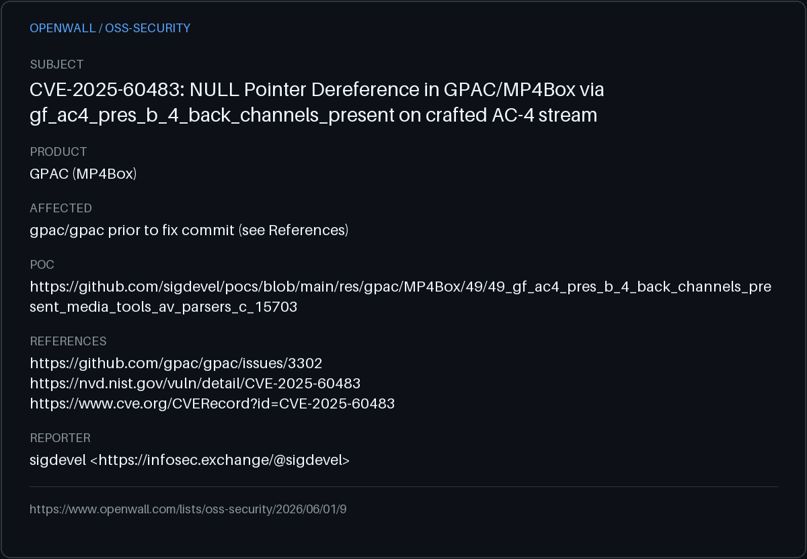](https://www.openwall.com/lists/oss-security/2026/06/01/9)

[PoC and References (TXT)](openwall-2026-06-01-9/openwall-2026-06-01-9.txt)

Source: <https://www.openwall.com/lists/oss-security/2026/06/01/9>

**PoC:**

- <https://github.com/sigdevel/pocs/blob/main/res/gpac/MP4Box/49/49_gf_ac4_pres_b_4_back_channels_present_media_tools_av_parsers_c_15703>

**References:**

- <https://github.com/gpac/gpac/issues/3302>
- <https://nvd.nist.gov/vuln/detail/CVE-2025-60483>
- <https://www.cve.org/CVERecord?id=CVE-2025-60483>

## CVE-2025-55664: Heap-based Buffer Overflow in GPAC/MP4Box via m2tsdmx_send_packet on crafted MPEG-2 TS file

[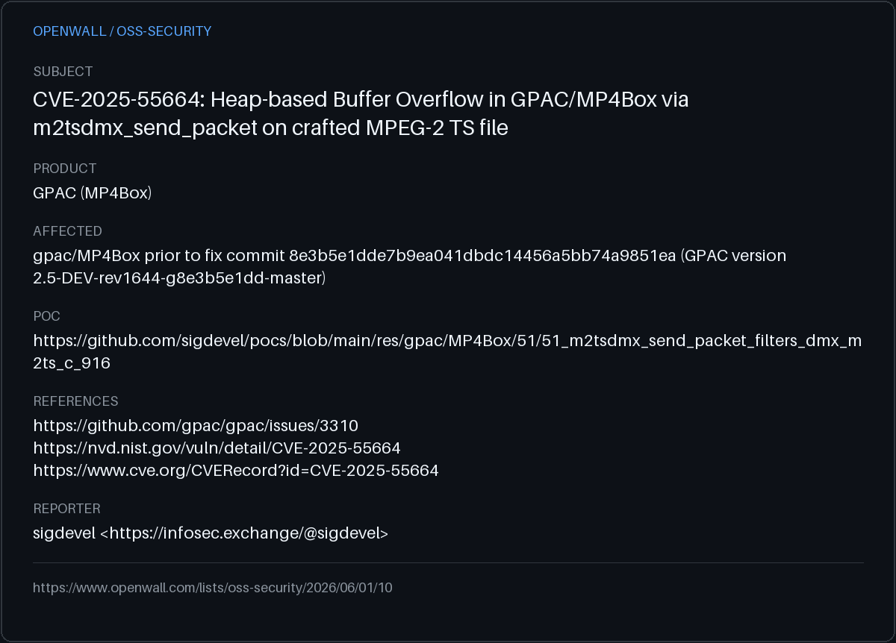](https://www.openwall.com/lists/oss-security/2026/06/01/10)

[PoC and References (TXT)](openwall-2026-06-01-10/openwall-2026-06-01-10.txt)

Source: <https://www.openwall.com/lists/oss-security/2026/06/01/10>

**PoC:**

- <https://github.com/sigdevel/pocs/blob/main/res/gpac/MP4Box/51/51_m2tsdmx_send_packet_filters_dmx_m2ts_c_916>

**References:**

- <https://github.com/gpac/gpac/issues/3310>
- <https://nvd.nist.gov/vuln/detail/CVE-2025-55664>
- <https://www.cve.org/CVERecord?id=CVE-2025-55664>

## CVE-2025-60485: NULL Pointer Dereference in GPAC/MP4Box via gf_isom_apple_set_tag_ex on crafted MP4 with corrupted esds box

[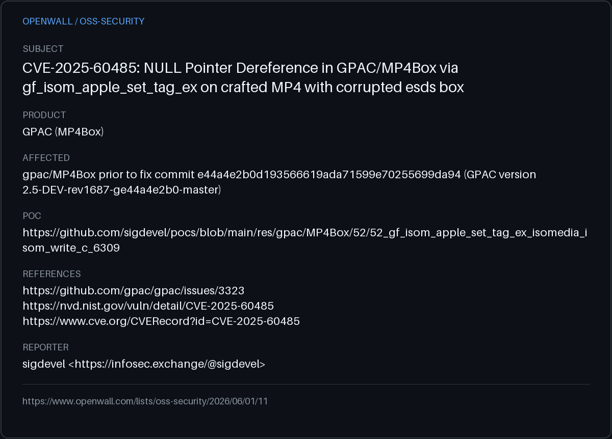](https://www.openwall.com/lists/oss-security/2026/06/01/11)

[PoC and References (TXT)](openwall-2026-06-01-11/openwall-2026-06-01-11.txt)

Source: <https://www.openwall.com/lists/oss-security/2026/06/01/11>

**PoC:**

- <https://github.com/sigdevel/pocs/blob/main/res/gpac/MP4Box/52/52_gf_isom_apple_set_tag_ex_isomedia_isom_write_c_6309>

**References:**

- <https://github.com/gpac/gpac/issues/3323>
- <https://nvd.nist.gov/vuln/detail/CVE-2025-60485>
- <https://www.cve.org/CVERecord?id=CVE-2025-60485>

## CVE-2025-60486: Use-After-Free in GPAC/MP4Box via dasher_process on crafted MPEG-2 TS file

[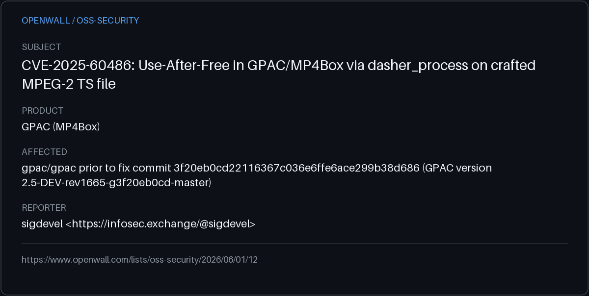](https://www.openwall.com/lists/oss-security/2026/06/01/12)

[PoC and References (TXT)](openwall-2026-06-01-12/openwall-2026-06-01-12.txt)

Source: <https://www.openwall.com/lists/oss-security/2026/06/01/12>

**PoC:**

- <https://github.com/sigdevel/pocs/blob/main/res/gpac/MP4Box/53/53_dasher_process_filters_dasher_c_9445>

**References:**

- <https://github.com/gpac/gpac/issues/3314>
- <https://nvd.nist.gov/vuln/detail/CVE-2025-60486>
- <https://www.cve.org/CVERecord?id=CVE-2025-60486>

## CVE-2025-60495: NULL Pointer Dereference in GPAC/MP4Box via gf_media_get_color_info on crafted MP4 with inconsistent sample entry

[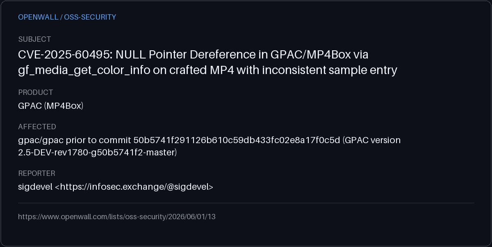](https://www.openwall.com/lists/oss-security/2026/06/01/13)

[PoC and References (TXT)](openwall-2026-06-01-13/openwall-2026-06-01-13.txt)

Source: <https://www.openwall.com/lists/oss-security/2026/06/01/13>

**PoC:**

- <https://github.com/sigdevel/pocs/blob/main/res/gpac/MP4Box/66/66_gf_media_get_color_info_media_tools_isom_tools_c_979>

**References:**

- <https://github.com/gpac/gpac/issues/3335>
- <https://nvd.nist.gov/vuln/detail/CVE-2025-60495>
- <https://www.cve.org/CVERecord?id=CVE-2025-60495>

## CVE-2025-55640: Heap Buffer Overflow in GPAC/MP4Box via stbl_AddSize on crafted MP4 with corrupted sample metadata

[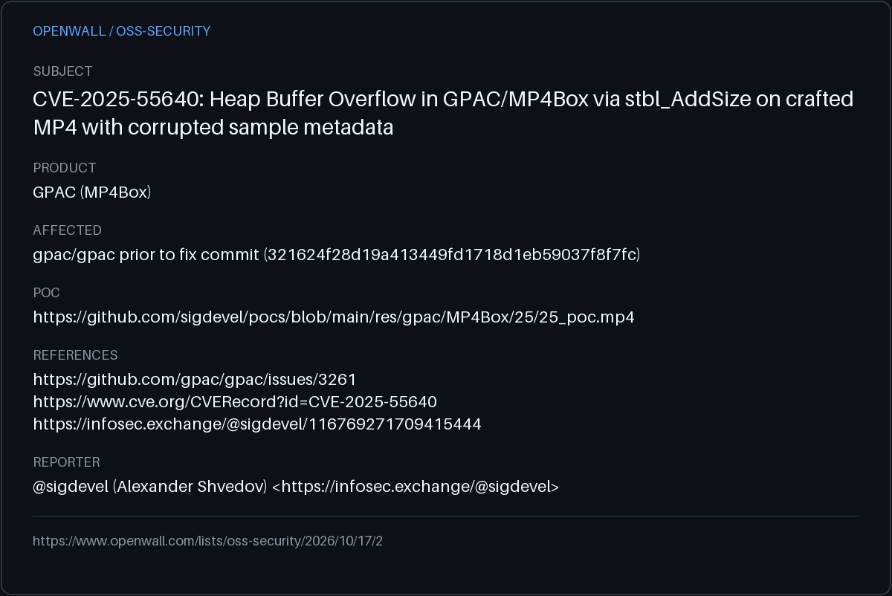](https://www.openwall.com/lists/oss-security/2026/10/17/2)

[PoC and References (TXT)](openwall-2026-10-17-2/openwall-2026-10-17-2.txt)

Source: <https://www.openwall.com/lists/oss-security/2026/10/17/2>

**PoC:**

- <https://github.com/sigdevel/pocs/blob/main/res/gpac/MP4Box/25/25_poc.mp4>

**References:**

- <https://github.com/gpac/gpac/issues/3261>
- <https://www.cve.org/CVERecord?id=CVE-2025-55640>
- <https://infosec.exchange/@sigdevel/116769271709415444>

## CVE-2025-55653: Divide by Zero in GPAC/MP4Box via gf_parse_lfrac on crafted MP4 with zero-denominator fraction

[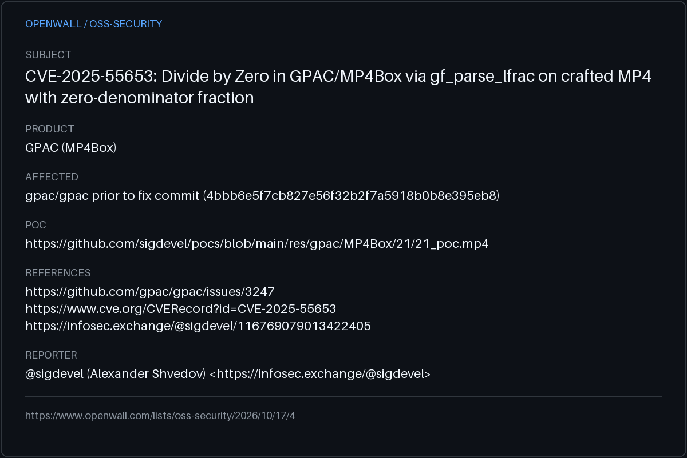](https://www.openwall.com/lists/oss-security/2026/10/17/4)

[PoC and References (TXT)](openwall-2026-10-17-4/openwall-2026-10-17-4.txt)

Source: <https://www.openwall.com/lists/oss-security/2026/10/17/4>

**PoC:**

- <https://github.com/sigdevel/pocs/blob/main/res/gpac/MP4Box/21/21_poc.mp4>

**References:**

- <https://github.com/gpac/gpac/issues/3247>
- <https://www.cve.org/CVERecord?id=CVE-2025-55653>
- <https://infosec.exchange/@sigdevel/116769079013422405>

## CVE-2025-55654: Use-after-free in GPAC/MP4Box gf_filter_pid_get_packet via crafted NHML export input

[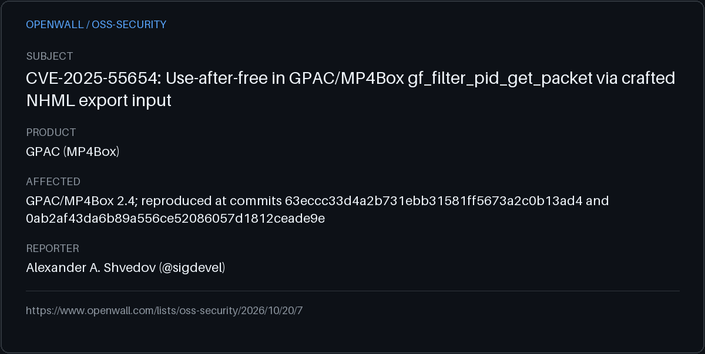](https://www.openwall.com/lists/oss-security/2026/10/20/7)

[PoC and References (TXT)](openwall-2026-10-20-7/openwall-2026-10-20-7.txt)

Source: <https://www.openwall.com/lists/oss-security/2026/10/20/7>

**PoC:**

- <https://github.com/sigdevel/pocs/blob/main/res/gpac/MP4Box/22/22_data>

**References:**

- <https://github.com/gpac/gpac/issues/3249>
- <https://github.com/gpac/gpac/commit/0ccd2927c7145f5ab0352c5b15f787757b34eb18>
- <https://www.cve.org/CVERecord?id=CVE-2025-55654>
- <https://raw.githubusercontent.com/CVEProject/cvelistV5/main/cves/2025/55xxx/CVE-2025-55654.json>
- <https://infosec.exchange/@sigdevel/116769098607015606>
- <https://bdu.fstec.ru/vul/2025-10087>

## CVE-2025-55667: NULL pointer dereference in GPAC/MP4Box dump_isom_saps via crafted MP4 input

[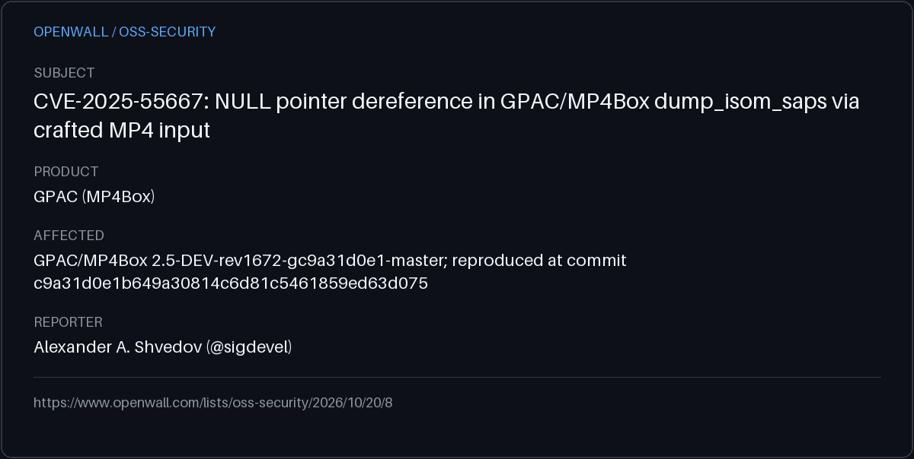](https://www.openwall.com/lists/oss-security/2026/10/20/8)

[PoC and References (TXT)](openwall-2026-10-20-8/openwall-2026-10-20-8.txt)

Source: <https://www.openwall.com/lists/oss-security/2026/10/20/8>

**PoC:**

- <https://github.com/sigdevel/pocs/blob/main/res/gpac/MP4Box/57/57_dump_isom_saps_filedump_c_1743>

**References:**

- <https://github.com/gpac/gpac/issues/3321>
- <https://github.com/gpac/gpac/commit/e6d01820d7bf3967d931fedb379ee5f209bc133b>
- <https://www.cve.org/CVERecord?id=CVE-2025-55667>

## CVE-2025-60480: Heap buffer overflow in GPAC/MP4Box gf_odf_ac4_cfg_alternative_info via crafted AC-4 file

[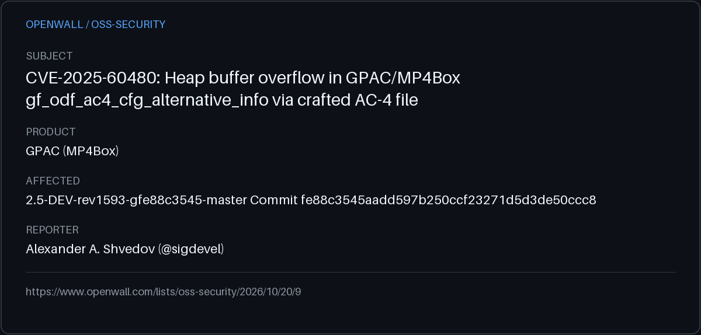](https://www.openwall.com/lists/oss-security/2026/10/20/9)

[PoC and References (TXT)](openwall-2026-10-20-9/openwall-2026-10-20-9.txt)

Source: <https://www.openwall.com/lists/oss-security/2026/10/20/9>

**PoC:**

- <https://github.com/sigdevel/pocs/blob/main/res/gpac/MP4Box/44/44_gf_odf_ac4_cfg_alternative_info_odf_descriptors_c_1899>

**References:**

- <https://github.com/gpac/gpac/issues/3295>
- <https://github.com/gpac/gpac/commit/e02d1fd24cdc26acb1b236ab38b3832cffcae21b>
- <https://www.cve.org/CVERecord?id=CVE-2025-60480>
- <https://raw.githubusercontent.com/CVEProject/cvelistV5/main/cves/2025/60xxx/CVE-2025-60480.json>
- <https://infosec.exchange/@sigdevel/117456490628466269>
- <https://bdu.fstec.ru/vul/2025-08615>

## CVE-2025-71438: Out-of-bounds Read in GPAC/MP4Box via gf_odf_ac4_cfg_dsi_v1 on crafted AC-4 stream with invalid frame rate index

[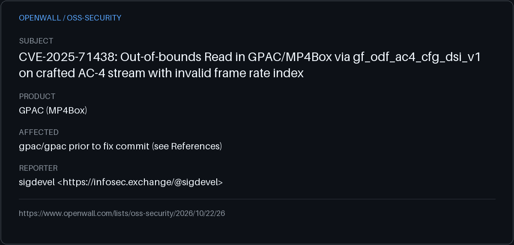](https://www.openwall.com/lists/oss-security/2026/10/22/26)

[PoC and References (TXT)](openwall-2026-10-22-26/openwall-2026-10-22-26.txt)

Source: <https://www.openwall.com/lists/oss-security/2026/10/22/26>

**PoC:**

- <https://github.com/sigdevel/pocs/blob/main/res/gpac/MP4Box/50/50_gf_odf_ac4_cfg_dsi_v1_odf_descriptors_c_2179>

**References:**

- <https://github.com/gpac/gpac/issues/3303>
- <https://nvd.nist.gov/vuln/detail/CVE-2025-71438>
- <https://github.com/gpac/gpac/releases/tag/v26.07.0>
- <https://infosec.exchange/@sigdevel/117484156995584313>
- <https://github.com/gpac/gpac/commit/13eb5b76560aaf7813b865a2ad433258478e2695>

## CVE-2025-60496: Divide by zero in GPAC/MP4Box reframer via crafted truncated MP4 file

[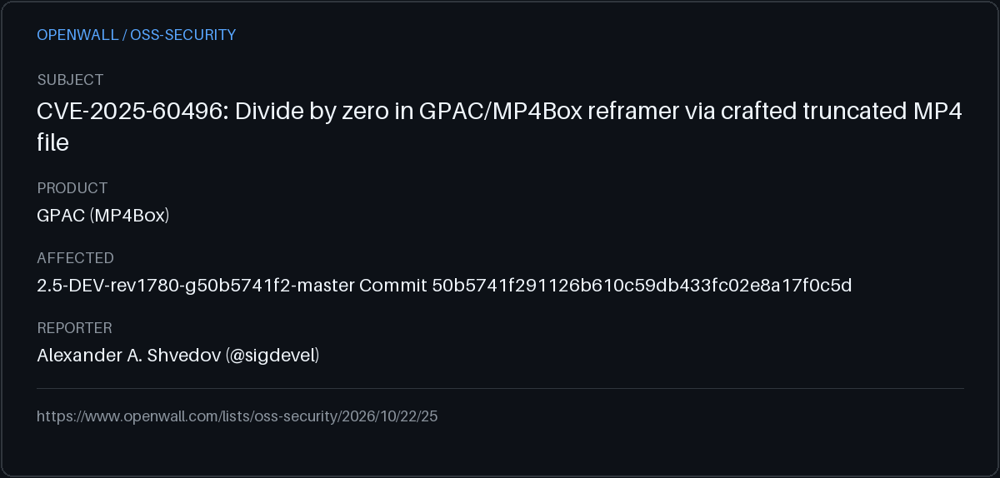](https://www.openwall.com/lists/oss-security/2026/10/22/25)

[PoC and References (TXT)](openwall-2026-10-22-25/openwall-2026-10-22-25.txt)

Source: <https://www.openwall.com/lists/oss-security/2026/10/22/25>

**PoC:**

- <https://github.com/sigdevel/pocs/blob/main/res/gpac/MP4Box/65/65_reframer_send_packet_filters_reframer_c_1026>

**References:**

- <https://github.com/gpac/gpac/issues/3334>
- <https://github.com/gpac/gpac/commit/f03c946aae129980f0426d4cbae9746d0536fee6>
- <https://www.cve.org/CVERecord?id=CVE-2025-60496>
- <https://raw.githubusercontent.com/CVEProject/cvelistV5/main/cves/2025/60xxx/CVE-2025-60496.json>
- <https://infosec.exchange/@sigdevel/117451461416101711>

## CVE-2025-60479: NULL pointer dereference in GPAC/MP4Box StatSFVec2f via crafted BIFS scene CVE-2025-60479: NULL pointer dereference in GPAC/MP4Box StatSFVec2f via crafted BIFS scene

[PoC and References (TXT)](openwall-2026-10-22-24/openwall-2026-10-22-24.txt)

Source: <https://www.openwall.com/lists/oss-security/2026/10/22/24>

**PoC:**

- <https://github.com/sigdevel/pocs/blob/main/res/gpac/MP4Box/58/58_StatSFVec2f_scene_manager_scene_stats_c_192>

**References:**

- <https://github.com/gpac/gpac/issues/3322>
- <https://github.com/gpac/gpac/commit/75786eb61b7cc838b57c3d4f8004b4f13b5b724c>
- <https://www.cve.org/CVERecord?id=CVE-2025-60479>
- <https://raw.githubusercontent.com/CVEProject/cvelistV5/main/cves/2025/60xxx/CVE-2025-60479.json>
- <https://infosec.exchange/@sigdevel/117451528497213210>
- <https://bdu.fstec.ru/vul/2025-13152>

## CVE-2025-60478: Heap use-after-free in GPAC/MP4Box packet destruction via crafted MPEG-2 TS file

[PoC and References (TXT)](openwall-2026-10-22-23/openwall-2026-10-22-23.txt)

Source: <https://www.openwall.com/lists/oss-security/2026/10/22/23>

**PoC:**

- <https://github.com/sigdevel/pocs/blob/main/res/gpac/MP4Box/47/47_gf_filter_packet_destroy_filter_core_filter_pck_c_678>

**References:**

- <https://github.com/gpac/gpac/issues/3300>
- <https://github.com/gpac/gpac/commit/c592a144bbe339ee581ca88aaa3247362795b742>
- <https://www.cve.org/CVERecord?id=CVE-2025-60478>
- <https://raw.githubusercontent.com/CVEProject/cvelistV5/main/cves/2025/60xxx/CVE-2025-60478.json>
- <https://infosec.exchange/@sigdevel/117456560052551246>
- <https://bdu.fstec.ru/vul/2025-09883>

## CVE-2025-60476: Heap use-after-free in GPAC/MP4Box AC-4 descriptor cleanup

[PoC and References (TXT)](openwall-2026-10-22-22/openwall-2026-10-22-22.txt)

Source: <https://www.openwall.com/lists/oss-security/2026/10/22/22>

**PoC:**

- <https://github.com/sigdevel/pocs/blob/main/res/gpac/MP4Box/42/42_gf_odf_ac4_cfg_clean_list_odf_descriptors_c_2419>

**References:**

- <https://github.com/gpac/gpac/issues/3293>
- <https://github.com/gpac/gpac/commit/e02d1fd24cdc26acb1b236ab38b3832cffcae21b>
- <https://www.cve.org/CVERecord?id=CVE-2025-60476>
- <https://raw.githubusercontent.com/CVEProject/cvelistV5/main/cves/2025/60xxx/CVE-2025-60476.json>
- <https://infosec.exchange/@sigdevel/117456471347684902>
- <https://bdu.fstec.ru/vul/2025-08612>

## CVE-2025-60469: NULL pointer dereference in GPAC/MP4Box AC-4 parser via crafted file

[PoC and References (TXT)](openwall-2026-10-22-21/openwall-2026-10-22-21.txt)

Source: <https://www.openwall.com/lists/oss-security/2026/10/22/21>

**PoC:**

- <https://github.com/sigdevel/pocs/blob/main/res/gpac/MP4Box/41/41_gf_ac4_presentation_ch_mode_media_tools_av_parsers_c_15641>

**References:**

- <https://github.com/gpac/gpac/issues/3292>
- <https://github.com/gpac/gpac/commit/e02d1fd24cdc26acb1b236ab38b3832cffcae21b>
- <https://www.cve.org/CVERecord?id=CVE-2025-60469>
- <https://raw.githubusercontent.com/CVEProject/cvelistV5/main/cves/2025/60xxx/CVE-2025-60469.json>
- <https://infosec.exchange/@sigdevel/117456377012352192>
- <https://bdu.fstec.ru/vul/2025-08611>

## CVE-2025-60497: NULL pointer dereference in GPAC/MP4Box GetESD via crafted MP4 input

[PoC and References (TXT)](openwall-2026-10-23-19/openwall-2026-10-23-19.txt)

Source: <https://www.openwall.com/lists/oss-security/2026/10/23/19>

**PoC:**

- <https://github.com/sigdevel/pocs/blob/main/res/gpac/MP4Box/62/62_GetESD_isomedia_track_c_107>

**References:**

- <https://github.com/gpac/gpac/issues/3336>
- <https://github.com/gpac/gpac/commit/91083fcfce01aa596a13a6962768d13a60bfc8bb>
- <https://www.cve.org/CVERecord?id=CVE-2025-60497>
- <https://raw.githubusercontent.com/CVEProject/cvelistV5/main/cves/2025/60xxx/CVE-2025-60497.json>
- <https://infosec.exchange/@sigdevel/117451504006040011>

## CVE-2025-60494: invalid memory read in GPAC/MP4Box gf_props_equal_internal via crafted MP4 input

[PoC and References (TXT)](openwall-2026-10-23-18/openwall-2026-10-23-18.txt)

Source: <https://www.openwall.com/lists/oss-security/2026/10/23/18>

**PoC:**

- <https://github.com/sigdevel/pocs/blob/main/res/gpac/MP4Box/64/64_gf_props_equal_internal_filter_core_filter_props_c_867>

**References:**

- <https://github.com/gpac/gpac/issues/3329>
- <https://github.com/gpac/gpac/commit/fcb9083292befe61d3e2466b18edfedba49da098>
- <https://www.cve.org/CVERecord?id=CVE-2025-60494>
- <https://raw.githubusercontent.com/CVEProject/cvelistV5/main/cves/2025/60xxx/CVE-2025-60494.json>
- <https://infosec.exchange/@sigdevel/117451480059519560>

## CVE-2025-60492: uncontrolled recursion in GPAC/MP4Box BIFS decoder via crafted MP4 input

[PoC and References (TXT)](openwall-2026-10-23-17/openwall-2026-10-23-17.txt)

Source: <https://www.openwall.com/lists/oss-security/2026/10/23/17>

**PoC:**

- <https://github.com/sigdevel/pocs/blob/main/res/gpac/MP4Box/59/59_Anchor_Create_scenegraph_mpeg4_nodes_c_171>

**References:**

- <https://github.com/gpac/gpac/issues/3324>
- <https://github.com/gpac/gpac/commit/8e7b9a3a04331286b89d1803c65a2d6edc11b4c4>
- <https://www.cve.org/CVERecord?id=CVE-2025-60492>
- <https://raw.githubusercontent.com/CVEProject/cvelistV5/main/cves/2025/60xxx/CVE-2025-60492.json>
- <https://infosec.exchange/@sigdevel/117456655329648201>

## CVE-2025-60491: heap use-after-free in GPAC/MP4Box dasher_flush_segment via crafted MPEG-2 TS input

[PoC and References (TXT)](openwall-2026-10-23-16/openwall-2026-10-23-16.txt)

Source: <https://www.openwall.com/lists/oss-security/2026/10/23/16>

**PoC:**

- <https://github.com/sigdevel/pocs/blob/main/res/gpac/MP4Box/61/61_dasher_flush_segment_filters_dasher_c_8062>

**References:**

- <https://github.com/gpac/gpac/issues/3326>
- <https://github.com/gpac/gpac/commit/f6128214feb69cd689e4b9944a2621bc4ad8faf0>
- <https://www.cve.org/CVERecord?id=CVE-2025-60491>
- <https://raw.githubusercontent.com/CVEProject/cvelistV5/main/cves/2025/60xxx/CVE-2025-60491.json>
- <https://infosec.exchange/@sigdevel/117451513352278768>

## CVE-2025-60490: heap use-after-free in GPAC/MP4Box gf_filter_pid_send_event_downstream via crafted MPEG-2 TS input

[PoC and References (TXT)](openwall-2026-10-23-15/openwall-2026-10-23-15.txt)

Source: <https://www.openwall.com/lists/oss-security/2026/10/23/15>

**PoC:**

- <https://github.com/sigdevel/pocs/blob/main/res/gpac/MP4Box/54/54_gf_filter_pid_send_event_downstream_filter_core_filter_pid_c_7919>

**References:**

- <https://github.com/gpac/gpac/issues/3315>
- <https://github.com/gpac/gpac/commit/d0793f92e04fe284a25c2a9335cc5edc68deb6d4>
- <https://www.cve.org/CVERecord?id=CVE-2025-60490>
- <https://raw.githubusercontent.com/CVEProject/cvelistV5/main/cves/2025/60xxx/CVE-2025-60490.json>
- <https://infosec.exchange/@sigdevel/117456620287496398>
- <https://bdu.fstec.ru/vul/2025-13150>

## CVE-2025-60489: NULL pointer dereference in GPAC/MP4Box dasher_insert_timeline_entry via crafted MP4 input

[PoC and References (TXT)](openwall-2026-10-23-14/openwall-2026-10-23-14.txt)

Source: <https://www.openwall.com/lists/oss-security/2026/10/23/14>

**PoC:**

- <https://github.com/sigdevel/pocs/blob/main/res/gpac/MP4Box/60/60_dasher_insert_timeline_entry_filters_dasher_c_7760>

**References:**

- <https://github.com/gpac/gpac/issues/3325>
- <https://github.com/gpac/gpac/commit/4860a1a6f128ccc9ae37b4b738d22029f9672457>
- <https://www.cve.org/CVERecord?id=CVE-2025-60489>
- <https://raw.githubusercontent.com/CVEProject/cvelistV5/main/cves/2025/60xxx/CVE-2025-60489.json>
- <https://infosec.exchange/@sigdevel/117451521960820132>

## CVE-2025-60487: NULL pointer dereference in GPAC/MP4Box gf_isom_get_esd via crafted XML input

[PoC and References (TXT)](openwall-2026-10-23-13/openwall-2026-10-23-13.txt)

Source: <https://www.openwall.com/lists/oss-security/2026/10/23/13>

**PoC:**

Not provided in source.

**References:**

- <https://github.com/gpac/gpac/issues/3320>
- <https://github.com/gpac/gpac/commit/e6d01820d7bf3967d931fedb379ee5f209bc133b>
- <https://www.cve.org/CVERecord?id=CVE-2025-60487>
- <https://raw.githubusercontent.com/CVEProject/cvelistV5/main/cves/2025/60xxx/CVE-2025-60487.json>
- <https://infosec.exchange/@sigdevel/117456633862790827>
- <https://bdu.fstec.ru/vul/2025-13151>

## CVE-2025-60493: GPAC/MP4Box: NULL Pointer Dereference in check_media_profile via Crafted MP4 Input

[PoC and References (TXT)](openwall-2026-10-24-10/openwall-2026-10-24-10.txt)

Source: <https://www.openwall.com/lists/oss-security/2026/10/24/10>

**PoC:**

- <https://github.com/sigdevel/pocs/blob/main/res/gpac/MP4Box/63/63_check_media_profile_applications_mp4box_mp4box_c_3883>

**References:**

- <https://github.com/gpac/gpac/issues/3328>
- <https://github.com/gpac/gpac/commit/9afeea23f5c6584c02aefe1e1560c2844dfb8f7e>
- <https://www.cve.org/CVERecord?id=CVE-2025-60493>
- <https://raw.githubusercontent.com/CVEProject/cvelistV5/main/cves/2025/60xxx/CVE-2025-60493.json>
- <https://infosec.exchange/@sigdevel/117451489672249554>

## CVE-2025-60477: GPAC/MP4Box: NULL Pointer Dereference in gf_filter_pid_resolve_file_template_ex on crafted MP4 with special metadata

[PoC and References (TXT)](openwall-2026-10-26-1/openwall-2026-10-26-1.txt)

Source: <https://www.openwall.com/lists/oss-security/2026/10/26/1>

**PoC:**

- <https://github.com/sigdevel/pocs/blob/main/res/gpac/MP4Box/48/48_gf_filter_pid_resolve_file_template_ex_filter_core_filter_pid_c_9045>

**References:**

- <https://github.com/gpac/gpac/issues/3301>
- <https://nvd.nist.gov/vuln/detail/CVE-2025-60477>
- <https://infosec.exchange/@sigdevel/116658486442433074>

## CVE-2025-60475: GPAC/MP4Box: Global Buffer Overflow Read in gf_ac4_parser_bs on crafted AC-4 stream

[PoC and References (TXT)](openwall-2026-10-28-2/openwall-2026-10-28-2.txt)

Source: <https://www.openwall.com/lists/oss-security/2026/10/28/2>

**PoC:**

- <https://github.com/sigdevel/pocs/blob/main/res/gpac/MP4Box/40/40_gf_ac4_parser_bs_media_tools_av_parsers_c_16140>

**References:**

- <https://github.com/gpac/gpac/issues/3291>
- <https://github.com/gpac/gpac/commit/e02d1fd24cdc26acb1b236ab38b3832cffcae21b>
- <https://www.cve.org/CVERecord?id=CVE-2025-60475>
- <https://infosec.exchange/@sigdevel/117456354623831878>

## CVE-2025-60482: GPAC/MP4Box: Heap Use-After-Free in AC-4 Descriptor Cleanup

[PoC and References (TXT)](openwall-2026-10-29-3/openwall-2026-10-29-3.txt)

Source: <https://www.openwall.com/lists/oss-security/2026/10/29/3>

**PoC:**

- <https://github.com/sigdevel/pocs/blob/main/res/gpac/MP4Box/46/46_gf_odf_ac4_cfg_clean_list_odf_descriptors_c_2411>

**References:**

- <https://www.cve.org/CVERecord?id=CVE-2025-60482>
- <https://github.com/gpac/gpac/issues/3297>
- <https://raw.githubusercontent.com/CVEProject/cvelistV5/main/cves/2025/60xxx/CVE-2025-60482.json>
- <https://infosec.exchange/@sigdevel/117456522954593448>

## CVE-2026-128239: GPAC/MP4Box: NULL Pointer Dereference in MPEG-4 Form Handlers via Crafted XMT Input

[PoC and References (TXT)](openwall-2026-11-13-3/openwall-2026-11-13-3.txt)

Source: <https://www.openwall.com/lists/oss-security/2026/11/13/3>

**PoC:**

- <https://github.com/sigdevel/pocs/blob/main/res/gpac/MP4Box/221/221_ab_apply_compositor_mpeg4_form_c_627.xmt>

**References:**

- <https://github.com/gpac/gpac/issues/4029>
- <https://github.com/gpac/gpac/pull/4039>
- <https://github.com/gpac/gpac/commit/bc416b997622e43de65afab3bae9b7d05d72f2b0>
- <https://www.cve.org/CVERecord?id=CVE-2026-128239>
- <https://raw.githubusercontent.com/CVEProject/cvelistV5/main/cves/2026/128xxx/CVE-2026-128239.json>
- <https://www.vulncheck.com/advisories/gpac-through-26.07.0-null-pointer-dereference-via-mpeg-4-form-handlers>

## CVE-2026-128240: GPAC/MP4Box: Use-After-Free in gf_sg_proto_del During XMT Scene Teardown

[PoC and References (TXT)](openwall-2026-11-14-14/openwall-2026-11-14-14.txt)

Source: <https://www.openwall.com/lists/oss-security/2026/11/14/14>

**PoC:**

- <https://github.com/sigdevel/pocs/blob/main/res/gpac/MP4Box/223/223_gf_sg_proto_del_scenegraph_vrml_proto_c.xmt>

**References:**

- <https://github.com/gpac/gpac/issues/4031>
- <https://github.com/gpac/gpac/pull/4037>
- <https://github.com/gpac/gpac/commit/a2e5c62c213b5329a4572fe8e7c333e1ca26d028>
- <https://www.cve.org/CVERecord?id=CVE-2026-128240>
- <https://raw.githubusercontent.com/CVEProject/cvelistV5/main/cves/2026/128xxx/CVE-2026-128240.json>
- <https://www.vulncheck.com/advisories/gpac-through-26.07.0-use-after-free-in-gf-sg-proto-del-during-scene-teardown>

## CVE-2026-124031: GPAC/MP4Box: Type Confusion in Appearance Handling via Crafted XMT Input

[PoC and References (TXT)](openwall-2026-11-14-13/openwall-2026-11-14-13.txt)

Source: <https://www.openwall.com/lists/oss-security/2026/11/14/13>

**PoC:**

- <https://github.com/sigdevel/pocs/blob/main/res/gpac/MP4Box/222/222_gf_node_get_tag_compositor_texturing_c_370.xmt>

**References:**

- <https://github.com/gpac/gpac/issues/4030>
- <https://github.com/gpac/gpac/commit/43a8329a90ae2907716b593cc3746458516c7c39>
- <https://www.cve.org/CVERecord?id=CVE-2026-124031>
- <https://raw.githubusercontent.com/CVEProject/cvelistV5/main/cves/2026/124xxx/CVE-2026-124031.json>
- <https://www.vulncheck.com/advisories/gpac-through-26.07.0-type-confusion-via-drawable-get-aspect-2d-mpeg4>

## CVE-2026-124030: GPAC/MP4Box: Type Confusion in XMT Field-Replace Commands

[PoC and References (TXT)](openwall-2026-11-14-12/openwall-2026-11-14-12.txt)

Source: <https://www.openwall.com/lists/oss-security/2026/11/14/12>

**PoC:**

- <https://github.com/sigdevel/pocs/blob/main/res/gpac/MP4Box/224/224_gf_sg_command_apply_scenegraph_commands_c_346.xmt>

**References:**

- <https://github.com/gpac/gpac/issues/4032>
- <https://github.com/gpac/gpac/commit/1359c4da9329cedceeb8fcfeab6d97e0927236e1>
- <https://www.cve.org/CVERecord?id=CVE-2026-124030>
- <https://raw.githubusercontent.com/CVEProject/cvelistV5/main/cves/2026/124xxx/CVE-2026-124030.json>
- <https://www.vulncheck.com/advisories/gpac-through-26.07.0-type-confusion-via-gf-sg-command-apply-xmt-field-replace>

## CVE-2025-71467: GPAC/MP4Box: NULL Pointer Dereference in gf_node_get_field_by_name via Crafted XMT Input Product: GPAC (MP4Box)

[PoC and References (TXT)](openwall-2026-11-16-8/openwall-2026-11-16-8.txt)

Source: <https://www.openwall.com/lists/oss-security/2026/11/16/8>

**PoC:**

- <https://github.com/sigdevel/pocs/blob/main/res/gpac/MP4Box/27/27_gf_node_get_field_by_name_scenegraph_base_scenegraph_c_2088>

**References:**

- <https://github.com/gpac/gpac/issues/3268>
- <https://github.com/gpac/gpac/commit/62714f27c64a3d1eb7e880f9eed2d38673cb43ce>
- <https://www.cve.org/CVERecord?id=CVE-2025-71467>
- <https://raw.githubusercontent.com/CVEProject/cvelistV5/main/cves/2025/71xxx/CVE-2025-71467.json>

## CVE-2025-71466: GPAC/MP4Box: NULL Pointer Dereference in m2tsdmx_update_sdt via Crafted MPEG-2 TS Input

[PoC and References (TXT)](openwall-2026-11-16-7/openwall-2026-11-16-7.txt)

Source: <https://www.openwall.com/lists/oss-security/2026/11/16/7>

**PoC:**

- <https://github.com/sigdevel/pocs/blob/main/res/gpac/MP4Box/26/26_m2tsdmx_update_sdt_filters_dmx_m2ts_c_218>

**References:**

- <https://github.com/gpac/gpac/issues/3267>
- <https://github.com/gpac/gpac/commit/62714f27c64a3d1eb7e880f9eed2d38673cb43ce>
- <https://www.cve.org/CVERecord?id=CVE-2025-71466>
- <https://raw.githubusercontent.com/CVEProject/cvelistV5/main/cves/2025/71xxx/CVE-2025-71466.json>

## CVE-2025-60465: Use-After-Free in GPAC/MP4Box via gf_filter_pid_inst_swap on crafted MPEG-2 TS file

[PoC and References (TXT)](openwall-2026-06-27-1/openwall-2026-06-27-1.txt)

Source: <https://www.openwall.com/lists/oss-security/2026/06/27/1>

**PoC:**

- <https://github.com/sigdevel/pocs/blob/main/res/gpac/MP4Box/34/34_gf_filter_pid_inst_swap_filter_core_filter_pid_c_633>

**References:**

- <https://github.com/gpac/gpac/issues/3283>
- <https://www.cve.org/CVERecord?id=CVE-2025-60465>
- <https://infosec.exchange/@sigdevel/116778494176930561>

## CVE-2025-71468: GPAC/MP4Box: NULL Pointer Dereference in gf_dash_group_get_audio_channels via Crafted DASH Manifest

[PoC and References (TXT)](openwall-2026-11-17-21/openwall-2026-11-17-21.txt)

Source: <https://www.openwall.com/lists/oss-security/2026/11/17/21>

**PoC:**

- <https://github.com/sigdevel/pocs/blob/main/res/gpac/MP4Box/28/28_gf_dash_group_get_audio_channels_media_tools_dash_client_c_10769>

**References:**

- <https://github.com/gpac/gpac/issues/3269>
- <https://github.com/gpac/gpac/commit/62714f27c64a3d1eb7e880f9eed2d38673cb43ce>
- <https://www.cve.org/CVERecord?id=CVE-2025-71468>
- <https://raw.githubusercontent.com/CVEProject/cvelistV5/main/cves/2025/71xxx/CVE-2025-71468.json>

## CVE-2025-71469: GPAC/MP4Box: Type Confusion in XMT/BT Scene Loader Causing a Crash in gf_scene_ns_connect_object

[PoC and References (TXT)](openwall-2026-11-17-22/openwall-2026-11-17-22.txt)

Source: <https://www.openwall.com/lists/oss-security/2026/11/17/22>

**PoC:**

- <https://github.com/sigdevel/pocs/blob/main/res/gpac/MP4Box/30/30_compositor_scene_ns_c_479_in_gf_scene_ns_connect_object>

**References:**

- <https://github.com/gpac/gpac/issues/3271>
- <https://github.com/gpac/gpac/commit/62714f27c64a3d1eb7e880f9eed2d38673cb43ce>
- <https://www.cve.org/CVERecord?id=CVE-2025-71469>
- <https://raw.githubusercontent.com/CVEProject/cvelistV5/main/cves/2025/71xxx/CVE-2025-71469.json>

## CVE-2025-71471: GPAC/MP4Box: Use of Uninitialized Memory in stbl_AddCTS via Crafted MP4 Input

[PoC and References (TXT)](openwall-2026-11-18-12/openwall-2026-11-18-12.txt)

Source: <https://www.openwall.com/lists/oss-security/2026/11/18/12>

**PoC:**

- <https://github.com/sigdevel/pocs/blob/main/res/gpac/MP4Box/69/69_utils_list_c_672>

**References:**

- <https://github.com/gpac/gpac/issues/3412>
- <https://github.com/gpac/gpac/commit/a8c83bd36ca074b81c39ae5ccc0c8580d098072a>
- <https://www.cve.org/CVERecord?id=CVE-2025-71471>
- <https://raw.githubusercontent.com/CVEProject/cvelistV5/main/cves/2025/71xxx/CVE-2025-71471.json>
- <https://www.vulncheck.com/advisories/gpac-before-26.02.0-uninitialized-memory-use-in-stbl-addcts>

## CVE-2026-130630: GPAC/MP4Box: NULL Pointer Dereference in dasher_configure_pid via Crafted MPEG-2 TS Input

[PoC and References (TXT)](openwall-2026-11-18-13/openwall-2026-11-18-13.txt)

Source: <https://www.openwall.com/lists/oss-security/2026/11/18/13>

**PoC:**

- <https://github.com/sigdevel/pocs/blob/main/res/gpac/MP4Box/70/70_dasher_configure_pid>

**References:**

- <https://github.com/gpac/gpac/issues/3500>
- <https://github.com/gpac/gpac/commit/8ed521b69dcbf9a5a79b52b7d43d507ccb048c84>
- <https://www.cve.org/CVERecord?id=CVE-2026-130630>
- <https://raw.githubusercontent.com/CVEProject/cvelistV5/main/cves/2026/130xxx/CVE-2026-130630.json>
- <https://www.vulncheck.com/advisories/gpac-26.02.0-null-pointer-dereference-via-dasher-configure-pid>

## CVE-2026-130631: GPAC/MP4Box: Uninitialized Pointer Access in GetESD via RVC Configuration

[PoC and References (TXT)](openwall-2026-11-18-14/openwall-2026-11-18-14.txt)

Source: <https://www.openwall.com/lists/oss-security/2026/11/18/14>

**PoC:**

- <https://github.com/sigdevel/pocs/blob/main/res/gpac/MP4Box/73/73_isomedia_track_c_GetESD>

**References:**

- <https://github.com/gpac/gpac/issues/3592>
- <https://github.com/gpac/gpac/commit/25081b9610477fc8de48d2f1cadd3fd232a9dcbc>
- <https://www.cve.org/CVERecord?id=CVE-2026-130631>
- <https://raw.githubusercontent.com/CVEProject/cvelistV5/main/cves/2026/130xxx/CVE-2026-130631.json>
- <https://www.vulncheck.com/advisories/gpac-before-26.07.0-uninitialized-pointer-access-in-getesd-via-rvc-configuration>

## CVE-2026-130633: GPAC/MP4Box: Heap Use-After-Free in gf_props_del_property via PID Property Arguments

[PoC and References (TXT)](openwall-2026-11-18-15/openwall-2026-11-18-15.txt)

Source: <https://www.openwall.com/lists/oss-security/2026/11/18/15>

**PoC:**

- <https://github.com/sigdevel/pocs/blob/main/res/gpac/MP4Box/72/72_gf_props_del_property>

**References:**

- <https://github.com/gpac/gpac/issues/3441>
- <https://github.com/gpac/gpac/commit/d65d699012bd82a0839e8af6747bca438e26938a>
- <https://www.cve.org/CVERecord?id=CVE-2026-130633>
- <https://raw.githubusercontent.com/CVEProject/cvelistV5/main/cves/2026/130xxx/CVE-2026-130633.json>
- <https://www.vulncheck.com/advisories/gpac-before-26.02.0-use-after-free-via-pid-property-arguments>

## CVE-2026-130635: GPAC/MP4Box: Uncontrolled Recursion in dasher_gather_deps via Cyclic Stream Dependencies

[PoC and References (TXT)](openwall-2026-11-20-10/openwall-2026-11-20-10.txt)

Source: <https://www.openwall.com/lists/oss-security/2026/11/20/10>

**PoC:**

- <https://github.com/sigdevel/pocs/blob/main/res/gpac/MP4Box/77/77_utils_list_c_718_gf_list_insert>

**References:**

- <https://github.com/gpac/gpac/issues/3585>
- <https://github.com/gpac/gpac/commit/5439b94d091e764742a6b108509516d3810bd034>
- <https://www.cve.org/CVERecord?id=CVE-2026-130635>
- <https://raw.githubusercontent.com/CVEProject/cvelistV5/main/cves/2026/130xxx/CVE-2026-130635.json>
- <https://www.vulncheck.com/advisories/gpac-before-26.07.0-uncontrolled-recursion-via-dasher-gather-deps>

## CVE-2026-130793: GPAC/MP4Box: Stack Buffer Overflow in gf_filter_pid_resolve_file_template_ex via Crafted NHML Input

[PoC and References (TXT)](openwall-2026-11-20-9/openwall-2026-11-20-9.txt)

Source: <https://www.openwall.com/lists/oss-security/2026/11/20/9>

**PoC:**

- <https://github.com/sigdevel/pocs/blob/main/res/gpac/MP4Box/78/78_filter_core_filter_pid_c_9366_gf_filter_pid_resolve_file_template_ex>

**References:**

- <https://github.com/gpac/gpac/issues/3586>
- <https://github.com/gpac/gpac/commit/5439b94d091e764742a6b108509516d3810bd034>
- <https://www.cve.org/CVERecord?id=CVE-2026-130793>
- <https://raw.githubusercontent.com/CVEProject/cvelistV5/main/cves/2026/130xxx/CVE-2026-130793.json>
- <https://www.vulncheck.com/advisories/gpac-before-26.07.0-stack-based-buffer-overflow-via-gf-filter-pid-resolve-file-template-ex>

## CVE-2026-130634: GPAC/MP4Box: Heap Buffer Overflow in gf_mpd_resolve_url via Crafted DASH Manifest

[PoC and References (TXT)](openwall-2026-11-20-8/openwall-2026-11-20-8.txt)

Source: <https://www.openwall.com/lists/oss-security/2026/11/20/8>

**PoC:**

- <https://github.com/sigdevel/pocs/blob/main/res/gpac/MP4Box/75/75_media_tools_mpd_c_5684_gf_mpd_resolve_url>

**References:**

- <https://github.com/gpac/gpac/issues/3582>
- <https://github.com/gpac/gpac/commit/5439b94d091e764742a6b108509516d3810bd034>
- <https://www.cve.org/CVERecord?id=CVE-2026-130634>
- <https://raw.githubusercontent.com/CVEProject/cvelistV5/main/cves/2026/130xxx/CVE-2026-130634.json>
- <https://www.vulncheck.com/advisories/gpac-before-26.07.0-heap-based-buffer-overflow-via-gf-mpd-resolve-url>

## CVE-2026-130632: GPAC/MP4Box: Out-of-Bounds Read in m2tsdmx_send_packet via Crafted MPEG-2 TS VC-1 Input

[PoC and References (TXT)](openwall-2026-11-20-7/openwall-2026-11-20-7.txt)

Source: <https://www.openwall.com/lists/oss-security/2026/11/20/7>

**PoC:**

- <https://github.com/sigdevel/pocs/blob/main/res/gpac/MP4Box/74/74_m2tsdmx_send_packet>

**References:**

- <https://github.com/gpac/gpac/issues/3442>
- <https://github.com/gpac/gpac/commit/d65d699012bd82a0839e8af6747bca438e26938a>
- <https://www.cve.org/CVERecord?id=CVE-2026-130632>
- <https://raw.githubusercontent.com/CVEProject/cvelistV5/main/cves/2026/130xxx/CVE-2026-130632.json>
- <https://www.vulncheck.com/advisories/gpac-before-26.02.0-out-of-bounds-read-via-m2tsdmx-send-packet>

## CVE-2026-135441: MediaInfoLib before 26.10 Uninitialized Pointer Dereference via File_Usac Conformance Profile

[PoC and References (TXT)](cve-cve-2026-135441-6eb04594f4d3/cve-cve-2026-135441-6eb04594f4d3.txt)

Source: <https://www.cve.org/CVERecord?id=CVE-2026-135441>

**PoC:**

- <https://github.com/sigdevel/pocs/blob/main/res/mediainfo/2/mediainfo_2>

**References:**

- <https://www.cve.org/CVERecord?id=CVE-2026-135441>
- <https://raw.githubusercontent.com/CVEProject/cvelistV5/main/cves/2026/135xxx/CVE-2026-135441.json>
- <https://github.com/MediaArea/MediaInfoLib/issues/2607>
- <https://github.com/MediaArea/MediaInfoLib/pull/2677>
- <https://github.com/MediaArea/MediaInfoLib/commit/eb999843362ca8a2dcba6a554fb5415a61287b97>
- <https://github.com/MediaArea/MediaInfoLib/blob/v26.01/Source/MediaInfo/Multiple/File_Mpeg4_Descriptors.cpp#L425-L433>
- <https://github.com/MediaArea/MediaInfoLib/releases/tag/v26.10>
- <https://github.com/sigdevel/pocs/blob/main/res/mediainfo/2/mediainfo_2>
- <https://www.vulncheck.com/advisories/mediainfolib-before-26.10-uninitialized-pointer-dereference-via-file-usac-conformance-profile>

## CVE-2026-130792: GPAC before 26.07.0 Heap Buffer Overflow via XML SAX Parser Entity Handling

[PoC and References (TXT)](cve-cve-2026-130792-b7290dfd8527/cve-cve-2026-130792-b7290dfd8527.txt)

Source: <https://www.cve.org/CVERecord?id=CVE-2026-130792>

**PoC:**

- <https://github.com/sigdevel/pocs/blob/main/res/gpac/MP4Box/79/79_xml_sax_append_string_xml_parser_c_993.xml>
- <https://github.com/sigdevel/pocs/blob/main/res/gpac/MP4Box/86/86_xml_sax_swap_utils_xml_parser_c_214>

**References:**

- <https://www.cve.org/CVERecord?id=CVE-2026-130792>
- <https://raw.githubusercontent.com/CVEProject/cvelistV5/main/cves/2026/130xxx/CVE-2026-130792.json>
- <https://github.com/gpac/gpac/issues/3615>
- <https://github.com/gpac/gpac/issues/3646>
- <https://github.com/gpac/gpac/commit/e87dff25aa91f9a52d8857b4d8558c93960c9522>
- <https://github.com/gpac/gpac/commit/6f54ff86b2fdc045d6a683b93f9ced8928d8b35c>
- <https://github.com/gpac/gpac/releases/tag/v26.07.0>
- <https://github.com/gpac/gpac/blob/v26.02.0/src/utils/xml_parser.c#L1040-L1069>
- <https://github.com/gpac/gpac/blob/v26.02.0/src/utils/xml_parser.c#L977-L998>
- <https://github.com/sigdevel/pocs/blob/main/res/gpac/MP4Box/79/79_xml_sax_append_string_xml_parser_c_993.xml>
- <https://github.com/gpac/gpac/issues/3645>
- <https://github.com/gpac/gpac/blob/v26.02.0/src/utils/xml_parser.c#L1043-L1068>
- <https://github.com/sigdevel/pocs/blob/main/res/gpac/MP4Box/86/86_xml_sax_swap_utils_xml_parser_c_214>
- <https://www.vulncheck.com/advisories/gpac-before-26.07.0-heap-buffer-overflow-via-xml-sax-parser-entity-handling>

## CVE-2026-130832: GPAC before 26.07.0 NULL Pointer Dereference via xmt_parse_element() ROUTE Handling

[PoC and References (TXT)](cve-cve-2026-130832-8287e5490d5c/cve-cve-2026-130832-8287e5490d5c.txt)

Source: <https://www.cve.org/CVERecord?id=CVE-2026-130832>

**PoC:**

- <https://github.com/sigdevel/pocs/blob/main/res/gpac/MP4Box/80/80_xmt_parse_element_scene_manager_loader_xmt_c_1513.xmt>

**References:**

- <https://www.cve.org/CVERecord?id=CVE-2026-130832>
- <https://raw.githubusercontent.com/CVEProject/cvelistV5/main/cves/2026/130xxx/CVE-2026-130832.json>
- <https://github.com/gpac/gpac/issues/3616>
- <https://github.com/gpac/gpac/commit/e87dff25aa91f9a52d8857b4d8558c93960c9522>
- <https://github.com/gpac/gpac/releases/tag/v26.07.0>
- <https://github.com/gpac/gpac/blob/v26.02.0/src/scene_manager/loader_xmt.c#L1509-L1514>
- <https://github.com/sigdevel/pocs/blob/main/res/gpac/MP4Box/80/80_xmt_parse_element_scene_manager_loader_xmt_c_1513.xmt>
- <https://www.vulncheck.com/advisories/gpac-before-26.07.0-null-pointer-dereference-via-xmt-parse-element-route-handling>

## CVE-2026-130830: GPAC before 26.07.0 Use-After-Free via load_xmt_done() XMT Scene Loader

[PoC and References (TXT)](cve-cve-2026-130830-5e5eea2e30f1/cve-cve-2026-130830-5e5eea2e30f1.txt)

Source: <https://www.cve.org/CVERecord?id=CVE-2026-130830>

**PoC:**

- <https://github.com/sigdevel/pocs/blob/main/res/gpac/MP4Box/82/82_gf_node_register_scenegraph_base_scenegraph_c_769.xmt>

**References:**

- <https://www.cve.org/CVERecord?id=CVE-2026-130830>
- <https://raw.githubusercontent.com/CVEProject/cvelistV5/main/cves/2026/130xxx/CVE-2026-130830.json>
- <https://github.com/gpac/gpac/issues/3618>
- <https://github.com/gpac/gpac/commit/e87dff25aa91f9a52d8857b4d8558c93960c9522>
- <https://github.com/gpac/gpac/releases/tag/v26.07.0>
- <https://github.com/gpac/gpac/blob/v26.02.0/src/scene_manager/loader_xmt.c#L3238-L3250>
- <https://github.com/sigdevel/pocs/blob/main/res/gpac/MP4Box/82/82_gf_node_register_scenegraph_base_scenegraph_c_769.xmt>
- <https://www.vulncheck.com/advisories/gpac-before-26.07.0-use-after-free-via-load-xmt-done-xmt-scene-loader>

## CVE-2026-130831: GPAC before 26.07.0 Use-After-Free via xmt_parse_element() DEF/USE Handling

[PoC and References (TXT)](cve-cve-2026-130831-95e4ce58f9b7/cve-cve-2026-130831-95e4ce58f9b7.txt)

Source: <https://www.cve.org/CVERecord?id=CVE-2026-130831>

**PoC:**

- <https://github.com/sigdevel/pocs/blob/main/res/gpac/MP4Box/84/84_gf_node_get_tag_scenegraph_base_scenegraph_c_1268.xmt>

**References:**

- <https://www.cve.org/CVERecord?id=CVE-2026-130831>
- <https://raw.githubusercontent.com/CVEProject/cvelistV5/main/cves/2026/130xxx/CVE-2026-130831.json>
- <https://github.com/gpac/gpac/issues/3620>
- <https://github.com/gpac/gpac/commit/e87dff25aa91f9a52d8857b4d8558c93960c9522>
- <https://github.com/gpac/gpac/releases/tag/v26.07.0>
- <https://github.com/gpac/gpac/blob/v26.02.0/src/scene_manager/loader_xmt.c#L1826-L1866>
- <https://github.com/sigdevel/pocs/blob/main/res/gpac/MP4Box/84/84_gf_node_get_tag_scenegraph_base_scenegraph_c_1268.xmt>
- <https://www.vulncheck.com/advisories/gpac-before-26.07.0-use-after-free-via-xmt-parse-element-def-use-handling>

## CVE-2026-130799: GPAC before 26.07.0 Use-After-Free via XMT DEF Node Resolution

[PoC and References (TXT)](cve-cve-2026-130799-396699b49ae7/cve-cve-2026-130799-396699b49ae7.txt)

Source: <https://www.cve.org/CVERecord?id=CVE-2026-130799>

**PoC:**

- <https://github.com/sigdevel/pocs/blob/main/res/gpac/MP4Box/83/83_gf_node_get_field_by_name_scenegraph_base_scenegraph_c_2094.xmt>

**References:**

- <https://www.cve.org/CVERecord?id=CVE-2026-130799>
- <https://raw.githubusercontent.com/CVEProject/cvelistV5/main/cves/2026/130xxx/CVE-2026-130799.json>
- <https://github.com/gpac/gpac/issues/3619>
- <https://github.com/gpac/gpac/commit/e87dff25aa91f9a52d8857b4d8558c93960c9522>
- <https://github.com/gpac/gpac/releases/tag/v26.07.0>
- <https://github.com/gpac/gpac/blob/v26.02.0/src/scene_manager/loader_xmt.c#L1825-L1840>
- <https://github.com/sigdevel/pocs/blob/main/res/gpac/MP4Box/83/83_gf_node_get_field_by_name_scenegraph_base_scenegraph_c_2094.xmt>
- <https://www.vulncheck.com/advisories/gpac-before-26.07.0-use-after-free-via-xmt-def-node-resolution>

## CVE-2026-130795: GPAC before 26.07.0 Type Confusion via XMT Command Buffer Unwinding

[PoC and References (TXT)](cve-cve-2026-130795-4784e7ba1a99/cve-cve-2026-130795-4784e7ba1a99.txt)

Source: <https://www.cve.org/CVERecord?id=CVE-2026-130795>

**PoC:**

- <https://github.com/sigdevel/pocs/blob/main/res/gpac/MP4Box/89/89_gf_list_count_utils_list_c_664>

**References:**

- <https://www.cve.org/CVERecord?id=CVE-2026-130795>
- <https://raw.githubusercontent.com/CVEProject/cvelistV5/main/cves/2026/130xxx/CVE-2026-130795.json>
- <https://github.com/gpac/gpac/issues/3648>
- <https://github.com/gpac/gpac/issues/3650>
- <https://github.com/gpac/gpac/commit/6f54ff86b2fdc045d6a683b93f9ced8928d8b35c>
- <https://github.com/gpac/gpac/releases/tag/v26.07.0>
- <https://github.com/gpac/gpac/blob/v26.02.0/src/scene_manager/loader_xmt.c#L2866-L2878>
- <https://github.com/gpac/gpac/blob/v26.02.0/src/scene_manager/loader_xmt.c#L994-L1002>
- <https://github.com/sigdevel/pocs/blob/main/res/gpac/MP4Box/89/89_gf_list_count_utils_list_c_664>
- <https://www.vulncheck.com/advisories/gpac-before-26.07.0-type-confusion-via-xmt-command-buffer-unwinding>

## CVE-2026-130061: GPAC before 26.07.0 Double Free via gf_sg_sfcommand_del() in XMT Scenes

[PoC and References (TXT)](cve-cve-2026-130061-93f553a4de42/cve-cve-2026-130061-93f553a4de42.txt)

Source: <https://www.cve.org/CVERecord?id=CVE-2026-130061>

**PoC:**

- <https://github.com/sigdevel/pocs/blob/main/res/gpac/MP4Box/93/93_gf_sg_sfcommand_del_scenegraph_vrml_tools_c_622>

**References:**

- <https://www.cve.org/CVERecord?id=CVE-2026-130061>
- <https://raw.githubusercontent.com/CVEProject/cvelistV5/main/cves/2026/130xxx/CVE-2026-130061.json>
- <https://github.com/gpac/gpac/issues/3652>
- <https://github.com/gpac/gpac/commit/6f54ff86b2fdc045d6a683b93f9ced8928d8b35c>
- <https://github.com/gpac/gpac/releases/tag/v26.07.0>
- <https://github.com/gpac/gpac/blob/v26.02.0/src/scenegraph/vrml_tools.c#L614-L623>
- <https://github.com/gpac/gpac/blob/v26.02.0/src/scene_manager/loader_xmt.c#L1758-L1764>
- <https://github.com/sigdevel/pocs/blob/main/res/gpac/MP4Box/93/93_gf_sg_sfcommand_del_scenegraph_vrml_tools_c_622>
- <https://www.vulncheck.com/advisories/gpac-before-26.07.0-double-free-via-gf-sg-sfcommand-del-in-xmt-scenes>

## CVE-2026-130062: GPAC before 26.07.0 NULL Pointer Dereference via XMT Connect Elements

[PoC and References (TXT)](cve-cve-2026-130062-cee8397db220/cve-cve-2026-130062-cee8397db220.txt)

Source: <https://www.cve.org/CVERecord?id=CVE-2026-130062>

**PoC:**

- <https://github.com/sigdevel/pocs/blob/main/res/gpac/MP4Box/90/90_gf_node_get_tag_scenegraph_base_scenegraph_c_1270>

**References:**

- <https://www.cve.org/CVERecord?id=CVE-2026-130062>
- <https://raw.githubusercontent.com/CVEProject/cvelistV5/main/cves/2026/130xxx/CVE-2026-130062.json>
- <https://github.com/gpac/gpac/issues/3649>
- <https://github.com/gpac/gpac/commit/6f54ff86b2fdc045d6a683b93f9ced8928d8b35c>
- <https://github.com/gpac/gpac/releases/tag/v26.07.0>
- <https://github.com/gpac/gpac/blob/v26.02.0/src/scene_manager/loader_xmt.c#L1643-L1644>
- <https://github.com/gpac/gpac/blob/v26.02.0/src/scenegraph/base_scenegraph.c#L1260-L1264>
- <https://github.com/sigdevel/pocs/blob/main/res/gpac/MP4Box/90/90_gf_node_get_tag_scenegraph_base_scenegraph_c_1270>
- <https://www.vulncheck.com/advisories/gpac-before-26.07.0-null-pointer-dereference-via-xmt-connect-elements>

## CVE-2026-130798: GPAC before 26.07.0 Use-After-Free in xmt_resolve_od_links via Discarded XMT Nodes

[PoC and References (TXT)](cve-cve-2026-130798-3b8ee5b63083/cve-cve-2026-130798-3b8ee5b63083.txt)

Source: <https://www.cve.org/CVERecord?id=CVE-2026-130798>

**PoC:**

- <https://github.com/sigdevel/pocs/blob/main/res/gpac/MP4Box/94/94_xmt_resolve_od_links_scene_manager_loader_xmt_c_584>

**References:**

- <https://www.cve.org/CVERecord?id=CVE-2026-130798>
- <https://raw.githubusercontent.com/CVEProject/cvelistV5/main/cves/2026/130xxx/CVE-2026-130798.json>
- <https://github.com/gpac/gpac/issues/3653>
- <https://github.com/gpac/gpac/commit/6f54ff86b2fdc045d6a683b93f9ced8928d8b35c>
- <https://github.com/gpac/gpac/releases/tag/v26.07.0>
- <https://github.com/gpac/gpac/blob/v26.02.0/src/scene_manager/loader_xmt.c#L2926-L2934>
- <https://github.com/gpac/gpac/blob/v26.02.0/src/scene_manager/loader_xmt.c#L578-L593>
- <https://github.com/sigdevel/pocs/blob/main/res/gpac/MP4Box/94/94_xmt_resolve_od_links_scene_manager_loader_xmt_c_584>
- <https://www.vulncheck.com/advisories/gpac-before-26.07.0-use-after-free-in-xmt-resolve-od-links-via-discarded-xmt-nodes>

## CVE-2026-132760: GPAC MP4Box before 26.07.0 NULL Pointer Dereference via gf_isom_get_meta

[PoC and References (TXT)](cve-cve-2026-132760-3f945d175f07/cve-cve-2026-132760-3f945d175f07.txt)

Source: <https://www.cve.org/CVERecord?id=CVE-2026-132760>

**PoC:**

- <https://github.com/sigdevel/pocs/blob/main/res/gpac/MP4Box/101/101_gf_isom_get_meta_isomedia_meta_c_38>

**References:**

- <https://www.cve.org/CVERecord?id=CVE-2026-132760>
- <https://raw.githubusercontent.com/CVEProject/cvelistV5/main/cves/2026/132xxx/CVE-2026-132760.json>
- <https://github.com/gpac/gpac/issues/3665>
- <https://github.com/gpac/gpac/commit/758b34ffb17df4d7583b5515241cce67b9278ed9>
- <https://github.com/gpac/gpac/releases/tag/v26.07.0>
- <https://github.com/gpac/gpac/blob/v26.02.0/src/isomedia/meta.c#L31-L41>
- <https://github.com/sigdevel/pocs/blob/main/res/gpac/MP4Box/101/101_gf_isom_get_meta_isomedia_meta_c_38>
- <https://www.vulncheck.com/advisories/gpac-mp4box-before-26.07.0-null-pointer-dereference-via-gf-isom-get-meta>

## CVE-2026-130797: GPAC through 26.07.0 Uninitialized Variable via Duplicate XMT PROTO Field Names

[PoC and References (TXT)](cve-cve-2026-130797-1b00d812d955/cve-cve-2026-130797-1b00d812d955.txt)

Source: <https://www.cve.org/CVERecord?id=CVE-2026-130797>

**PoC:**

- <https://github.com/sigdevel/pocs/blob/main/res/gpac/MP4Box/96/96_xmt_parse_bool_scene_manager_loader_xmt_c_808>

**References:**

- <https://www.cve.org/CVERecord?id=CVE-2026-130797>
- <https://raw.githubusercontent.com/CVEProject/cvelistV5/main/cves/2026/130xxx/CVE-2026-130797.json>
- <https://github.com/gpac/gpac/issues/3655>
- <https://github.com/gpac/gpac/issues/3765>
- <https://github.com/gpac/gpac/commit/10faf1cd466097cc6a7ce5b0dea715a82cb1455d>
- <https://github.com/gpac/gpac/commit/6f54ff86b2fdc045d6a683b93f9ced8928d8b35c>
- <https://github.com/gpac/gpac/blob/v26.07.0/src/scene_manager/loader_xmt.c#L1709-L1716>
- <https://github.com/gpac/gpac/blob/v26.02.0/src/scene_manager/loader_xmt.c#L1559-L1566>
- <https://github.com/sigdevel/pocs/blob/main/res/gpac/MP4Box/96/96_xmt_parse_bool_scene_manager_loader_xmt_c_808>
- <https://www.vulncheck.com/advisories/gpac-through-26.07.0-uninitialized-variable-via-duplicate-xmt-proto-field-names>

## CVE-2026-130829: GPAC before 26.07.0 NULL Pointer Dereference via xmt_new_od_link_from_node()

[PoC and References (TXT)](cve-cve-2026-130829-5cbf9152f015/cve-cve-2026-130829-5cbf9152f015.txt)

Source: <https://www.cve.org/CVERecord?id=CVE-2026-130829>

**PoC:**

- <https://github.com/sigdevel/pocs/blob/main/res/gpac/MP4Box/95/95_xmt_new_od_link_from_node_scene_manager_loader_xmt_c_286>

**References:**

- <https://www.cve.org/CVERecord?id=CVE-2026-130829>
- <https://raw.githubusercontent.com/CVEProject/cvelistV5/main/cves/2026/130xxx/CVE-2026-130829.json>
- <https://github.com/gpac/gpac/issues/3654>
- <https://github.com/gpac/gpac/commit/6f54ff86b2fdc045d6a683b93f9ced8928d8b35c>
- <https://github.com/gpac/gpac/releases/tag/v26.07.0>
- <https://github.com/gpac/gpac/blob/v26.02.0/src/scene_manager/loader_xmt.c#L280-L287>
- <https://github.com/sigdevel/pocs/blob/main/res/gpac/MP4Box/95/95_xmt_new_od_link_from_node_scene_manager_loader_xmt_c_286>
- <https://www.vulncheck.com/advisories/gpac-before-26.07.0-null-pointer-dereference-via-xmt-new-od-link-from-node>

## CVE-2026-130834: GPAC before 26.07.0 Use-After-Free via xmt_parse_command() XMT Scene Loader

[PoC and References (TXT)](cve-cve-2026-130834-de95eb568507/cve-cve-2026-130834-de95eb568507.txt)

Source: <https://www.cve.org/CVERecord?id=CVE-2026-130834>

**PoC:**

- <https://github.com/sigdevel/pocs/blob/main/res/gpac/MP4Box/99/99_xmt_parse_command_scene_manager_loader_xmt_c_2358>

**References:**

- <https://www.cve.org/CVERecord?id=CVE-2026-130834>
- <https://raw.githubusercontent.com/CVEProject/cvelistV5/main/cves/2026/130xxx/CVE-2026-130834.json>
- <https://github.com/gpac/gpac/issues/3658>
- <https://github.com/gpac/gpac/commit/6f54ff86b2fdc045d6a683b93f9ced8928d8b35c>
- <https://github.com/gpac/gpac/releases/tag/v26.07.0>
- <https://github.com/gpac/gpac/blob/v26.02.0/src/scene_manager/loader_xmt.c#L2306-L2354>
- <https://github.com/sigdevel/pocs/blob/main/res/gpac/MP4Box/99/99_xmt_parse_command_scene_manager_loader_xmt_c_2358>
- <https://www.vulncheck.com/advisories/gpac-before-26.07.0-use-after-free-via-xmt-parse-command-xmt-scene-loader>

## CVE-2026-130836: GPAC before 26.07.0 Invalid Pointer Free in gf_sg_command_del()

[PoC and References (TXT)](cve-cve-2026-130836-3b50650a151a/cve-cve-2026-130836-3b50650a151a.txt)

Source: <https://www.cve.org/CVERecord?id=CVE-2026-130836>

**PoC:**

- <https://github.com/sigdevel/pocs/blob/main/res/gpac/MP4Box/98/98_gf_sg_command_del_scenegraph_commands_c_79>

**References:**

- <https://www.cve.org/CVERecord?id=CVE-2026-130836>
- <https://raw.githubusercontent.com/CVEProject/cvelistV5/main/cves/2026/130xxx/CVE-2026-130836.json>
- <https://github.com/gpac/gpac/issues/3657>
- <https://github.com/gpac/gpac/commit/6f54ff86b2fdc045d6a683b93f9ced8928d8b35c>
- <https://github.com/gpac/gpac/releases/tag/v26.07.0>
- <https://github.com/gpac/gpac/blob/v26.02.0/src/scenegraph/commands.c#L58-L82>
- <https://github.com/sigdevel/pocs/blob/main/res/gpac/MP4Box/98/98_gf_sg_command_del_scenegraph_commands_c_79>
- <https://www.vulncheck.com/advisories/gpac-before-26.07.0-invalid-pointer-free-in-gf-sg-command-del>

## CVE-2026-130837: GPAC before 26.07.0 Heap Out-of-Bounds Read via xmt_parse_mf_field()

[PoC and References (TXT)](cve-cve-2026-130837-0ae0bf67d35f/cve-cve-2026-130837-0ae0bf67d35f.txt)

Source: <https://www.cve.org/CVERecord?id=CVE-2026-130837>

**PoC:**

- <https://github.com/sigdevel/pocs/blob/main/res/gpac/MP4Box/97/97_xmt_parse_string_scene_manager_loader_xmt_c_845>

**References:**

- <https://www.cve.org/CVERecord?id=CVE-2026-130837>
- <https://raw.githubusercontent.com/CVEProject/cvelistV5/main/cves/2026/130xxx/CVE-2026-130837.json>
- <https://github.com/gpac/gpac/issues/3656>
- <https://github.com/gpac/gpac/commit/6f54ff86b2fdc045d6a683b93f9ced8928d8b35c>
- <https://github.com/gpac/gpac/releases/tag/v26.07.0>
- <https://github.com/gpac/gpac/blob/v26.02.0/src/scene_manager/loader_xmt.c#L1063-L1097>
- <https://github.com/sigdevel/pocs/blob/main/res/gpac/MP4Box/97/97_xmt_parse_string_scene_manager_loader_xmt_c_845>
- <https://www.vulncheck.com/advisories/gpac-before-26.07.0-heap-out-of-bounds-read-via-xmt-parse-mf-field>

## CVE-2026-132762: GPAC MP4Box before 26.07.0 Divide by Zero in DumpTrackInfo

[PoC and References (TXT)](cve-cve-2026-132762-d02e8133037b/cve-cve-2026-132762-d02e8133037b.txt)

Source: <https://www.cve.org/CVERecord?id=CVE-2026-132762>

**PoC:**

- <https://github.com/sigdevel/pocs/blob/main/res/gpac/MP4Box/102/102_DumpTrackInfo_applications_mp4box_filedump_c_4038>

**References:**

- <https://www.cve.org/CVERecord?id=CVE-2026-132762>
- <https://raw.githubusercontent.com/CVEProject/cvelistV5/main/cves/2026/132xxx/CVE-2026-132762.json>
- <https://github.com/gpac/gpac/issues/3661>
- <https://github.com/gpac/gpac/commit/6f54ff86b2fdc045d6a683b93f9ced8928d8b35c>
- <https://github.com/gpac/gpac/releases/tag/v26.07.0>
- <https://github.com/gpac/gpac/blob/v26.02.0/applications/mp4box/filedump.c#L4030-L4040>
- <https://github.com/sigdevel/pocs/blob/main/res/gpac/MP4Box/102/102_DumpTrackInfo_applications_mp4box_filedump_c_4038>
- <https://www.vulncheck.com/advisories/gpac-mp4box-before-26.07.0-divide-by-zero-in-dumptrackinfo>

## CVE-2026-132757: GPAC before 26.07.0 NULL Pointer Dereference in DoWriteMeta

[PoC and References (TXT)](cve-cve-2026-132757-55ae556e2899/cve-cve-2026-132757-55ae556e2899.txt)

Source: <https://www.cve.org/CVERecord?id=CVE-2026-132757>

**PoC:**

- <https://github.com/sigdevel/pocs/blob/main/res/gpac/MP4Box/106/106_DoWriteMeta_isomedia_isom_store_c_983>

**References:**

- <https://www.cve.org/CVERecord?id=CVE-2026-132757>
- <https://raw.githubusercontent.com/CVEProject/cvelistV5/main/cves/2026/132xxx/CVE-2026-132757.json>
- <https://github.com/gpac/gpac/issues/3666>
- <https://github.com/gpac/gpac/commit/758b34ffb17df4d7583b5515241cce67b9278ed9>
- <https://github.com/gpac/gpac/releases/tag/v26.07.0>
- <https://github.com/gpac/gpac/blob/v26.02.0/src/isomedia/isom_store.c#L975-L990>
- <https://github.com/sigdevel/pocs/blob/main/res/gpac/MP4Box/106/106_DoWriteMeta_isomedia_isom_store_c_983>
- <https://www.vulncheck.com/advisories/gpac-before-26.07.0-null-pointer-dereference-in-dowritemeta>

## CVE-2026-132758: GPAC MP4Box before 26.07.0 NULL Pointer Dereference via xmt_node_end

[PoC and References (TXT)](cve-cve-2026-132758-c65724c32ebb/cve-cve-2026-132758-c65724c32ebb.txt)

Source: <https://www.cve.org/CVERecord?id=CVE-2026-132758>

**PoC:**

- <https://github.com/sigdevel/pocs/blob/main/res/gpac/MP4Box/107/107_xmt_node_end_scene_manager_loader_xmt_c_2847>

**References:**

- <https://www.cve.org/CVERecord?id=CVE-2026-132758>
- <https://raw.githubusercontent.com/CVEProject/cvelistV5/main/cves/2026/132xxx/CVE-2026-132758.json>
- <https://github.com/gpac/gpac/issues/3673>
- <https://github.com/gpac/gpac/commit/1306d35801e43cb5a74cee864d9b03c6285f8556>
- <https://github.com/gpac/gpac/releases/tag/v26.07.0>
- <https://github.com/gpac/gpac/blob/v26.02.0/src/scene_manager/loader_xmt.c#L2778-L2790>
- <https://github.com/sigdevel/pocs/blob/main/res/gpac/MP4Box/107/107_xmt_node_end_scene_manager_loader_xmt_c_2847>
- <https://www.vulncheck.com/advisories/gpac-mp4box-before-26.07.0-null-pointer-dereference-via-xmt-node-end>

## CVE-2026-132759: GPAC before 26.07.0 Use-After-Free in gf_sg_route_del via Freed Route Source

[PoC and References (TXT)](cve-cve-2026-132759-8d2204c23ec9/cve-cve-2026-132759-8d2204c23ec9.txt)

Source: <https://www.cve.org/CVERecord?id=CVE-2026-132759>

**PoC:**

- <https://github.com/sigdevel/pocs/blob/main/res/gpac/MP4Box/115/115_gf_sg_route_del_scenegraph_vrml_route_c_88>

**References:**

- <https://www.cve.org/CVERecord?id=CVE-2026-132759>
- <https://raw.githubusercontent.com/CVEProject/cvelistV5/main/cves/2026/132xxx/CVE-2026-132759.json>
- <https://github.com/gpac/gpac/issues/3705>
- <https://github.com/gpac/gpac/commit/14a22a69f8f6120392fa17eff8fd54ad162e9a3e>
- <https://github.com/gpac/gpac/releases/tag/v26.07.0>
- <https://github.com/gpac/gpac/blob/v26.02.0/src/scenegraph/vrml_route.c#L81-L95>
- <https://github.com/sigdevel/pocs/blob/main/res/gpac/MP4Box/115/115_gf_sg_route_del_scenegraph_vrml_route_c_88>
- <https://www.vulncheck.com/advisories/gpac-before-26.07.0-use-after-free-in-gf-sg-route-del-via-freed-route-source>

## CVE-2026-132761: GPAC before 26.07.0 Use-After-Free in gf_node_try_destroy via gf_sg_command_del

[PoC and References (TXT)](cve-cve-2026-132761-103747c6ac07/cve-cve-2026-132761-103747c6ac07.txt)

Source: <https://www.cve.org/CVERecord?id=CVE-2026-132761>

**PoC:**

- <https://github.com/sigdevel/pocs/blob/main/res/gpac/MP4Box/116/116_gf_node_try_destroy_scenegraph_base_scenegraph_c_663>

**References:**

- <https://www.cve.org/CVERecord?id=CVE-2026-132761>
- <https://raw.githubusercontent.com/CVEProject/cvelistV5/main/cves/2026/132xxx/CVE-2026-132761.json>
- <https://github.com/gpac/gpac/issues/3686>
- <https://github.com/gpac/gpac/commit/41ce91ded3aad83ca7139bd00e3ee9ff4cd7796a>
- <https://github.com/gpac/gpac/releases/tag/v26.07.0>
- <https://github.com/gpac/gpac/blob/v26.02.0/src/scenegraph/base_scenegraph.c#L659-L668>
- <https://github.com/sigdevel/pocs/blob/main/res/gpac/MP4Box/116/116_gf_node_try_destroy_scenegraph_base_scenegraph_c_663>
- <https://www.vulncheck.com/advisories/gpac-before-26.07.0-use-after-free-in-gf-node-try-destroy-via-gf-sg-command-del>

## CVE-2026-130063: GPAC before 26.07.0 Use-After-Free in gf_node_get_tag() via XMT Loader

[PoC and References (TXT)](cve-cve-2026-130063-5d23b3040c4b/cve-cve-2026-130063-5d23b3040c4b.txt)

Source: <https://www.cve.org/CVERecord?id=CVE-2026-130063>

**PoC:**

- <https://github.com/sigdevel/pocs/blob/main/res/gpac/MP4Box/120/120_gf_node_get_tag_scenegraph_base_scenegraph_c_1271>

**References:**

- <https://www.cve.org/CVERecord?id=CVE-2026-130063>
- <https://raw.githubusercontent.com/CVEProject/cvelistV5/main/cves/2026/130xxx/CVE-2026-130063.json>
- <https://github.com/gpac/gpac/issues/3690>
- <https://github.com/gpac/gpac/commit/41ce91ded3aad83ca7139bd00e3ee9ff4cd7796a>
- <https://github.com/gpac/gpac/releases/tag/v26.07.0>
- <https://github.com/gpac/gpac/blob/v26.02.0/src/scene_manager/loader_xmt.c#L2927-L2933>
- <https://github.com/gpac/gpac/blob/v26.02.0/src/scene_manager/loader_xmt.c#L3060-L3070>
- <https://github.com/sigdevel/pocs/blob/main/res/gpac/MP4Box/120/120_gf_node_get_tag_scenegraph_base_scenegraph_c_1271>
- <https://www.vulncheck.com/advisories/gpac-before-26.07.0-use-after-free-in-gf-node-get-tag-via-xmt-loader>

## CVE-2026-132768: GPAC before 26.07.0 Use-After-Free in xmt_find_node via XMT Peeked Nodes

[PoC and References (TXT)](cve-cve-2026-132768-cf4e6367fbd5/cve-cve-2026-132768-cf4e6367fbd5.txt)

Source: <https://www.cve.org/CVERecord?id=CVE-2026-132768>

**PoC:**

- <https://github.com/sigdevel/pocs/blob/main/res/gpac/MP4Box/122/122_gf_node_get_name_scenegraph_base_scenegraph_c_1308>

**References:**

- <https://www.cve.org/CVERecord?id=CVE-2026-132768>
- <https://raw.githubusercontent.com/CVEProject/cvelistV5/main/cves/2026/132xxx/CVE-2026-132768.json>
- <https://github.com/gpac/gpac/issues/3707>
- <https://github.com/gpac/gpac/commit/14a22a69f8f6120392fa17eff8fd54ad162e9a3e>
- <https://github.com/gpac/gpac/releases/tag/v26.07.0>
- <https://github.com/gpac/gpac/blob/v26.02.0/src/scene_manager/loader_xmt.c#L725-L740>
- <https://github.com/sigdevel/pocs/blob/main/res/gpac/MP4Box/122/122_gf_node_get_name_scenegraph_base_scenegraph_c_1308>
- <https://www.vulncheck.com/advisories/gpac-before-26.07.0-use-after-free-in-xmt-find-node-via-xmt-peeked-nodes>

## CVE-2026-132770: GPAC before 26.07.0 NULL Pointer Dereference via xmt_parse_proto

[PoC and References (TXT)](cve-cve-2026-132770-09016bf0e8d4/cve-cve-2026-132770-09016bf0e8d4.txt)

Source: <https://www.cve.org/CVERecord?id=CVE-2026-132770>

**PoC:**

- <https://github.com/sigdevel/pocs/blob/main/res/gpac/MP4Box/123/123_xmt_parse_proto_scene_manager_loader_xmt_c_1454>
- <https://github.com/gpac/gpac/issues/3691>

**References:**

- <https://www.cve.org/CVERecord?id=CVE-2026-132770>
- <https://raw.githubusercontent.com/CVEProject/cvelistV5/main/cves/2026/132xxx/CVE-2026-132770.json>
- <https://github.com/gpac/gpac/issues/3691>
- <https://github.com/gpac/gpac/commit/3947eb18e140f37149ecc3b6a0a469c03eaf682d>
- <https://github.com/gpac/gpac/releases/tag/v26.07.0>
- <https://github.com/gpac/gpac/blob/v26.02.0/src/scene_manager/loader_xmt.c#L1435-L1450>
- <https://github.com/sigdevel/pocs/blob/main/res/gpac/MP4Box/123/123_xmt_parse_proto_scene_manager_loader_xmt_c_1454>
- <https://www.vulncheck.com/advisories/gpac-before-26.07.0-null-pointer-dereference-via-xmt-parse-proto>

## CVE-2026-132763: GPAC before 26.07.0 Integer Underflow Out-of-Bounds Write in gf_xml_sax_peek_node

[PoC and References (TXT)](cve-cve-2026-132763-9a752053b768/cve-cve-2026-132763-9a752053b768.txt)

Source: <https://www.cve.org/CVERecord?id=CVE-2026-132763>

**PoC:**

- <https://github.com/sigdevel/pocs/blob/main/res/gpac/MP4Box/128/128_gf_xml_sax_peek_node_utils_xml_parser_c_1600>

**References:**

- <https://www.cve.org/CVERecord?id=CVE-2026-132763>
- <https://raw.githubusercontent.com/CVEProject/cvelistV5/main/cves/2026/132xxx/CVE-2026-132763.json>
- <https://github.com/gpac/gpac/issues/3694>
- <https://github.com/gpac/gpac/commit/3947eb18e140f37149ecc3b6a0a469c03eaf682d>
- <https://github.com/gpac/gpac/releases/tag/v26.07.0>
- <https://github.com/gpac/gpac/blob/v26.02.0/src/utils/xml_parser.c#L1585-L1600>
- <https://github.com/sigdevel/pocs/blob/main/res/gpac/MP4Box/128/128_gf_xml_sax_peek_node_utils_xml_parser_c_1600>
- <https://www.vulncheck.com/advisories/gpac-before-26.07.0-integer-underflow-out-of-bounds-write-in-gf-xml-sax-peek-node>

## CVE-2026-132765: GPAC MP4Box through 26.07.0 Use-After-Free in gf_node_try_destroy via Conditional Command

[PoC and References (TXT)](cve-cve-2026-132765-24f16d8e06b8/cve-cve-2026-132765-24f16d8e06b8.txt)

Source: <https://www.cve.org/CVERecord?id=CVE-2026-132765>

**PoC:**

- <https://github.com/sigdevel/pocs/blob/main/res/gpac/MP4Box/125/125_gf_node_try_destroy_scenegraph_base_scenegraph_c_704>

**References:**

- <https://www.cve.org/CVERecord?id=CVE-2026-132765>
- <https://raw.githubusercontent.com/CVEProject/cvelistV5/main/cves/2026/132xxx/CVE-2026-132765.json>
- <https://github.com/gpac/gpac/issues/3762>
- <https://github.com/gpac/gpac/issues/3764>
- <https://github.com/gpac/gpac/commit/5e620eff3bea16972dd948b2a153e416ffb1c81d>
- <https://github.com/gpac/gpac/blob/v26.07.0/src/scenegraph/base_scenegraph.c#L700-L710>
- <https://github.com/sigdevel/pocs/blob/main/res/gpac/MP4Box/125/125_gf_node_try_destroy_scenegraph_base_scenegraph_c_704>
- <https://www.vulncheck.com/advisories/gpac-mp4box-through-26.07.0-use-after-free-in-gf-node-try-destroy-via-conditional-command>

## CVE-2026-132767: GPAC before 26.07.0 NULL Pointer Dereference via xmt_parse_command atIndexField

[PoC and References (TXT)](cve-cve-2026-132767-1b8e9f2e8547/cve-cve-2026-132767-1b8e9f2e8547.txt)

Source: <https://www.cve.org/CVERecord?id=CVE-2026-132767>

**PoC:**

- <https://github.com/sigdevel/pocs/blob/main/res/gpac/MP4Box/126/126_xmt_parse_command_scene_manager_loader_xmt_c_2444>

**References:**

- <https://www.cve.org/CVERecord?id=CVE-2026-132767>
- <https://raw.githubusercontent.com/CVEProject/cvelistV5/main/cves/2026/132xxx/CVE-2026-132767.json>
- <https://github.com/gpac/gpac/issues/3692>
- <https://github.com/gpac/gpac/commit/3947eb18e140f37149ecc3b6a0a469c03eaf682d>
- <https://github.com/gpac/gpac/releases/tag/v26.07.0>
- <https://github.com/gpac/gpac/blob/v26.02.0/src/scene_manager/loader_xmt.c#L2375-L2395>
- <https://github.com/sigdevel/pocs/blob/main/res/gpac/MP4Box/126/126_xmt_parse_command_scene_manager_loader_xmt_c_2444>
- <https://www.vulncheck.com/advisories/gpac-before-26.07.0-null-pointer-dereference-via-xmt-parse-command-atindexfield>

## CVE-2026-132769: GPAC before 26.07.0 Type Confusion via xmt_parse_script_field

[PoC and References (TXT)](cve-cve-2026-132769-267102b1c454/cve-cve-2026-132769-267102b1c454.txt)

Source: <https://www.cve.org/CVERecord?id=CVE-2026-132769>

**PoC:**

- <https://github.com/sigdevel/pocs/blob/main/res/gpac/MP4Box/127/127_gf_sg_vrml_mf_reset_scenegraph_vrml_tools_c_1122>

**References:**

- <https://www.cve.org/CVERecord?id=CVE-2026-132769>
- <https://raw.githubusercontent.com/CVEProject/cvelistV5/main/cves/2026/132xxx/CVE-2026-132769.json>
- <https://github.com/gpac/gpac/issues/3693>
- <https://github.com/gpac/gpac/commit/3947eb18e140f37149ecc3b6a0a469c03eaf682d>
- <https://github.com/gpac/gpac/releases/tag/v26.07.0>
- <https://github.com/gpac/gpac/blob/v26.02.0/src/scene_manager/loader_xmt.c#L1395-L1410>
- <https://github.com/sigdevel/pocs/blob/main/res/gpac/MP4Box/127/127_gf_sg_vrml_mf_reset_scenegraph_vrml_tools_c_1122>
- <https://www.vulncheck.com/advisories/gpac-before-26.07.0-type-confusion-via-xmt-parse-script-field>

## CVE-2026-132771: GPAC before 26.07.0 Use-After-Free in ReplaceDEFNode via gf_sg_vrml_parent_destroy

[PoC and References (TXT)](cve-cve-2026-132771-6a7a5ed8d9e8/cve-cve-2026-132771-6a7a5ed8d9e8.txt)

Source: <https://www.cve.org/CVERecord?id=CVE-2026-132771>

**PoC:**

- <https://github.com/sigdevel/pocs/blob/main/res/gpac/MP4Box/129/129_ReplaceDEFNode_scenegraph_base_scenegraph_c_825>

**References:**

- <https://www.cve.org/CVERecord?id=CVE-2026-132771>
- <https://raw.githubusercontent.com/CVEProject/cvelistV5/main/cves/2026/132xxx/CVE-2026-132771.json>
- <https://github.com/gpac/gpac/issues/3695>
- <https://github.com/gpac/gpac/commit/41ce91ded3aad83ca7139bd00e3ee9ff4cd7796a>
- <https://github.com/gpac/gpac/releases/tag/v26.07.0>
- <https://github.com/gpac/gpac/blob/v26.02.0/src/scenegraph/vrml_tools.c#L158-L170>
- <https://github.com/sigdevel/pocs/blob/main/res/gpac/MP4Box/129/129_ReplaceDEFNode_scenegraph_base_scenegraph_c_825>
- <https://www.vulncheck.com/advisories/gpac-before-26.07.0-use-after-free-in-replacedefnode-via-gf-sg-vrml-parent-destroy>

## CVE-2026-132764: GPAC before 26.07.0 Use-After-Free in xmt_resolve_routes via ROUTE Commands

[PoC and References (TXT)](cve-cve-2026-132764-4189aa825af3/cve-cve-2026-132764-4189aa825af3.txt)

Source: <https://www.cve.org/CVERecord?id=CVE-2026-132764>

**PoC:**

- <https://github.com/sigdevel/pocs/blob/main/res/gpac/MP4Box/130/130_xmt_resolve_routes_scene_manager_loader_xmt_c_1164>

**References:**

- <https://www.cve.org/CVERecord?id=CVE-2026-132764>
- <https://raw.githubusercontent.com/CVEProject/cvelistV5/main/cves/2026/132xxx/CVE-2026-132764.json>
- <https://github.com/gpac/gpac/issues/3696>
- <https://github.com/gpac/gpac/commit/41ce91ded3aad83ca7139bd00e3ee9ff4cd7796a>
- <https://github.com/gpac/gpac/releases/tag/v26.07.0>
- <https://github.com/gpac/gpac/blob/v26.02.0/src/scene_manager/loader_xmt.c#L1150-L1170>
- <https://github.com/sigdevel/pocs/blob/main/res/gpac/MP4Box/130/130_xmt_resolve_routes_scene_manager_loader_xmt_c_1164>
- <https://www.vulncheck.com/advisories/gpac-before-26.07.0-use-after-free-in-xmt-resolve-routes-via-route-commands>

## CVE-2026-130064: GPAC before 26.07.0 Use-After-Free in gf_sg_command_del() via XMT-A Command Buffers

[PoC and References (TXT)](cve-cve-2026-130064-fe7a8ebe4419/cve-cve-2026-130064-fe7a8ebe4419.txt)

Source: <https://www.cve.org/CVERecord?id=CVE-2026-130064>

**PoC:**

- <https://github.com/sigdevel/pocs/blob/main/res/gpac/MP4Box/131/131_gf_sg_command_del_scenegraph_commands_c_61>

**References:**

- <https://www.cve.org/CVERecord?id=CVE-2026-130064>
- <https://raw.githubusercontent.com/CVEProject/cvelistV5/main/cves/2026/130xxx/CVE-2026-130064.json>
- <https://github.com/gpac/gpac/issues/3737>
- <https://github.com/gpac/gpac/commit/41056e87d2a1a104359937b23491c0156ed5e17b>
- <https://github.com/gpac/gpac/releases/tag/v26.07.0>
- <https://github.com/gpac/gpac/blob/v26.02.0/src/scene_manager/loader_xmt.c#L1758-L1764>
- <https://github.com/gpac/gpac/blob/v26.02.0/src/scenegraph/commands.c#L48-L60>
- <https://github.com/sigdevel/pocs/blob/main/res/gpac/MP4Box/131/131_gf_sg_command_del_scenegraph_commands_c_61>
- <https://www.vulncheck.com/advisories/gpac-before-26.07.0-use-after-free-in-gf-sg-command-del-via-xmt-a-command-buffers>

## CVE-2026-132772: GPAC MP4Box before 26.07.0 Use-After-Free in xmt_node_start via XMT Parser

[PoC and References (TXT)](cve-cve-2026-132772-a8ea679e17f3/cve-cve-2026-132772-a8ea679e17f3.txt)

Source: <https://www.cve.org/CVERecord?id=CVE-2026-132772>

**PoC:**

- <https://github.com/sigdevel/pocs/blob/main/res/gpac/MP4Box/134/134_xmt_node_start_scene_manager_loader_xmt_c_2655>

**References:**

- <https://www.cve.org/CVERecord?id=CVE-2026-132772>
- <https://raw.githubusercontent.com/CVEProject/cvelistV5/main/cves/2026/132xxx/CVE-2026-132772.json>
- <https://github.com/gpac/gpac/issues/3697>
- <https://github.com/gpac/gpac/commit/41ce91ded3aad83ca7139bd00e3ee9ff4cd7796a>
- <https://github.com/gpac/gpac/releases/tag/v26.07.0>
- <https://github.com/gpac/gpac/blob/v26.02.0/src/scene_manager/loader_xmt.c#L2590-L2600>
- <https://github.com/sigdevel/pocs/blob/main/res/gpac/MP4Box/134/134_xmt_node_start_scene_manager_loader_xmt_c_2655>
- <https://www.vulncheck.com/advisories/gpac-mp4box-before-26.07.0-use-after-free-in-xmt-node-start-via-xmt-parser>

## CVE-2026-132776: GPAC MP4Box before 26.07.0 Use-After-Free in xmt_find_node via SFNode Replacement

[PoC and References (TXT)](cve-cve-2026-132776-0427b02409fa/cve-cve-2026-132776-0427b02409fa.txt)

Source: <https://www.cve.org/CVERecord?id=CVE-2026-132776>

**PoC:**

- <https://github.com/sigdevel/pocs/blob/main/res/gpac/MP4Box/140/140_gf_node_get_name_scenegraph_base_scenegraph_c_1331>

**References:**

- <https://www.cve.org/CVERecord?id=CVE-2026-132776>
- <https://raw.githubusercontent.com/CVEProject/cvelistV5/main/cves/2026/132xxx/CVE-2026-132776.json>
- <https://github.com/gpac/gpac/issues/3739>
- <https://github.com/gpac/gpac/commit/41056e87d2a1a104359937b23491c0156ed5e17b>
- <https://github.com/gpac/gpac/releases/tag/v26.07.0>
- <https://github.com/gpac/gpac/blob/v26.02.0/src/scene_manager/loader_xmt.c#L2950-L2962>
- <https://github.com/sigdevel/pocs/blob/main/res/gpac/MP4Box/140/140_gf_node_get_name_scenegraph_base_scenegraph_c_1331>
- <https://www.vulncheck.com/advisories/gpac-mp4box-before-26.07.0-use-after-free-in-xmt-find-node-via-sfnode-replacement>

## CVE-2026-132775: GPAC before 26.07.0 Use-After-Free in gf_node_try_destroy via XMT Field-Replace

[PoC and References (TXT)](cve-cve-2026-132775-b7f09cc6b20d/cve-cve-2026-132775-b7f09cc6b20d.txt)

Source: <https://www.cve.org/CVERecord?id=CVE-2026-132775>

**PoC:**

- <https://github.com/sigdevel/pocs/blob/main/res/gpac/MP4Box/142/142_gf_node_try_destroy_scenegraph_base_scenegraph_c_695>

**References:**

- <https://www.cve.org/CVERecord?id=CVE-2026-132775>
- <https://raw.githubusercontent.com/CVEProject/cvelistV5/main/cves/2026/132xxx/CVE-2026-132775.json>
- <https://github.com/gpac/gpac/issues/3752>
- <https://github.com/gpac/gpac/commit/41056e87d2a1a104359937b23491c0156ed5e17b>
- <https://github.com/gpac/gpac/releases/tag/v26.07.0>
- <https://github.com/gpac/gpac/blob/v26.02.0/src/scenegraph/commands.c#L65-L80>
- <https://github.com/sigdevel/pocs/blob/main/res/gpac/MP4Box/142/142_gf_node_try_destroy_scenegraph_base_scenegraph_c_695>
- <https://www.vulncheck.com/advisories/gpac-before-26.07.0-use-after-free-in-gf-node-try-destroy-via-xmt-field-replace>

## CVE-2026-134662: GPAC MP4Box through 26.07.0 Double Free via gf_sg_sfcommand_del

[PoC and References (TXT)](cve-cve-2026-134662-010c5abbbc27/cve-cve-2026-134662-010c5abbbc27.txt)

Source: <https://www.cve.org/CVERecord?id=CVE-2026-134662>

**PoC:**

- <https://github.com/sigdevel/pocs/blob/main/res/gpac/MP4Box/156/156_gf_sg_sfcommand_del_scenegraph_vrml_tools_c_628.xmt>
- <https://github.com/sigdevel/pocs/blob/main/res/gpac/MP4Box/180/180_gf_sg_del_scenegraph_base_scenegraph_c_202.xmt>
- <https://github.com/sigdevel/pocs/blob/main/res/gpac/MP4Box/191/191_gf_sg_sfcommand_del_scenegraph_vrml_tools_c_632>

**References:**

- <https://www.cve.org/CVERecord?id=CVE-2026-134662>
- <https://raw.githubusercontent.com/CVEProject/cvelistV5/main/cves/2026/134xxx/CVE-2026-134662.json>
- <https://github.com/gpac/gpac/issues/3767>
- <https://github.com/gpac/gpac/issues/3766>
- <https://github.com/gpac/gpac/issues/3773>
- <https://github.com/gpac/gpac/issues/3774>
- <https://github.com/gpac/gpac/commit/5e620eff3bea16972dd948b2a153e416ffb1c81d>
- <https://github.com/gpac/gpac/commit/3e535640b48ed3218e74929cbf3e42250fce3ddf>
- <https://github.com/gpac/gpac/blob/v26.07.0/src/scenegraph/vrml_tools.c#L620-L629>
- <https://github.com/gpac/gpac/blob/v26.07.0/src/scene_manager/loader_xmt.c#L1908-L1920>
- <https://github.com/sigdevel/pocs/blob/main/res/gpac/MP4Box/156/156_gf_sg_sfcommand_del_scenegraph_vrml_tools_c_628.xmt>
- <https://github.com/gpac/gpac/issues/3788>
- <https://github.com/gpac/gpac/blob/v26.07.0/src/scenegraph/base_scenegraph.c#L197-L203>
- <https://github.com/sigdevel/pocs/blob/main/res/gpac/MP4Box/180/180_gf_sg_del_scenegraph_base_scenegraph_c_202.xmt>
- <https://github.com/gpac/gpac/issues/3837>
- <https://github.com/gpac/gpac/commit/6fc2832ba83467bbf89349395e89de1353ab5b77>
- <https://github.com/sigdevel/pocs/blob/main/res/gpac/MP4Box/191/191_gf_sg_sfcommand_del_scenegraph_vrml_tools_c_632>
- <https://www.vulncheck.com/advisories/gpac-mp4box-through-26.07.0-double-free-via-gf-sg-sfcommand-del>

## CVE-2026-134660: GPAC MP4Box through 26.07.0 Type Confusion via xmt_parse_command

[PoC and References (TXT)](cve-cve-2026-134660-9fb42d01131f/cve-cve-2026-134660-9fb42d01131f.txt)

Source: <https://www.cve.org/CVERecord?id=CVE-2026-134660>

**PoC:**

- <https://github.com/sigdevel/pocs/blob/main/res/gpac/MP4Box/157/157_gf_node_list_get_child_scenegraph_base_scenegraph_c_1490.xmt>

**References:**

- <https://www.cve.org/CVERecord?id=CVE-2026-134660>
- <https://raw.githubusercontent.com/CVEProject/cvelistV5/main/cves/2026/134xxx/CVE-2026-134660.json>
- <https://github.com/gpac/gpac/issues/3768>
- <https://github.com/gpac/gpac/commit/5e620eff3bea16972dd948b2a153e416ffb1c81d>
- <https://github.com/gpac/gpac/blob/v26.07.0/src/scene_manager/loader_xmt.c#L2573-L2574>
- <https://github.com/sigdevel/pocs/blob/main/res/gpac/MP4Box/157/157_gf_node_list_get_child_scenegraph_base_scenegraph_c_1490.xmt>
- <https://www.vulncheck.com/advisories/gpac-mp4box-through-26.07.0-type-confusion-via-xmt-parse-command>

## CVE-2026-134661: GPAC MP4Box through 26.07.0 NULL Pointer Dereference in gf_odf_encode_ui_config

[PoC and References (TXT)](cve-cve-2026-134661-b4855ee474d5/cve-cve-2026-134661-b4855ee474d5.txt)

Source: <https://www.cve.org/CVERecord?id=CVE-2026-134661>

**PoC:**

- <https://github.com/sigdevel/pocs/blob/main/res/gpac/MP4Box/158/158_gf_odf_encode_ui_config_odf_descriptors_c_431.xmt>

**References:**

- <https://www.cve.org/CVERecord?id=CVE-2026-134661>
- <https://raw.githubusercontent.com/CVEProject/cvelistV5/main/cves/2026/134xxx/CVE-2026-134661.json>
- <https://github.com/gpac/gpac/issues/3769>
- <https://github.com/gpac/gpac/commit/5e620eff3bea16972dd948b2a153e416ffb1c81d>
- <https://github.com/gpac/gpac/blob/v26.07.0/src/odf/descriptors.c#L426-L431>
- <https://github.com/gpac/gpac/blob/v26.07.0/src/filters/load_bt_xmt.c#L691-L694>
- <https://github.com/sigdevel/pocs/blob/main/res/gpac/MP4Box/158/158_gf_odf_encode_ui_config_odf_descriptors_c_431.xmt>
- <https://www.vulncheck.com/advisories/gpac-mp4box-through-26.07.0-null-pointer-dereference-in-gf-odf-encode-ui-config>

## CVE-2026-134671: GPAC MP4Box through 26.07.0 Use-After-Free via Discarded XMT Nodes

[PoC and References (TXT)](cve-cve-2026-134671-daf23a4a8d36/cve-cve-2026-134671-daf23a4a8d36.txt)

Source: <https://www.cve.org/CVERecord?id=CVE-2026-134671>

**PoC:**

- <https://github.com/sigdevel/pocs/blob/main/res/gpac/MP4Box/160/160_gf_node_unregister_scenegraph_base_scenegraph_c_721.xmt>

**References:**

- <https://www.cve.org/CVERecord?id=CVE-2026-134671>
- <https://raw.githubusercontent.com/CVEProject/cvelistV5/main/cves/2026/134xxx/CVE-2026-134671.json>
- <https://github.com/gpac/gpac/issues/3770>
- <https://github.com/gpac/gpac/commit/5e620eff3bea16972dd948b2a153e416ffb1c81d>
- <https://github.com/gpac/gpac/blob/v26.07.0/src/scene_manager/loader_xmt.c#L3193-L3226>
- <https://github.com/gpac/gpac/blob/v26.07.0/src/scene_manager/loader_xmt.c#L3500-L3512>
- <https://github.com/sigdevel/pocs/blob/main/res/gpac/MP4Box/160/160_gf_node_unregister_scenegraph_base_scenegraph_c_721.xmt>
- <https://www.vulncheck.com/advisories/gpac-mp4box-through-26.07.0-use-after-free-via-discarded-xmt-nodes>

## CVE-2026-134701: GPAC MP4Box through 26.07.0 Use-After-Free in xmt_resolve_od_links via Discarded SceneReplace Subtree

[PoC and References (TXT)](cve-cve-2026-134701-b0908a380c09/cve-cve-2026-134701-b0908a380c09.txt)

Source: <https://www.cve.org/CVERecord?id=CVE-2026-134701>

**PoC:**

- <https://github.com/sigdevel/pocs/blob/main/res/gpac/MP4Box/220/220_xmt_resolve_od_links_scene_manager_loader_xmt_c_596>

**References:**

- <https://www.cve.org/CVERecord?id=CVE-2026-134701>
- <https://raw.githubusercontent.com/CVEProject/cvelistV5/main/cves/2026/134xxx/CVE-2026-134701.json>
- <https://github.com/gpac/gpac/issues/4003>
- <https://github.com/gpac/gpac/commit/d727ef4462c72d4033a70803e9130bd9dd542401>
- <https://github.com/gpac/gpac/blob/v26.07.0/src/scene_manager/loader_xmt.c#L3110-L3124>
- <https://github.com/gpac/gpac/blob/v26.07.0/src/scene_manager/loader_xmt.c#L578-L590>
- <https://github.com/sigdevel/pocs/blob/main/res/gpac/MP4Box/220/220_xmt_resolve_od_links_scene_manager_loader_xmt_c_596>
- <https://www.vulncheck.com/advisories/gpac-mp4box-through-26.07.0-use-after-free-in-xmt-resolve-od-links-via-discarded-scenereplace-subtree>

## CVE-2026-134673: GPAC MP4Box through 26.07.0 Use-After-Free in xmt_resolve_od_links via Stale URL Segment Pointer

[PoC and References (TXT)](cve-cve-2026-134673-021594fbf38f/cve-cve-2026-134673-021594fbf38f.txt)

Source: <https://www.cve.org/CVERecord?id=CVE-2026-134673>

**PoC:**

- <https://github.com/sigdevel/pocs/blob/main/res/gpac/MP4Box/161/161_xmt_resolve_od_links_scene_manager_loader_xmt_c_589.xmt>

**References:**

- <https://www.cve.org/CVERecord?id=CVE-2026-134673>
- <https://raw.githubusercontent.com/CVEProject/cvelistV5/main/cves/2026/134xxx/CVE-2026-134673.json>
- <https://github.com/gpac/gpac/issues/3771>
- <https://github.com/gpac/gpac/commit/5e620eff3bea16972dd948b2a153e416ffb1c81d>
- <https://github.com/gpac/gpac/blob/v26.07.0/src/scene_manager/loader_xmt.c#L581-L597>
- <https://github.com/sigdevel/pocs/blob/main/res/gpac/MP4Box/161/161_xmt_resolve_od_links_scene_manager_loader_xmt_c_589.xmt>
- <https://www.vulncheck.com/advisories/gpac-mp4box-through-26.07.0-use-after-free-in-xmt-resolve-od-links-via-stale-url-segment-pointer>

## CVE-2026-134668: GPAC MP4Box through 26.07.0 Use-After-Free in XMT Loader

[PoC and References (TXT)](cve-cve-2026-134668-3b710ced053c/cve-cve-2026-134668-3b710ced053c.txt)

Source: <https://www.cve.org/CVERecord?id=CVE-2026-134668>

**PoC:**

- <https://github.com/sigdevel/pocs/blob/main/res/gpac/MP4Box/173/173_xmt_parse_command_scene_manager_loader_xmt_c_2525.xmt>
- <https://github.com/sigdevel/pocs/blob/main/res/gpac/MP4Box/182/182_xmt_node_start_scene_manager_loader_xmt_c_2770.xmt>
- <https://github.com/sigdevel/pocs/blob/main/res/gpac/MP4Box/165/165_load_xmt_run_scene_manager_loader_xmt_c_3449.xmt>

**References:**

- <https://www.cve.org/CVERecord?id=CVE-2026-134668>
- <https://raw.githubusercontent.com/CVEProject/cvelistV5/main/cves/2026/134xxx/CVE-2026-134668.json>
- <https://github.com/gpac/gpac/issues/3782>
- <https://github.com/gpac/gpac/issues/3781>
- <https://github.com/gpac/gpac/issues/3789>
- <https://github.com/gpac/gpac/issues/3790>
- <https://github.com/gpac/gpac/commit/5e620eff3bea16972dd948b2a153e416ffb1c81d>
- <https://github.com/gpac/gpac/commit/3e535640b48ed3218e74929cbf3e42250fce3ddf>
- <https://github.com/gpac/gpac/blob/v26.07.0/src/scene_manager/loader_xmt.c#L3193-L3197>
- <https://github.com/gpac/gpac/blob/v26.07.0/src/scene_manager/loader_xmt.c#L2522-L2526>
- <https://github.com/sigdevel/pocs/blob/main/res/gpac/MP4Box/173/173_xmt_parse_command_scene_manager_loader_xmt_c_2525.xmt>
- <https://github.com/sigdevel/pocs/blob/main/res/gpac/MP4Box/182/182_xmt_node_start_scene_manager_loader_xmt_c_2770.xmt>
- <https://github.com/gpac/gpac/issues/3775>
- <https://github.com/gpac/gpac/blob/v26.07.0/src/scene_manager/loader_xmt.c#L3446-L3458>
- <https://github.com/sigdevel/pocs/blob/main/res/gpac/MP4Box/165/165_load_xmt_run_scene_manager_loader_xmt_c_3449.xmt>
- <https://www.vulncheck.com/advisories/gpac-mp4box-through-26.07.0-use-after-free-in-xmt-loader>

## CVE-2026-134670: GPAC MP4Box through 26.07.0 Use-After-Free via xmt_node_end

[PoC and References (TXT)](cve-cve-2026-134670-f7a5a8251f48/cve-cve-2026-134670-f7a5a8251f48.txt)

Source: <https://www.cve.org/CVERecord?id=CVE-2026-134670>

**PoC:**

- <https://github.com/sigdevel/pocs/blob/main/res/gpac/MP4Box/166/166_xmt_node_end_scene_manager_loader_xmt_c_3157.xmt>

**References:**

- <https://www.cve.org/CVERecord?id=CVE-2026-134670>
- <https://raw.githubusercontent.com/CVEProject/cvelistV5/main/cves/2026/134xxx/CVE-2026-134670.json>
- <https://github.com/gpac/gpac/issues/3776>
- <https://github.com/gpac/gpac/commit/5e620eff3bea16972dd948b2a153e416ffb1c81d>
- <https://github.com/gpac/gpac/blob/v26.07.0/src/scene_manager/loader_xmt.c#L3147-L3158>
- <https://github.com/sigdevel/pocs/blob/main/res/gpac/MP4Box/166/166_xmt_node_end_scene_manager_loader_xmt_c_3157.xmt>
- <https://www.vulncheck.com/advisories/gpac-mp4box-through-26.07.0-use-after-free-via-xmt-node-end>

## CVE-2026-134666: GPAC MP4Box through 26.07.0 Use-After-Free via xmt_text_content

[PoC and References (TXT)](cve-cve-2026-134666-81fae3dd20a6/cve-cve-2026-134666-81fae3dd20a6.txt)

Source: <https://www.cve.org/CVERecord?id=CVE-2026-134666>

**PoC:**

- <https://github.com/sigdevel/pocs/blob/main/res/gpac/MP4Box/167/167_gf_node_get_tag_scenegraph_base_scenegraph_c_1312.xmt>

**References:**

- <https://www.cve.org/CVERecord?id=CVE-2026-134666>
- <https://raw.githubusercontent.com/CVEProject/cvelistV5/main/cves/2026/134xxx/CVE-2026-134666.json>
- <https://github.com/gpac/gpac/issues/3777>
- <https://github.com/gpac/gpac/commit/3e535640b48ed3218e74929cbf3e42250fce3ddf>
- <https://github.com/gpac/gpac/blob/v26.07.0/src/scene_manager/loader_xmt.c#L3276-L3281>
- <https://github.com/gpac/gpac/blob/v26.07.0/src/scene_manager/loader_xmt.c#L3290-L3306>
- <https://github.com/sigdevel/pocs/blob/main/res/gpac/MP4Box/167/167_gf_node_get_tag_scenegraph_base_scenegraph_c_1312.xmt>
- <https://www.vulncheck.com/advisories/gpac-mp4box-through-26.07.0-use-after-free-via-xmt-text-content>

## CVE-2026-134669: GPAC MP4Box through 26.07.0 Heap Buffer Over-read in gf_xml_sax_peek_node

[PoC and References (TXT)](cve-cve-2026-134669-1ff851a5d53b/cve-cve-2026-134669-1ff851a5d53b.txt)

Source: <https://www.cve.org/CVERecord?id=CVE-2026-134669>

**PoC:**

- <https://github.com/sigdevel/pocs/blob/main/res/gpac/MP4Box/171/171_gf_xml_sax_peek_node_utils_xml_parser_c_1596.xmt>

**References:**

- <https://www.cve.org/CVERecord?id=CVE-2026-134669>
- <https://raw.githubusercontent.com/CVEProject/cvelistV5/main/cves/2026/134xxx/CVE-2026-134669.json>
- <https://github.com/gpac/gpac/issues/3780>
- <https://github.com/gpac/gpac/commit/5e620eff3bea16972dd948b2a153e416ffb1c81d>
- <https://github.com/gpac/gpac/blob/v26.07.0/src/utils/xml_parser.c#L1594-L1598>
- <https://github.com/sigdevel/pocs/blob/main/res/gpac/MP4Box/171/171_gf_xml_sax_peek_node_utils_xml_parser_c_1596.xmt>
- <https://www.vulncheck.com/advisories/gpac-mp4box-through-26.07.0-heap-buffer-over-read-in-gf-xml-sax-peek-node>

## CVE-2026-134664: GPAC MP4Box through 26.07.0 NULL Pointer Dereference via MPEG-4 Sensor Handling

[PoC and References (TXT)](cve-cve-2026-134664-bcf56bcbecd8/cve-cve-2026-134664-bcf56bcbecd8.txt)

Source: <https://www.cve.org/CVERecord?id=CVE-2026-134664>

**PoC:**

- <https://github.com/sigdevel/pocs/blob/main/res/gpac/MP4Box/174/174_compositor_mpeg4_get_sensor_handler_ex_compositor_mpeg4_sensors_c_1451.xmt>
- <https://github.com/gpac/gpac/issues/3783>

**References:**

- <https://www.cve.org/CVERecord?id=CVE-2026-134664>
- <https://raw.githubusercontent.com/CVEProject/cvelistV5/main/cves/2026/134xxx/CVE-2026-134664.json>
- <https://github.com/gpac/gpac/issues/3783>
- <https://github.com/gpac/gpac/commit/5e620eff3bea16972dd948b2a153e416ffb1c81d>
- <https://github.com/gpac/gpac/commit/3e535640b48ed3218e74929cbf3e42250fce3ddf>
- <https://github.com/gpac/gpac/blob/v26.07.0/src/compositor/mpeg4_sensors.c#L1137-L1141>
- <https://github.com/gpac/gpac/blob/v26.07.0/src/compositor/mpeg4_sensors.c#L1451>
- <https://github.com/sigdevel/pocs/blob/main/res/gpac/MP4Box/174/174_compositor_mpeg4_get_sensor_handler_ex_compositor_mpeg4_sensors_c_1451.xmt>
- <https://www.vulncheck.com/advisories/gpac-mp4box-through-26.07.0-null-pointer-dereference-via-mpeg-4-sensor-handling>

## CVE-2026-134667: GPAC MP4Box through 26.07.0 Stack Buffer Overflow via xmt_resolve_od_links

[PoC and References (TXT)](cve-cve-2026-134667-4fc0175d916f/cve-cve-2026-134667-4fc0175d916f.txt)

Source: <https://www.cve.org/CVERecord?id=CVE-2026-134667>

**PoC:**

- <https://github.com/sigdevel/pocs/blob/main/res/gpac/MP4Box/176/176_xmt_resolve_od_links_scene_manager_loader_xmt_c_602.xmt>
- <https://github.com/gpac/gpac/issues/3902>

**References:**

- <https://www.cve.org/CVERecord?id=CVE-2026-134667>
- <https://raw.githubusercontent.com/CVEProject/cvelistV5/main/cves/2026/134xxx/CVE-2026-134667.json>
- <https://github.com/gpac/gpac/issues/3902>
- <https://github.com/gpac/gpac/commit/5c9990b0f45ef21aa79c7fa79d49b3f3b8e08057>
- <https://github.com/gpac/gpac/blob/v26.07.0/src/scene_manager/loader_xmt.c#L583-L591>
- <https://github.com/sigdevel/pocs/blob/main/res/gpac/MP4Box/176/176_xmt_resolve_od_links_scene_manager_loader_xmt_c_602.xmt>
- <https://www.vulncheck.com/advisories/gpac-mp4box-through-26.07.0-stack-buffer-overflow-via-xmt-resolve-od-links>

## CVE-2026-134665: GPAC MP4Box through 26.07.0 Use-After-Free in gf_node_get_name via XMT Parser

[PoC and References (TXT)](cve-cve-2026-134665-654b7a50c82b/cve-cve-2026-134665-654b7a50c82b.txt)

Source: <https://www.cve.org/CVERecord?id=CVE-2026-134665>

**PoC:**

- <https://github.com/sigdevel/pocs/blob/main/res/gpac/MP4Box/178/178_gf_node_get_name_scenegraph_base_scenegraph_c_1340.xmt>

**References:**

- <https://www.cve.org/CVERecord?id=CVE-2026-134665>
- <https://raw.githubusercontent.com/CVEProject/cvelistV5/main/cves/2026/134xxx/CVE-2026-134665.json>
- <https://github.com/gpac/gpac/issues/3786>
- <https://github.com/gpac/gpac/commit/3e535640b48ed3218e74929cbf3e42250fce3ddf>
- <https://github.com/gpac/gpac/blob/v26.07.0/src/scene_manager/loader_xmt.c#L2081-L2084>
- <https://github.com/gpac/gpac/blob/v26.07.0/src/scenegraph/base_scenegraph.c#L1336-L1340>
- <https://github.com/sigdevel/pocs/blob/main/res/gpac/MP4Box/178/178_gf_node_get_name_scenegraph_base_scenegraph_c_1340.xmt>
- <https://www.vulncheck.com/advisories/gpac-mp4box-through-26.07.0-use-after-free-in-gf-node-get-name-via-xmt-parser>

## CVE-2026-134663: GPAC MP4Box through 26.07.0 Use-After-Free in gf_sg_command_new via XMT Loader

[PoC and References (TXT)](cve-cve-2026-134663-ad37f1f6fe2a/cve-cve-2026-134663-ad37f1f6fe2a.txt)

Source: <https://www.cve.org/CVERecord?id=CVE-2026-134663>

**PoC:**

- <https://github.com/sigdevel/pocs/blob/main/res/gpac/MP4Box/179/179_gf_sg_command_new_scenegraph_commands_c_44.xmt>

**References:**

- <https://www.cve.org/CVERecord?id=CVE-2026-134663>
- <https://raw.githubusercontent.com/CVEProject/cvelistV5/main/cves/2026/134xxx/CVE-2026-134663.json>
- <https://github.com/gpac/gpac/issues/3787>
- <https://github.com/gpac/gpac/commit/3e535640b48ed3218e74929cbf3e42250fce3ddf>
- <https://github.com/gpac/gpac/blob/v26.07.0/src/scenegraph/commands.c#L40-L45>
- <https://github.com/gpac/gpac/blob/v26.07.0/src/scene_manager/loader_xmt.c#L2521-L2526>
- <https://github.com/sigdevel/pocs/blob/main/res/gpac/MP4Box/179/179_gf_sg_command_new_scenegraph_commands_c_44.xmt>
- <https://www.vulncheck.com/advisories/gpac-mp4box-through-26.07.0-use-after-free-in-gf-sg-command-new-via-xmt-loader>

## CVE-2026-134681: GPAC MP4Box through 26.07.0 Uncontrolled Recursion via gf_sg_proto_instantiate

[PoC and References (TXT)](cve-cve-2026-134681-ad3bd4c4c8fc/cve-cve-2026-134681-ad3bd4c4c8fc.txt)

Source: <https://www.cve.org/CVERecord?id=CVE-2026-134681>

**PoC:**

- <https://github.com/sigdevel/pocs/blob/main/res/gpac/MP4Box/184/184_Material2D_Create_scenegraph_mpeg4_nodes_c_9322.xmt>

**References:**

- <https://www.cve.org/CVERecord?id=CVE-2026-134681>
- <https://raw.githubusercontent.com/CVEProject/cvelistV5/main/cves/2026/134xxx/CVE-2026-134681.json>
- <https://github.com/gpac/gpac/issues/3791>
- <https://github.com/gpac/gpac/commit/3e535640b48ed3218e74929cbf3e42250fce3ddf>
- <https://github.com/gpac/gpac/blob/v26.07.0/src/scenegraph/vrml_proto.c#L648-L660>
- <https://github.com/sigdevel/pocs/blob/main/res/gpac/MP4Box/184/184_Material2D_Create_scenegraph_mpeg4_nodes_c_9322.xmt>
- <https://www.vulncheck.com/advisories/gpac-mp4box-through-26.07.0-uncontrolled-recursion-via-gf-sg-proto-instantiate>

## CVE-2026-134683: GPAC MP4Box through 26.07.0 Uncontrolled Recursion via xmt_remove_od_links_recursive

[PoC and References (TXT)](cve-cve-2026-134683-ef879ea7613f/cve-cve-2026-134683-ef879ea7613f.txt)

Source: <https://www.cve.org/CVERecord?id=CVE-2026-134683>

**PoC:**

- <https://github.com/sigdevel/pocs/blob/main/res/gpac/MP4Box/185/185_xmt_remove_od_links_recursive_scene_manager_loader_xmt_c_1599.xmt>

**References:**

- <https://www.cve.org/CVERecord?id=CVE-2026-134683>
- <https://raw.githubusercontent.com/CVEProject/cvelistV5/main/cves/2026/134xxx/CVE-2026-134683.json>
- <https://github.com/gpac/gpac/issues/3792>
- <https://github.com/gpac/gpac/commit/3e535640b48ed3218e74929cbf3e42250fce3ddf>
- <https://github.com/gpac/gpac/blob/v26.07.0/src/scene_manager/loader_xmt.c#L1598-L1642>
- <https://github.com/sigdevel/pocs/blob/main/res/gpac/MP4Box/185/185_xmt_remove_od_links_recursive_scene_manager_loader_xmt_c_1599.xmt>
- <https://www.vulncheck.com/advisories/gpac-mp4box-through-26.07.0-uncontrolled-recursion-via-xmt-remove-od-links-recursive>

## CVE-2026-134677: GPAC MP4Box through 26.07.0 Use-After-Free in xmt_resolve_od_links via Discarded Out-of-Scope Node

[PoC and References (TXT)](cve-cve-2026-134677-bc573f627547/cve-cve-2026-134677-bc573f627547.txt)

Source: <https://www.cve.org/CVERecord?id=CVE-2026-134677>

**PoC:**

- <https://github.com/sigdevel/pocs/blob/main/res/gpac/MP4Box/186/186_xmt_resolve_od_links_scene_manager_loader_xmt_c_585>

**References:**

- <https://www.cve.org/CVERecord?id=CVE-2026-134677>
- <https://raw.githubusercontent.com/CVEProject/cvelistV5/main/cves/2026/134xxx/CVE-2026-134677.json>
- <https://github.com/gpac/gpac/issues/3832>
- <https://github.com/gpac/gpac/commit/f6e7fdaab515a4e70094f6cf3068ddac20edf7c5>
- <https://github.com/gpac/gpac/blob/v26.07.0/src/scene_manager/loader_xmt.c#L578-L587>
- <https://github.com/gpac/gpac/blob/v26.07.0/src/scene_manager/loader_xmt.c#L3193-L3197>
- <https://github.com/sigdevel/pocs/blob/main/res/gpac/MP4Box/186/186_xmt_resolve_od_links_scene_manager_loader_xmt_c_585>
- <https://www.vulncheck.com/advisories/gpac-mp4box-through-26.07.0-use-after-free-in-xmt-resolve-od-links-via-discarded-out-of-scope-node>

## CVE-2026-134680: GPAC MP4Box through 26.07.0 NULL Pointer Dereference in TraverseForm

[PoC and References (TXT)](cve-cve-2026-134680-b74c6c7a8fc7/cve-cve-2026-134680-b74c6c7a8fc7.txt)

Source: <https://www.cve.org/CVERecord?id=CVE-2026-134680>

**PoC:**

- <https://github.com/sigdevel/pocs/blob/main/res/gpac/MP4Box/188/188_TraverseForm_compositor_mpeg4_form_c_303>

**References:**

- <https://www.cve.org/CVERecord?id=CVE-2026-134680>
- <https://raw.githubusercontent.com/CVEProject/cvelistV5/main/cves/2026/134xxx/CVE-2026-134680.json>
- <https://github.com/gpac/gpac/issues/3834>
- <https://github.com/gpac/gpac/commit/ef6a5b7e740d119ca00ec15c57a7ed0554e5b2db>
- <https://github.com/gpac/gpac/blob/v26.07.0/src/compositor/mpeg4_form.c#L300-L305>
- <https://github.com/sigdevel/pocs/blob/main/res/gpac/MP4Box/188/188_TraverseForm_compositor_mpeg4_form_c_303>
- <https://www.vulncheck.com/advisories/gpac-mp4box-through-26.07.0-null-pointer-dereference-in-traverseform>

## CVE-2026-134682: GPAC MP4Box through 26.07.0 Use-After-Free via gf_sg_proto_del

[PoC and References (TXT)](cve-cve-2026-134682-a7682430e76a/cve-cve-2026-134682-a7682430e76a.txt)

Source: <https://www.cve.org/CVERecord?id=CVE-2026-134682>

**PoC:**

- <https://github.com/sigdevel/pocs/blob/main/res/gpac/MP4Box/187/187_gf_node_unregister_scenegraph_base_scenegraph_c_740>

**References:**

- <https://www.cve.org/CVERecord?id=CVE-2026-134682>
- <https://raw.githubusercontent.com/CVEProject/cvelistV5/main/cves/2026/134xxx/CVE-2026-134682.json>
- <https://github.com/gpac/gpac/issues/3833>
- <https://github.com/gpac/gpac/commit/f6e7fdaab515a4e70094f6cf3068ddac20edf7c5>
- <https://github.com/gpac/gpac/blob/v26.07.0/src/scenegraph/vrml_proto.c#L114-L120>
- <https://github.com/gpac/gpac/blob/v26.07.0/src/scenegraph/base_scenegraph.c#L718-L722>
- <https://github.com/sigdevel/pocs/blob/main/res/gpac/MP4Box/187/187_gf_node_unregister_scenegraph_base_scenegraph_c_740>
- <https://www.vulncheck.com/advisories/gpac-mp4box-through-26.07.0-use-after-free-via-gf-sg-proto-del>

## CVE-2026-134676: GPAC MP4Box through 26.07.0 Use-After-Free in gf_odm_disconnect

[PoC and References (TXT)](cve-cve-2026-134676-c8e93f4c9ff1/cve-cve-2026-134676-c8e93f4c9ff1.txt)

Source: <https://www.cve.org/CVERecord?id=CVE-2026-134676>

**PoC:**

- <https://github.com/sigdevel/pocs/blob/main/res/gpac/MP4Box/189/189_gf_odm_disconnect_compositor_object_manager_c_148>
- <https://github.com/gpac/gpac/issues/3835>

**References:**

- <https://www.cve.org/CVERecord?id=CVE-2026-134676>
- <https://raw.githubusercontent.com/CVEProject/cvelistV5/main/cves/2026/134xxx/CVE-2026-134676.json>
- <https://github.com/gpac/gpac/issues/3835>
- <https://github.com/gpac/gpac/commit/f6e7fdaab515a4e70094f6cf3068ddac20edf7c5>
- <https://github.com/gpac/gpac/blob/v26.07.0/src/compositor/object_manager.c#L146-L148>
- <https://github.com/gpac/gpac/blob/v26.07.0/src/compositor/scene_ns.c#L429-L434>
- <https://github.com/sigdevel/pocs/blob/main/res/gpac/MP4Box/189/189_gf_odm_disconnect_compositor_object_manager_c_148>
- <https://www.vulncheck.com/advisories/gpac-mp4box-through-26.07.0-use-after-free-in-gf-odm-disconnect>

## CVE-2026-134689: GPAC MP4Box through 26.07.0 NULL Pointer Dereference via JSScript_LoadVRML

[PoC and References (TXT)](cve-cve-2026-134689-f9abbd0392c2/cve-cve-2026-134689-f9abbd0392c2.txt)

Source: <https://www.cve.org/CVERecord?id=CVE-2026-134689>

**PoC:**

- <https://github.com/sigdevel/pocs/blob/main/res/gpac/MP4Box/192/192_JSScript_LoadVRML_scenegraph_vrml_js_c_4137>

**References:**

- <https://www.cve.org/CVERecord?id=CVE-2026-134689>
- <https://raw.githubusercontent.com/CVEProject/cvelistV5/main/cves/2026/134xxx/CVE-2026-134689.json>
- <https://github.com/gpac/gpac/issues/3838>
- <https://github.com/gpac/gpac/commit/3593988de4510d84740a3ec25e06e2803487fd11>
- <https://github.com/gpac/gpac/blob/v26.07.0/src/scenegraph/vrml_js.c#L4134-L4137>
- <https://github.com/sigdevel/pocs/blob/main/res/gpac/MP4Box/192/192_JSScript_LoadVRML_scenegraph_vrml_js_c_4137>
- <https://www.vulncheck.com/advisories/gpac-mp4box-through-26.07.0-null-pointer-dereference-via-jsscript-loadvrml>

## CVE-2026-134690: GPAC MP4Box through 26.07.0 NULL Pointer Dereference in Compositor Node Handlers

[PoC and References (TXT)](cve-cve-2026-134690-d7a7a4f41a77/cve-cve-2026-134690-d7a7a4f41a77.txt)

Source: <https://www.cve.org/CVERecord?id=CVE-2026-134690>

**PoC:**

- <https://github.com/sigdevel/pocs/blob/main/res/gpac/MP4Box/193/193_InputSensorRegister_compositor_mpeg4_inputsensor_c_457>
- <https://github.com/sigdevel/pocs/blob/main/res/gpac/MP4Box/197/197_compositor_layout_modified_compositor_mpeg4_layout_c_841>
- <https://github.com/sigdevel/pocs/blob/main/res/gpac/MP4Box/202/202_envtest_evaluate_compositor_mpeg4_sensors_c_1515>
- <https://github.com/sigdevel/pocs/blob/main/res/gpac/MP4Box/169/169_InputSensorModified_compositor_mpeg4_inputsensor_c_524.xmt>
- <https://github.com/sigdevel/pocs/blob/main/res/gpac/MP4Box/175/175_envtest_evaluate_compositor_mpeg4_sensors_c_1487.xmt>

**References:**

- <https://www.cve.org/CVERecord?id=CVE-2026-134690>
- <https://raw.githubusercontent.com/CVEProject/cvelistV5/main/cves/2026/134xxx/CVE-2026-134690.json>
- <https://github.com/gpac/gpac/issues/3839>
- <https://github.com/gpac/gpac/issues/3842>
- <https://github.com/gpac/gpac/issues/3847>
- <https://github.com/gpac/gpac/commit/3593988de4510d84740a3ec25e06e2803487fd11>
- <https://github.com/gpac/gpac/blob/v26.07.0/src/compositor/mpeg4_inputsensor.c#L452-L457>
- <https://github.com/gpac/gpac/blob/v26.07.0/src/compositor/mpeg4_layout.c#L837-L842>
- <https://github.com/gpac/gpac/blob/v26.07.0/src/compositor/mpeg4_sensors.c#L1478-L1515>
- <https://github.com/sigdevel/pocs/blob/main/res/gpac/MP4Box/193/193_InputSensorRegister_compositor_mpeg4_inputsensor_c_457>
- <https://github.com/sigdevel/pocs/blob/main/res/gpac/MP4Box/197/197_compositor_layout_modified_compositor_mpeg4_layout_c_841>
- <https://github.com/sigdevel/pocs/blob/main/res/gpac/MP4Box/202/202_envtest_evaluate_compositor_mpeg4_sensors_c_1515>
- <https://github.com/gpac/gpac/issues/3778>
- <https://github.com/gpac/gpac/commit/5e620eff3bea16972dd948b2a153e416ffb1c81d>
- <https://github.com/gpac/gpac/blob/v26.07.0/src/compositor/mpeg4_inputsensor.c#L519-L525>
- <https://github.com/sigdevel/pocs/blob/main/res/gpac/MP4Box/169/169_InputSensorModified_compositor_mpeg4_inputsensor_c_524.xmt>
- <https://github.com/gpac/gpac/issues/3784>
- <https://github.com/gpac/gpac/blob/v26.07.0/src/compositor/mpeg4_sensors.c#L1470-L1487>
- <https://github.com/sigdevel/pocs/blob/main/res/gpac/MP4Box/175/175_envtest_evaluate_compositor_mpeg4_sensors_c_1487.xmt>
- <https://www.vulncheck.com/advisories/gpac-mp4box-through-26.07.0-null-pointer-dereference-in-compositor-node-handlers>

## CVE-2026-134688: GPAC MP4Box through 26.07.0 Use-After-Free in ctxload_process via InputSensor Stream

[PoC and References (TXT)](cve-cve-2026-134688-3cd489285ffd/cve-cve-2026-134688-3cd489285ffd.txt)

Source: <https://www.cve.org/CVERecord?id=CVE-2026-134688>

**PoC:**

- <https://github.com/sigdevel/pocs/blob/main/res/gpac/MP4Box/194/194_gf_odf_delete_descriptor_odf_desc_private_c_167>

**References:**

- <https://www.cve.org/CVERecord?id=CVE-2026-134688>
- <https://raw.githubusercontent.com/CVEProject/cvelistV5/main/cves/2026/134xxx/CVE-2026-134688.json>
- <https://github.com/gpac/gpac/issues/3840>
- <https://github.com/gpac/gpac/commit/d34570e3d994ede1f7fa84075fea793f8939308e>
- <https://github.com/gpac/gpac/blob/v26.07.0/src/filters/load_bt_xmt.c#L690-L699>
- <https://github.com/sigdevel/pocs/blob/main/res/gpac/MP4Box/194/194_gf_odf_delete_descriptor_odf_desc_private_c_167>
- <https://www.vulncheck.com/advisories/gpac-mp4box-through-26.07.0-use-after-free-in-ctxload-process-via-inputsensor-stream>

## CVE-2026-134685: GPAC MP4Box through 26.07.0 Use-After-Free in load_xmt_done

[PoC and References (TXT)](cve-cve-2026-134685-9323bac5d2fb/cve-cve-2026-134685-9323bac5d2fb.txt)

Source: <https://www.cve.org/CVERecord?id=CVE-2026-134685>

**PoC:**

- <https://github.com/sigdevel/pocs/blob/main/res/gpac/MP4Box/196/196_gf_node_get_tag_scenegraph_base_scenegraph_c_1332>
- <https://github.com/gpac/gpac/issues/3841>

**References:**

- <https://www.cve.org/CVERecord?id=CVE-2026-134685>
- <https://raw.githubusercontent.com/CVEProject/cvelistV5/main/cves/2026/134xxx/CVE-2026-134685.json>
- <https://github.com/gpac/gpac/issues/3841>
- <https://github.com/gpac/gpac/commit/d34570e3d994ede1f7fa84075fea793f8939308e>
- <https://github.com/gpac/gpac/blob/v26.07.0/src/scene_manager/loader_xmt.c#L3485-L3497>
- <https://github.com/sigdevel/pocs/blob/main/res/gpac/MP4Box/196/196_gf_node_get_tag_scenegraph_base_scenegraph_c_1332>
- <https://www.vulncheck.com/advisories/gpac-mp4box-through-26.07.0-use-after-free-in-load-xmt-done>

## CVE-2026-134687: GPAC MP4Box through 26.07.0 NULL Pointer Dereference in gf_sg_command_apply via MFNode Field Replace Without Value

[PoC and References (TXT)](cve-cve-2026-134687-c5d6981c3264/cve-cve-2026-134687-c5d6981c3264.txt)

Source: <https://www.cve.org/CVERecord?id=CVE-2026-134687>

**PoC:**

- <https://github.com/sigdevel/pocs/blob/main/res/gpac/MP4Box/199/199_gf_sg_command_apply_scenegraph_commands_c_273>

**References:**

- <https://www.cve.org/CVERecord?id=CVE-2026-134687>
- <https://raw.githubusercontent.com/CVEProject/cvelistV5/main/cves/2026/134xxx/CVE-2026-134687.json>
- <https://github.com/gpac/gpac/issues/3844>
- <https://github.com/gpac/gpac/commit/3593988de4510d84740a3ec25e06e2803487fd11>
- <https://github.com/gpac/gpac/blob/v26.07.0/src/scenegraph/commands.c#L263-L280>
- <https://github.com/sigdevel/pocs/blob/main/res/gpac/MP4Box/199/199_gf_sg_command_apply_scenegraph_commands_c_273>
- <https://www.vulncheck.com/advisories/gpac-mp4box-through-26.07.0-null-pointer-dereference-in-gf-sg-command-apply-via-mfnode-field-replace-without-value>

## CVE-2026-134692: GPAC MP4Box through 26.07.0 Use-After-Free in gf_node_unregister via XMT DEF Lookup

[PoC and References (TXT)](cve-cve-2026-134692-0eaaf0bcbd35/cve-cve-2026-134692-0eaaf0bcbd35.txt)

Source: <https://www.cve.org/CVERecord?id=CVE-2026-134692>

**PoC:**

- <https://github.com/sigdevel/pocs/blob/main/res/gpac/MP4Box/206/206_gf_node_unregister_scenegraph_base_scenegraph_c_744>

**References:**

- <https://www.cve.org/CVERecord?id=CVE-2026-134692>
- <https://raw.githubusercontent.com/CVEProject/cvelistV5/main/cves/2026/134xxx/CVE-2026-134692.json>
- <https://github.com/gpac/gpac/issues/3865>
- <https://github.com/gpac/gpac/commit/c3aa04432e63e0f19b41f5c898a9073eaf6b5815>
- <https://github.com/gpac/gpac/blob/v26.07.0/src/scene_manager/loader_xmt.c#L720-L733>
- <https://github.com/gpac/gpac/blob/v26.07.0/src/scenegraph/vrml_proto.c#L126-L130>
- <https://github.com/sigdevel/pocs/blob/main/res/gpac/MP4Box/206/206_gf_node_unregister_scenegraph_base_scenegraph_c_744>
- <https://www.vulncheck.com/advisories/gpac-mp4box-through-26.07.0-use-after-free-in-gf-node-unregister-via-xmt-def-lookup>

## CVE-2026-134700: GPAC MP4Box through 26.07.0 Use-After-Free in gf_node_unregister via PROTO Nodes

[PoC and References (TXT)](cve-cve-2026-134700-fbb3cce5bd2d/cve-cve-2026-134700-fbb3cce5bd2d.txt)

Source: <https://www.cve.org/CVERecord?id=CVE-2026-134700>

**PoC:**

- <https://github.com/sigdevel/pocs/blob/main/res/gpac/MP4Box/207/207_gf_node_unregister_scenegraph_base_scenegraph_c_772>
- <https://github.com/sigdevel/pocs/blob/main/res/gpac/MP4Box/219/219_gf_node_unregister_scenegraph_base_scenegraph_c_772>
- <https://github.com/sigdevel/pocs/blob/main/res/gpac/MP4Box/200/200_gf_node_get_field_scenegraph_base_scenegraph_c_2148>
- <https://github.com/sigdevel/pocs/blob/main/res/gpac/MP4Box/198/198_gf_dom_listener_process_add_scenegraph_dom_events_c_239>

**References:**

- <https://www.cve.org/CVERecord?id=CVE-2026-134700>
- <https://raw.githubusercontent.com/CVEProject/cvelistV5/main/cves/2026/134xxx/CVE-2026-134700.json>
- <https://github.com/gpac/gpac/issues/3904>
- <https://github.com/gpac/gpac/issues/3940>
- <https://github.com/gpac/gpac/commit/d76f3c667d9f86d25db43f2935519b0f8ce9ac27>
- <https://github.com/gpac/gpac/commit/7bb26070e58b6c29a0a3140c65ad223e75d44f17>
- <https://github.com/gpac/gpac/blob/v26.07.0/src/scene_manager/loader_xmt.c#L3159-L3170>
- <https://github.com/gpac/gpac/blob/v26.07.0/src/scenegraph/base_scenegraph.c#L746-L749>
- <https://github.com/sigdevel/pocs/blob/main/res/gpac/MP4Box/207/207_gf_node_unregister_scenegraph_base_scenegraph_c_772>
- <https://github.com/sigdevel/pocs/blob/main/res/gpac/MP4Box/219/219_gf_node_unregister_scenegraph_base_scenegraph_c_772>
- <https://github.com/gpac/gpac/issues/3845>
- <https://github.com/gpac/gpac/issues/3843>
- <https://github.com/gpac/gpac/commit/6fc2832ba83467bbf89349395e89de1353ab5b77>
- <https://github.com/gpac/gpac/blob/v26.07.0/src/scenegraph/commands.c#L196-L252>
- <https://github.com/sigdevel/pocs/blob/main/res/gpac/MP4Box/200/200_gf_node_get_field_scenegraph_base_scenegraph_c_2148>
- <https://github.com/sigdevel/pocs/blob/main/res/gpac/MP4Box/198/198_gf_dom_listener_process_add_scenegraph_dom_events_c_239>
- <https://www.vulncheck.com/advisories/gpac-mp4box-through-26.07.0-use-after-free-in-gf-node-unregister-via-proto-nodes>

## CVE-2026-134696: GPAC MP4Box through 26.07.0 Use-After-Free in gf_sg_proto_del via XMT PROTO Delete

[PoC and References (TXT)](cve-cve-2026-134696-ccccb4689ccc/cve-cve-2026-134696-ccccb4689ccc.txt)

Source: <https://www.cve.org/CVERecord?id=CVE-2026-134696>

**PoC:**

- <https://github.com/sigdevel/pocs/blob/main/res/gpac/MP4Box/209/209_gf_sg_proto_del_scenegraph_vrml_proto_c_108>
- <https://github.com/sigdevel/pocs/blob/main/res/gpac/MP4Box/217/217_gf_sg_proto_del_scenegraph_vrml_proto_c_108>

**References:**

- <https://www.cve.org/CVERecord?id=CVE-2026-134696>
- <https://raw.githubusercontent.com/CVEProject/cvelistV5/main/cves/2026/134xxx/CVE-2026-134696.json>
- <https://github.com/gpac/gpac/issues/3881>
- <https://github.com/gpac/gpac/issues/3938>
- <https://github.com/gpac/gpac/commit/6d198eda188c0e813ac32a078ddb7546a2dc4368>
- <https://github.com/gpac/gpac/commit/a6954817dbdc4a5c9c2e9f7ea7d6b26ea8f057b1>
- <https://github.com/gpac/gpac/blob/v26.07.0/src/scenegraph/commands.c#L483-L502>
- <https://github.com/gpac/gpac/blob/v26.07.0/src/scenegraph/vrml_proto.c#L102-L111>
- <https://github.com/sigdevel/pocs/blob/main/res/gpac/MP4Box/209/209_gf_sg_proto_del_scenegraph_vrml_proto_c_108>
- <https://github.com/sigdevel/pocs/blob/main/res/gpac/MP4Box/217/217_gf_sg_proto_del_scenegraph_vrml_proto_c_108>
- <https://www.vulncheck.com/advisories/gpac-mp4box-through-26.07.0-use-after-free-in-gf-sg-proto-del-via-xmt-proto-delete>

## CVE-2026-134697: GPAC MP4Box through 26.07.0 NULL Pointer Dereference in gf_sg_command_apply via Replace Command Without Payload

[PoC and References (TXT)](cve-cve-2026-134697-42635930da47/cve-cve-2026-134697-42635930da47.txt)

Source: <https://www.cve.org/CVERecord?id=CVE-2026-134697>

**PoC:**

- <https://github.com/sigdevel/pocs/blob/main/res/gpac/MP4Box/210/210_gf_sg_command_apply_scenegraph_commands_c_603>
- <https://github.com/sigdevel/pocs/blob/main/res/gpac/MP4Box/170/170_gf_sg_command_apply_scenegraph_commands_c_612.xmt>

**References:**

- <https://www.cve.org/CVERecord?id=CVE-2026-134697>
- <https://raw.githubusercontent.com/CVEProject/cvelistV5/main/cves/2026/134xxx/CVE-2026-134697.json>
- <https://github.com/gpac/gpac/issues/3882>
- <https://github.com/gpac/gpac/commit/24b13792c0119560ed4c52e19785008177227da4>
- <https://github.com/gpac/gpac/blob/v26.07.0/src/scenegraph/commands.c#L562-L578>
- <https://github.com/sigdevel/pocs/blob/main/res/gpac/MP4Box/210/210_gf_sg_command_apply_scenegraph_commands_c_603>
- <https://github.com/gpac/gpac/issues/3779>
- <https://github.com/gpac/gpac/commit/5e620eff3bea16972dd948b2a153e416ffb1c81d>
- <https://github.com/gpac/gpac/blob/v26.07.0/src/scenegraph/commands.c#L608-L612>
- <https://github.com/sigdevel/pocs/blob/main/res/gpac/MP4Box/170/170_gf_sg_command_apply_scenegraph_commands_c_612.xmt>
- <https://www.vulncheck.com/advisories/gpac-mp4box-through-26.07.0-null-pointer-dereference-in-gf-sg-command-apply-via-replace-command-without-payload>

## CVE-2026-134699: GPAC MP4Box through 26.07.0 Heap Buffer Over-read via Text fontStyle Type Confusion

[PoC and References (TXT)](cve-cve-2026-134699-1baf114b9408/cve-cve-2026-134699-1baf114b9408.txt)

Source: <https://www.cve.org/CVERecord?id=CVE-2026-134699>

**PoC:**

- <https://github.com/sigdevel/pocs/blob/main/res/gpac/MP4Box/211/211_build_text_compositor_mpeg4_text_c_217>

**References:**

- <https://www.cve.org/CVERecord?id=CVE-2026-134699>
- <https://raw.githubusercontent.com/CVEProject/cvelistV5/main/cves/2026/134xxx/CVE-2026-134699.json>
- <https://github.com/gpac/gpac/issues/3883>
- <https://github.com/gpac/gpac/commit/19f828998b1dc5fd63fbdf4e894e469d79c963b7>
- <https://github.com/gpac/gpac/blob/v26.07.0/src/compositor/mpeg4_text.c#L210-L217>
- <https://github.com/sigdevel/pocs/blob/main/res/gpac/MP4Box/211/211_build_text_compositor_mpeg4_text_c_217>
- <https://www.vulncheck.com/advisories/gpac-mp4box-through-26.07.0-heap-buffer-over-read-via-text-fontstyle-type-confusion>

## CVE-2026-134698: GPAC MP4Box through 26.07.0 Type Confusion in ctxload_process via XMT ODUpdate

[PoC and References (TXT)](cve-cve-2026-134698-eefc81f2626b/cve-cve-2026-134698-eefc81f2626b.txt)

Source: <https://www.cve.org/CVERecord?id=CVE-2026-134698>

**PoC:**

- <https://github.com/sigdevel/pocs/blob/main/res/gpac/MP4Box/212/212_gf_list_get_utils_list_c_670>

**References:**

- <https://www.cve.org/CVERecord?id=CVE-2026-134698>
- <https://raw.githubusercontent.com/CVEProject/cvelistV5/main/cves/2026/134xxx/CVE-2026-134698.json>
- <https://github.com/gpac/gpac/issues/3884>
- <https://github.com/gpac/gpac/commit/a448d241f7f6194e59cb2e046dcc1afd328bd31f>
- <https://github.com/gpac/gpac/blob/v26.07.0/src/filters/load_bt_xmt.c#L640-L649>
- <https://github.com/sigdevel/pocs/blob/main/res/gpac/MP4Box/212/212_gf_list_get_utils_list_c_670>
- <https://www.vulncheck.com/advisories/gpac-mp4box-through-26.07.0-type-confusion-in-ctxload-process-via-xmt-odupdate>

## CVE-2026-134695: GPAC MP4Box through 26.07.0 Out-of-Bounds Read in avilib via AVI Audio Tracks

[PoC and References (TXT)](cve-cve-2026-134695-5f5fdac10e45/cve-cve-2026-134695-5f5fdac10e45.txt)

Source: <https://www.cve.org/CVERecord?id=CVE-2026-134695>

**PoC:**

- <https://github.com/sigdevel/pocs/blob/main/res/gpac/MP4Box/214/214_AVI_close_media_tools_avilib_c_1782.avi>

**References:**

- <https://www.cve.org/CVERecord?id=CVE-2026-134695>
- <https://raw.githubusercontent.com/CVEProject/cvelistV5/main/cves/2026/134xxx/CVE-2026-134695.json>
- <https://github.com/gpac/gpac/issues/3901>
- <https://github.com/gpac/gpac/commit/2a94e8935720ed36b9ebcf9db0c0a1fd888890a4>
- <https://github.com/gpac/gpac/blob/v26.07.0/src/media_tools/avilib.c#L2048-L2058>
- <https://github.com/gpac/gpac/blob/v26.07.0/src/media_tools/avilib.c#L1777-L1790>
- <https://github.com/sigdevel/pocs/blob/main/res/gpac/MP4Box/214/214_AVI_close_media_tools_avilib_c_1782.avi>
- <https://www.vulncheck.com/advisories/gpac-mp4box-through-26.07.0-out-of-bounds-read-in-avilib-via-avi-audio-tracks>

## CVE-2026-134684: GPAC MP4Box through 26.07.0 Use-After-Free in xmt_resolve_od_links via SFNode Replacement

[PoC and References (TXT)](cve-cve-2026-134684-3485a91afeac/cve-cve-2026-134684-3485a91afeac.txt)

Source: <https://www.cve.org/CVERecord?id=CVE-2026-134684>

**PoC:**

- <https://github.com/sigdevel/pocs/blob/main/res/gpac/MP4Box/205/205_xmt_resolve_od_links_scene_manager_loader_xmt_c_597>
- <https://github.com/sigdevel/pocs/blob/main/res/gpac/MP4Box/215/215_xmt_resolve_od_links_scene_manager_loader_xmt_c_596>

**References:**

- <https://www.cve.org/CVERecord?id=CVE-2026-134684>
- <https://raw.githubusercontent.com/CVEProject/cvelistV5/main/cves/2026/134xxx/CVE-2026-134684.json>
- <https://github.com/gpac/gpac/issues/3864>
- <https://github.com/gpac/gpac/commit/2765ec5963ca93d750b47873e619cba98e17555a>
- <https://github.com/gpac/gpac/blob/v26.07.0/src/scene_manager/loader_xmt.c#L578-L585>
- <https://github.com/gpac/gpac/blob/v26.07.0/src/scene_manager/loader_xmt.c#L2081-L2083>
- <https://github.com/sigdevel/pocs/blob/main/res/gpac/MP4Box/205/205_xmt_resolve_od_links_scene_manager_loader_xmt_c_597>
- <https://github.com/gpac/gpac/issues/3936>
- <https://github.com/gpac/gpac/commit/6a8ebb71b7e19d47023e4f91ee960f3636644403>
- <https://github.com/gpac/gpac/commit/7b9d197154c6039ac299fd8bb7ae085cec6b5338>
- <https://github.com/gpac/gpac/blob/v26.07.0/src/scene_manager/loader_xmt.c#L2081-L2084>
- <https://github.com/gpac/gpac/blob/v26.07.0/src/scene_manager/loader_xmt.c#L578-L590>
- <https://github.com/sigdevel/pocs/blob/main/res/gpac/MP4Box/215/215_xmt_resolve_od_links_scene_manager_loader_xmt_c_596>
- <https://www.vulncheck.com/advisories/gpac-mp4box-through-26.07.0-use-after-free-in-xmt-resolve-od-links-via-sfnode-replacement>

## CVE-2026-134702: GPAC MP4Box through 26.07.0 Type Confusion via Curve2D point Field

[PoC and References (TXT)](cve-cve-2026-134702-5a732c581376/cve-cve-2026-134702-5a732c581376.txt)

Source: <https://www.cve.org/CVERecord?id=CVE-2026-134702>

**PoC:**

- <https://github.com/sigdevel/pocs/blob/main/res/gpac/MP4Box/218/218_curve2d_check_changes_compositor_mpeg4_geometry_2d_c_512>

**References:**

- <https://www.cve.org/CVERecord?id=CVE-2026-134702>
- <https://raw.githubusercontent.com/CVEProject/cvelistV5/main/cves/2026/134xxx/CVE-2026-134702.json>
- <https://github.com/gpac/gpac/issues/3939>
- <https://github.com/gpac/gpac/commit/4f8dedb945f26663a92d9d70304c382ea1ed26fa>
- <https://github.com/gpac/gpac/blob/v26.07.0/src/compositor/mpeg4_geometry_2d.c#L486-L512>
- <https://github.com/sigdevel/pocs/blob/main/res/gpac/MP4Box/218/218_curve2d_check_changes_compositor_mpeg4_geometry_2d_c_512>
- <https://www.vulncheck.com/advisories/gpac-mp4box-through-26.07.0-type-confusion-via-curve2d-point-field>

## CVE-2026-134691: GPAC MP4Box through 26.07.0 Use-After-Free in gf_event_target_get_node

[PoC and References (TXT)](cve-cve-2026-134691-a800afd90d1f/cve-cve-2026-134691-a800afd90d1f.txt)

Source: <https://www.cve.org/CVERecord?id=CVE-2026-134691>

**PoC:**

- <https://github.com/sigdevel/pocs/blob/main/res/gpac/MP4Box/201/201_gf_event_target_get_node_compositor_media_object_c_1670>

**References:**

- <https://www.cve.org/CVERecord?id=CVE-2026-134691>
- <https://raw.githubusercontent.com/CVEProject/cvelistV5/main/cves/2026/134xxx/CVE-2026-134691.json>
- <https://github.com/gpac/gpac/issues/3846>
- <https://github.com/gpac/gpac/commit/ef6a5b7e740d119ca00ec15c57a7ed0554e5b2db>
- <https://github.com/gpac/gpac/blob/v26.07.0/src/compositor/media_object.c#L1667-L1672>
- <https://github.com/gpac/gpac/blob/v26.07.0/src/compositor/scene.c#L455-L462>
- <https://github.com/sigdevel/pocs/blob/main/res/gpac/MP4Box/201/201_gf_event_target_get_node_compositor_media_object_c_1670>
- <https://www.vulncheck.com/advisories/gpac-mp4box-through-26.07.0-use-after-free-in-gf-event-target-get-node>

## CVE-2026-132777: GPAC before 26.07.0 Use-After-Free in Conditional_execute via Freed BIFS Decoder

[PoC and References (TXT)](cve-cve-2026-132777-b75a82c11fd1/cve-cve-2026-132777-b75a82c11fd1.txt)

Source: <https://www.cve.org/CVERecord?id=CVE-2026-132777>

**PoC:**

- <https://github.com/sigdevel/pocs/blob/main/res/gpac/MP4Box/139/139_Conditional_execute_bifs_conditional_c_69>

**References:**

- <https://www.cve.org/CVERecord?id=CVE-2026-132777>
- <https://raw.githubusercontent.com/CVEProject/cvelistV5/main/cves/2026/132xxx/CVE-2026-132777.json>
- <https://github.com/gpac/gpac/issues/3738>
- <https://github.com/gpac/gpac/commit/41056e87d2a1a104359937b23491c0156ed5e17b>
- <https://github.com/gpac/gpac/releases/tag/v26.07.0>
- <https://github.com/gpac/gpac/blob/v26.02.0/src/bifs/conditional.c#L60-L75>
- <https://github.com/sigdevel/pocs/blob/main/res/gpac/MP4Box/139/139_Conditional_execute_bifs_conditional_c_69>
- <https://www.vulncheck.com/advisories/gpac-before-26.07.0-use-after-free-in-conditional-execute-via-freed-bifs-decoder>

## CVE-2026-134672: GPAC MP4Box through 26.07.0 Uncontrolled Recursion via xmt_discard_subtree

[PoC and References (TXT)](cve-cve-2026-134672-16d2098742ba/cve-cve-2026-134672-16d2098742ba.txt)

Source: <https://www.cve.org/CVERecord?id=CVE-2026-134672>

**PoC:**

- <https://github.com/sigdevel/pocs/blob/main/res/gpac/MP4Box/162/162_xmt_discard_subtree_scene_manager_loader_xmt_c_1544.xmt>

**References:**

- <https://www.cve.org/CVERecord?id=CVE-2026-134672>
- <https://raw.githubusercontent.com/CVEProject/cvelistV5/main/cves/2026/134xxx/CVE-2026-134672.json>
- <https://github.com/gpac/gpac/issues/3772>
- <https://github.com/gpac/gpac/commit/5e620eff3bea16972dd948b2a153e416ffb1c81d>
- <https://github.com/gpac/gpac/blob/v26.07.0/src/scene_manager/loader_xmt.c#L1544-L1595>
- <https://github.com/sigdevel/pocs/blob/main/res/gpac/MP4Box/162/162_xmt_discard_subtree_scene_manager_loader_xmt_c_1544.xmt>
- <https://www.vulncheck.com/advisories/gpac-mp4box-through-26.07.0-uncontrolled-recursion-via-xmt-discard-subtree>

## CVE-2026-134693: GPAC MP4Box through 26.07.0 NULL Pointer Dereference in gf_sg_proto_create_node

[PoC and References (TXT)](cve-cve-2026-134693-386fe5beeb8a/cve-cve-2026-134693-386fe5beeb8a.txt)

Source: <https://www.cve.org/CVERecord?id=CVE-2026-134693>

**PoC:**

- <https://github.com/sigdevel/pocs/blob/main/res/gpac/MP4Box/213/213_gf_sg_proto_create_node_scenegraph_vrml_proto_c_821>

**References:**

- <https://www.cve.org/CVERecord?id=CVE-2026-134693>
- <https://raw.githubusercontent.com/CVEProject/cvelistV5/main/cves/2026/134xxx/CVE-2026-134693.json>
- <https://github.com/gpac/gpac/issues/3885>
- <https://github.com/gpac/gpac/commit/f5dcb1f005ac0d69a9a9f9e1d80f07ec98bbc72a>
- <https://github.com/gpac/gpac/blob/v26.07.0/src/scenegraph/vrml_proto.c#L774-L781>
- <https://github.com/sigdevel/pocs/blob/main/res/gpac/MP4Box/213/213_gf_sg_proto_create_node_scenegraph_vrml_proto_c_821>
- <https://www.vulncheck.com/advisories/gpac-mp4box-through-26.07.0-null-pointer-dereference-in-gf-sg-proto-create-node>

## CVE-2026-132778: GPAC before 26.07.0 Uncontrolled Recursion DoS via gf_sg_proto_field_is_sftime_offset

[PoC and References (TXT)](cve-cve-2026-132778-881ab47cfed1/cve-cve-2026-132778-881ab47cfed1.txt)

Source: <https://www.cve.org/CVERecord?id=CVE-2026-132778>

**PoC:**

- <https://github.com/sigdevel/pocs/blob/main/res/gpac/MP4Box/136/136_gf_sg_proto_field_is_sftime_offset_scenegraph_vrml_proto_c_1283>
- <https://github.com/gpac/gpac/issues/3708>

**References:**

- <https://www.cve.org/CVERecord?id=CVE-2026-132778>
- <https://raw.githubusercontent.com/CVEProject/cvelistV5/main/cves/2026/132xxx/CVE-2026-132778.json>
- <https://github.com/gpac/gpac/issues/3708>
- <https://github.com/gpac/gpac/commit/14a22a69f8f6120392fa17eff8fd54ad162e9a3e>
- <https://github.com/gpac/gpac/releases/tag/v26.07.0>
- <https://github.com/gpac/gpac/blob/v26.02.0/src/scenegraph/vrml_proto.c#L1276-L1300>
- <https://github.com/sigdevel/pocs/blob/main/res/gpac/MP4Box/136/136_gf_sg_proto_field_is_sftime_offset_scenegraph_vrml_proto_c_1283>
- <https://www.vulncheck.com/advisories/gpac-before-26.07.0-uncontrolled-recursion-dos-via-gf-sg-proto-field-is-sftime-offset>

## CVE-2026-135440: MediaInfoLib before 26.10 Use-After-Free via File_Vorbis::Setup

[PoC and References (TXT)](cve-cve-2026-135440-6667df6edcf8/cve-cve-2026-135440-6667df6edcf8.txt)

Source: <https://www.cve.org/CVERecord?id=CVE-2026-135440>

**PoC:**

- <https://github.com/sigdevel/pocs/blob/main/res/mediainfo/10/mediainfo_10>
- <https://github.com/sigdevel/pocs/blob/main/res/mediainfo/6/mediainfo_6>

**References:**

- <https://www.cve.org/CVERecord?id=CVE-2026-135440>
- <https://raw.githubusercontent.com/CVEProject/cvelistV5/main/cves/2026/135xxx/CVE-2026-135440.json>
- <https://github.com/MediaArea/MediaInfoLib/issues/2613>
- <https://github.com/MediaArea/MediaInfoLib/issues/2609>
- <https://github.com/MediaArea/MediaInfoLib/pull/2618>
- <https://github.com/MediaArea/MediaInfoLib/commit/6bacf12f0a7e5d72d7e46e4efb721f64b50348ba>
- <https://github.com/MediaArea/MediaInfoLib/commit/2a13d1b98525bcf789472b4fd80562f8e1b0756b>
- <https://github.com/MediaArea/MediaInfoLib/blob/v26.05/Source/MediaInfo/Audio/File_Vorbis.cpp#L132-L139>
- <https://github.com/MediaArea/MediaInfoLib/releases/tag/v26.10>
- <https://github.com/sigdevel/pocs/blob/main/res/mediainfo/10/mediainfo_10>
- <https://github.com/sigdevel/pocs/blob/main/res/mediainfo/6/mediainfo_6>
- <https://www.vulncheck.com/advisories/mediainfolib-before-26.10-use-after-free-via-file-vorbis-setup>

## CVE-2026-135442: MediaInfoLib before 26.10 Out-of-Bounds Read via File_Mpeg4v::Streams_Fill

[PoC and References (TXT)](cve-cve-2026-135442-feed39dc18d1/cve-cve-2026-135442-feed39dc18d1.txt)

Source: <https://www.cve.org/CVERecord?id=CVE-2026-135442>

**PoC:**

- <https://github.com/sigdevel/pocs/blob/main/res/mediainfo/5/mediainfo_5>

**References:**

- <https://www.cve.org/CVERecord?id=CVE-2026-135442>
- <https://raw.githubusercontent.com/CVEProject/cvelistV5/main/cves/2026/135xxx/CVE-2026-135442.json>
- <https://github.com/MediaArea/MediaInfoLib/issues/2608>
- <https://github.com/MediaArea/MediaInfoLib/commit/bf08c9644fc4681bebdbac12ed3fc9a84998da54>
- <https://github.com/MediaArea/MediaInfoLib/blob/v26.01/Source/MediaInfo/Video/File_Mpeg4v.cpp#L421-L422>
- <https://github.com/MediaArea/MediaInfoLib/releases/tag/v26.10>
- <https://github.com/sigdevel/pocs/blob/main/res/mediainfo/5/mediainfo_5>
- <https://www.vulncheck.com/advisories/mediainfolib-before-26.10-out-of-bounds-read-via-file-mpeg4v-streams-fill>

## CVE-2026-135443: MediaInfoLib before 26.10 Out-of-Bounds Read via File_Vc1::Streams_Fill

[PoC and References (TXT)](cve-cve-2026-135443-068b8cf7de98/cve-cve-2026-135443-068b8cf7de98.txt)

Source: <https://www.cve.org/CVERecord?id=CVE-2026-135443>

**PoC:**

- <https://github.com/sigdevel/pocs/blob/main/res/mediainfo/8/mediainfo_8>

**References:**

- <https://www.cve.org/CVERecord?id=CVE-2026-135443>
- <https://raw.githubusercontent.com/CVEProject/cvelistV5/main/cves/2026/135xxx/CVE-2026-135443.json>
- <https://github.com/MediaArea/MediaInfoLib/issues/2611>
- <https://github.com/MediaArea/MediaInfoLib/commit/bf08c9644fc4681bebdbac12ed3fc9a84998da54>
- <https://github.com/MediaArea/MediaInfoLib/blob/v26.01/Source/MediaInfo/Video/File_Vc1.cpp#L274-L293>
- <https://github.com/MediaArea/MediaInfoLib/releases/tag/v26.10>
- <https://github.com/sigdevel/pocs/blob/main/res/mediainfo/8/mediainfo_8>
- <https://www.vulncheck.com/advisories/mediainfolib-before-26.10-out-of-bounds-read-via-file-vc1-streams-fill>

## CVE-2026-135444: MediaInfoLib before 26.10 Out-of-Bounds Read via File_Mpegv::Streams_Fill

[PoC and References (TXT)](cve-cve-2026-135444-a462a7cf3829/cve-cve-2026-135444-a462a7cf3829.txt)

Source: <https://www.cve.org/CVERecord?id=CVE-2026-135444>

**PoC:**

- <https://github.com/sigdevel/pocs/blob/main/res/mediainfo/9/mediainfo_9>

**References:**

- <https://www.cve.org/CVERecord?id=CVE-2026-135444>
- <https://raw.githubusercontent.com/CVEProject/cvelistV5/main/cves/2026/135xxx/CVE-2026-135444.json>
- <https://github.com/MediaArea/MediaInfoLib/issues/2612>
- <https://github.com/MediaArea/MediaInfoLib/pull/2679>
- <https://github.com/MediaArea/MediaInfoLib/commit/bf08c9644fc4681bebdbac12ed3fc9a84998da54>
- <https://github.com/MediaArea/MediaInfoLib/commit/b8ca003457595f9541788682fa094cc4738665c6>
- <https://github.com/MediaArea/MediaInfoLib/blob/v26.05/Source/MediaInfo/Video/File_Mpegv.cpp#L1277-L1278>
- <https://github.com/MediaArea/MediaInfoLib/releases/tag/v26.10>
- <https://github.com/sigdevel/pocs/blob/main/res/mediainfo/9/mediainfo_9>
- <https://www.vulncheck.com/advisories/mediainfolib-before-26.10-out-of-bounds-read-via-file-mpegv-streams-fill>

## CVE-2026-135445: MediaInfoLib before 26.10 Divide-by-Zero via TimeCode::FromString

[PoC and References (TXT)](cve-cve-2026-135445-3eeef4bb6421/cve-cve-2026-135445-3eeef4bb6421.txt)

Source: <https://www.cve.org/CVERecord?id=CVE-2026-135445>

**PoC:**

- <https://github.com/sigdevel/pocs/blob/main/res/mediainfo/3/mediainfo_3>

**References:**

- <https://www.cve.org/CVERecord?id=CVE-2026-135445>
- <https://raw.githubusercontent.com/CVEProject/cvelistV5/main/cves/2026/135xxx/CVE-2026-135445.json>
- <https://github.com/MediaArea/MediaInfoLib/issues/2605>
- <https://github.com/MediaArea/MediaInfoLib/pull/2678>
- <https://github.com/MediaArea/MediaInfoLib/commit/d1d8295d58c5dc777a09b87a6bb6ba38bda737a0>
- <https://github.com/MediaArea/MediaInfoLib/blob/v26.05/Source/MediaInfo/TimeCode.cpp#L519-L525>
- <https://github.com/MediaArea/MediaInfoLib/releases/tag/v26.10>
- <https://github.com/sigdevel/pocs/blob/main/res/mediainfo/3/mediainfo_3>
- <https://www.vulncheck.com/advisories/mediainfolib-before-26.10-divide-by-zero-via-timecode-fromstring>

## CVE-2026-132754: MediaInfoLib before 26.10 Out-of-Bounds Read via File_Mpeg4::meta_iloc

[PoC and References (TXT)](cve-cve-2026-132754-28d6b66aad3c/cve-cve-2026-132754-28d6b66aad3c.txt)

Source: <https://www.cve.org/CVERecord?id=CVE-2026-132754>

**PoC:**

- <https://github.com/sigdevel/pocs/blob/main/res/mediainfo/7/mediainfo_7>

**References:**

- <https://www.cve.org/CVERecord?id=CVE-2026-132754>
- <https://raw.githubusercontent.com/CVEProject/cvelistV5/main/cves/2026/132xxx/CVE-2026-132754.json>
- <https://github.com/MediaArea/MediaInfoLib/issues/2610>
- <https://github.com/MediaArea/MediaInfoLib/pull/2636>
- <https://github.com/MediaArea/MediaInfoLib/commit/94fdf1983d3bae7bab96986c96392dcbebd6ac29>
- <https://github.com/MediaArea/MediaInfoLib/releases/tag/v26.10>
- <https://github.com/sigdevel/pocs/blob/main/res/mediainfo/7/mediainfo_7>
- <https://www.vulncheck.com/advisories/mediainfolib-before-26.10-out-of-bounds-read-via-file-mpeg4-meta-iloc>

## CVE-2025-70102: dhcpcd: NULL Pointer Dereference in Configuration Option Parsing Product: dhcpcd

[PoC and References (TXT)](openwall-2026-10-30-8/openwall-2026-10-30-8.txt)

Source: <https://www.openwall.com/lists/oss-security/2026/10/30/8>

**PoC:**

- <https://github.com/sigdevel/pocs/blob/main/res/dhcpcd/1/if-options_c_1886/if-options_c_1886>

**References:**

- <https://www.cve.org/CVERecord?id=CVE-2025-70102>
- <https://github.com/NetworkConfiguration/dhcpcd/issues/567>
- <https://github.com/sigdevel/pocs/blob/main/res/dhcpcd/1/if-options_c_1886/if-options_c_1886>
- <https://github.com/NetworkConfiguration/dhcpcd/commit/117742d755b591764036dd4218f314f748a3d2b7>

## CVE-2025-52290: FFmpeg NULL pointer dereference in avpriv_h264_has_num_reorder_frames

[PoC and References (TXT)](openwall-2026-10-20-6/openwall-2026-10-20-6.txt)

Source: <https://www.openwall.com/lists/oss-security/2026/10/20/6>

**PoC:**

- <https://github.com/sigdevel/pocs/blob/main/res/FFmpeg/ffmpeg/1/1_poc.mp4>

**References:**

- <https://github.com/sigdevel/pocs/blob/main/res/FFmpeg/ffmpeg/1/1_libavcodec_h264dec.c.64_17.md>
- <https://www.cve.org/CVERecord?id=CVE-2025-52290>
- <https://raw.githubusercontent.com/CVEProject/cvelistV5/main/cves/2025/52xxx/CVE-2025-52290.json>
- <https://infosec.exchange/@sigdevel/116733488628458667>
- <https://ffmpeg.org/>

## CVE-2026-124030: GPAC/MP4Box scenegraph/commands.c:346 NULL Pointer Dereference in gf_sg_command_apply

[PoC and References (TXT)](nvd-cve-2026-124030-0c5a184b57b6/nvd-cve-2026-124030-0c5a184b57b6.txt)

Source: <https://nvd.nist.gov/vuln/detail/cve-2026-124030>

Issue: <https://github.com/gpac/gpac/issues/4032>

**PoC:**

- <https://github.com/sigdevel/pocs/blob/main/res/gpac/MP4Box/224/224_gf_sg_command_apply_scenegraph_commands_c_346.xmt>

**References:**

- <https://nvd.nist.gov/vuln/detail/cve-2026-124030>
- <https://github.com/gpac/gpac/issues/4032>
- <https://raw.githubusercontent.com/CVEProject/cvelistV5/main/cves/2026/124xxx/CVE-2026-124030.json>
- <https://github.com/gpac/gpac>
- <https://github.com/gpac/gpac/commit/1359c4da9329cedceeb8fcfeab6d97e0927236e1>
- <https://github.com/sigdevel/pocs/blob/main/res/gpac/MP4Box/224/224_gf_sg_command_apply_scenegraph_commands_c_346.xmt>
- <https://github.com/gpac/gpac/blob/v26.07.0/src/scenegraph/commands.c#L321>
- <https://www.vulncheck.com/advisories/gpac-through-26.07.0-type-confusion-via-gf-sg-command-apply-xmt-field-replace>
- <http://www.openwall.com/lists/oss-security/2026/11/14/12>

## CVE-2026-124031: GPAC/MP4Box compositor/texturing.c:370 NULL Pointer Dereference in gf_node_get_tag

[PoC and References (TXT)](nvd-cve-2026-124031-a6c7eae497db/nvd-cve-2026-124031-a6c7eae497db.txt)

Source: <https://nvd.nist.gov/vuln/detail/cve-2026-124031>

Issue: <https://github.com/gpac/gpac/issues/4030>

**PoC:**

- <https://github.com/sigdevel/pocs/blob/main/res/gpac/MP4Box/222/222_gf_node_get_tag_compositor_texturing_c_370.xmt>

**References:**

- <https://nvd.nist.gov/vuln/detail/cve-2026-124031>
- <https://github.com/gpac/gpac/issues/4030>
- <https://raw.githubusercontent.com/CVEProject/cvelistV5/main/cves/2026/124xxx/CVE-2026-124031.json>
- <https://github.com/gpac/gpac>
- <https://github.com/gpac/gpac/commit/43a8329a90ae2907716b593cc3746458516c7c39>
- <https://github.com/sigdevel/pocs/blob/main/res/gpac/MP4Box/222/222_gf_node_get_tag_compositor_texturing_c_370.xmt>
- <https://github.com/gpac/gpac/blob/v26.07.0/src/compositor/drawable.c#L564-L565>
- <https://www.vulncheck.com/advisories/gpac-through-26.07.0-type-confusion-via-drawable-get-aspect-2d-mpeg4>
- <http://www.openwall.com/lists/oss-security/2026/11/14/13>

## CVE-2026-124307: fraunhoferhhi/vvdec DecoderLib/CABACReader.cpp:430 Use-After-Free in vvdec::CABACReader::readAlf

[PoC and References (TXT)](nvd-cve-2026-124307-24b2dd40de14/nvd-cve-2026-124307-24b2dd40de14.txt)

Source: <https://nvd.nist.gov/vuln/detail/cve-2026-124307>

Issue: <https://github.com/fraunhoferhhi/vvdec/issues/391>

**PoC:**

Not provided in source.

**References:**

- <https://nvd.nist.gov/vuln/detail/cve-2026-124307>
- <https://github.com/fraunhoferhhi/vvdec/issues/391>
- <https://raw.githubusercontent.com/CVEProject/cvelistV5/main/cves/2026/124xxx/CVE-2026-124307.json>
- <https://github.com/fraunhoferhhi/vvdec/issues/390>
- <https://github.com/fraunhoferhhi/vvdec/commit/1eddb30c4b8e02f3d13ba24aa7e52f1aa7b08c01>
- <https://github.com/fraunhoferhhi/vvdec/blob/v3.2.0/source/Lib/CommonLib/Slice.h#L2570>
- <https://github.com/fraunhoferhhi/vvdec/blob/v3.2.0/source/Lib/CommonLib/ParameterSetManager.h#L97>
- <https://github.com/fraunhoferhhi/vvdec/blob/v3.2.0/source/Lib/DecoderLib/CABACReader.cpp#L428-L429>
- <https://github.com/fraunhoferhhi/vvdec>
- <https://www.vulncheck.com/advisories/fraunhofer-hhi-vvdec-before-3.2.1-heap-use-after-free-via-alf-aps-redefinition>
- <http://www.openwall.com/lists/oss-security/2026/11/09/21>

## CVE-2026-124308: fraunhoferhhi/vvdec DecoderLib/DecLibRecon.cpp:409 Use-After-Free in vvdec::DecLibRecon::createSubPicRefBufs

[PoC and References (TXT)](nvd-cve-2026-124308-b786dba1a0b6/nvd-cve-2026-124308-b786dba1a0b6.txt)

Source: <https://nvd.nist.gov/vuln/detail/cve-2026-124308>

Issue: <https://github.com/fraunhoferhhi/vvdec/issues/392>

**PoC:**

- <https://github.com/fraunhoferhhi/vvdec/issues/392>

**References:**

- <https://nvd.nist.gov/vuln/detail/cve-2026-124308>
- <https://github.com/fraunhoferhhi/vvdec/issues/392>
- <https://raw.githubusercontent.com/CVEProject/cvelistV5/main/cves/2026/124xxx/CVE-2026-124308.json>
- <https://github.com/fraunhoferhhi/vvdec/issues/403>
- <https://github.com/fraunhoferhhi/vvdec/commit/8a0def8ba6050412d33e69a6f1e66e287b039083>
- <https://github.com/fraunhoferhhi/vvdec/blob/v3.2.0/source/Lib/DecoderLib/DecLibRecon.cpp#L405-L420>
- <https://github.com/fraunhoferhhi/vvdec/blob/v3.2.0/source/Lib/DecoderLib/DecLibRecon.cpp#L538-L542>
- <https://github.com/fraunhoferhhi/vvdec>
- <https://www.vulncheck.com/advisories/fraunhofer-hhi-vvdec-before-3.2.1-use-after-free-via-declibrecon-createsubpicrefbufs>
- <http://www.openwall.com/lists/oss-security/2026/11/10/15>
- <http://www.openwall.com/lists/oss-security/2026/11/11/29>

## CVE-2026-124309: fraunhoferhhi/vvdec CommonLib/Slice.h:644 Out-of-Bounds Read in vvdec::HRD::setBufferingPeriodSEI

[PoC and References (TXT)](nvd-cve-2026-124309-dffc6f00bd01/nvd-cve-2026-124309-dffc6f00bd01.txt)

Source: <https://nvd.nist.gov/vuln/detail/cve-2026-124309>

Issue: <https://github.com/fraunhoferhhi/vvdec/issues/397>

**PoC:**

Not provided in source.

**References:**

- <https://nvd.nist.gov/vuln/detail/cve-2026-124309>
- <https://github.com/fraunhoferhhi/vvdec/issues/397>
- <https://raw.githubusercontent.com/CVEProject/cvelistV5/main/cves/2026/124xxx/CVE-2026-124309.json>
- <https://github.com/fraunhoferhhi/vvdec/commit/1d657c7a822987d2ff935e9c227c5faf5318ca06>
- <https://github.com/fraunhoferhhi/vvdec/blob/v3.2.0/source/Lib/DecoderLib/SEIread.cpp#L586-L592>
- <https://github.com/fraunhoferhhi/vvdec/blob/v3.2.0/source/Lib/CommonLib/Slice.h#L644>
- <https://github.com/fraunhoferhhi/vvdec>
- <https://www.vulncheck.com/advisories/fraunhofer-hhi-vvdec-before-3.2.1-heap-out-of-bounds-read-via-seireader-xparseseiscalablenesting>
- <http://www.openwall.com/lists/oss-security/2026/11/11/28>

## CVE-2026-124310: fraunhoferhhi/vvdec CommonLib/Picture.h:267 Out-of-Bounds Read in vvdec::Picture::isRefScaled

[PoC and References (TXT)](nvd-cve-2026-124310-d4c3713212ef/nvd-cve-2026-124310-d4c3713212ef.txt)

Source: <https://nvd.nist.gov/vuln/detail/cve-2026-124310>

Issue: <https://github.com/fraunhoferhhi/vvdec/issues/402>

**PoC:**

- <https://github.com/fraunhoferhhi/vvdec/issues/402>

**References:**

- <https://nvd.nist.gov/vuln/detail/cve-2026-124310>
- <https://github.com/fraunhoferhhi/vvdec/issues/402>
- <https://raw.githubusercontent.com/CVEProject/cvelistV5/main/cves/2026/124xxx/CVE-2026-124310.json>
- <https://github.com/fraunhoferhhi/vvdec/commit/6e4b907ef5ab9db390b1293ba1ad5d7dd0a67e3f>
- <https://github.com/fraunhoferhhi/vvdec/commit/32b842c10bf024f09bc7cf1445fa6f8a987422ca>
- <https://github.com/fraunhoferhhi/vvdec/blob/v3.2.0/source/Lib/CommonLib/InterPrediction.cpp#L609-L631>
- <https://github.com/fraunhoferhhi/vvdec/blob/v3.2.0/source/Lib/CommonLib/Slice.h#L2645>
- <https://github.com/fraunhoferhhi/vvdec>
- <https://www.vulncheck.com/advisories/fraunhofer-hhi-vvdec-before-3.2.1-out-of-bounds-read-via-slice-getrefpic>
- <http://www.openwall.com/lists/oss-security/2026/11/11/24>

## CVE-2026-124311: fraunhoferhhi/vvdec CommonLib/InterPrediction.cpp:796 NULL Pointer Dereference in vvdec::InterPrediction::xPredInterBlk

[PoC and References (TXT)](nvd-cve-2026-124311-5c653d0abfbe/nvd-cve-2026-124311-5c653d0abfbe.txt)

Source: <https://nvd.nist.gov/vuln/detail/cve-2026-124311>

Issue: <https://github.com/fraunhoferhhi/vvdec/issues/420>

**PoC:**

Not provided in source.

**References:**

- <https://nvd.nist.gov/vuln/detail/cve-2026-124311>
- <https://github.com/fraunhoferhhi/vvdec/issues/420>
- <https://raw.githubusercontent.com/CVEProject/cvelistV5/main/cves/2026/124xxx/CVE-2026-124311.json>
- <https://github.com/fraunhoferhhi/vvdec/commit/fb73aca37b48f89814f57edbc8072a37d47bbe06>
- <https://github.com/fraunhoferhhi/vvdec/blob/v3.2.1/source/Lib/CommonLib/InterPrediction.cpp#L790-L796>
- <https://github.com/fraunhoferhhi/vvdec>
- <https://www.vulncheck.com/advisories/fraunhofer-hhi-vvdec-through-3.2.1-null-pointer-dereference-via-interprediction-xpredinterblk>
- <http://www.openwall.com/lists/oss-security/2026/11/09/22>

## CVE-2026-124312: fraunhoferhhi/vvdec CommonLib/CodingStructure.cpp:458 Heap Buffer Overflow in vvdec::CodingStructure::getColInfo

[PoC and References (TXT)](nvd-cve-2026-124312-1c6782f649f5/nvd-cve-2026-124312-1c6782f649f5.txt)

Source: <https://nvd.nist.gov/vuln/detail/cve-2026-124312>

Issue: <https://github.com/fraunhoferhhi/vvdec/issues/422>

**PoC:**

- <https://github.com/fraunhoferhhi/vvdec/issues/422>

**References:**

- <https://nvd.nist.gov/vuln/detail/cve-2026-124312>
- <https://github.com/fraunhoferhhi/vvdec/issues/422>
- <https://raw.githubusercontent.com/CVEProject/cvelistV5/main/cves/2026/124xxx/CVE-2026-124312.json>
- <https://github.com/fraunhoferhhi/vvdec/commit/0695c06221c27b3680fec9851ac2cf46b2195ea9>
- <https://github.com/fraunhoferhhi/vvdec/blob/v3.2.1/source/Lib/CommonLib/Slice.cpp#L1819-L1859>
- <https://github.com/fraunhoferhhi/vvdec/blob/v3.2.1/source/Lib/CommonLib/CodingStructure.cpp#L453-L458>
- <https://github.com/fraunhoferhhi/vvdec>
- <https://www.vulncheck.com/advisories/fraunhofer-hhi-vvdec-through-3.2.1-heap-out-of-bounds-read-via-codingstructure-getcolinfo>
- <http://www.openwall.com/lists/oss-security/2026/11/11/23>

## CVE-2026-134686: scenegraph/base_scenegraph.c:830 NULL Pointer Dereference in gf_node_register

[PoC and References (TXT)](cve-cve-2026-134686-fc9e8d9a1500/cve-cve-2026-134686-fc9e8d9a1500.txt)

Source: <https://www.cve.org/CVERecord?id=CVE-2026-134686>

Issue: <https://github.com/gpac/gpac/issues/3848>

**PoC:**

- <https://github.com/sigdevel/pocs/blob/main/res/gpac/MP4Box/203/203_gf_node_register_scenegraph_base_scenegraph_c_830>

**References:**

- <https://www.cve.org/CVERecord?id=CVE-2026-134686>
- <https://github.com/gpac/gpac/issues/3848>
- <https://raw.githubusercontent.com/CVEProject/cvelistV5/main/cves/2026/134xxx/CVE-2026-134686.json>
- <https://github.com/gpac/gpac/commit/6fc2832ba83467bbf89349395e89de1353ab5b77>
- <https://github.com/gpac/gpac/blob/v26.07.0/src/scenegraph/commands.c#L263-L280>
- <https://github.com/sigdevel/pocs/blob/main/res/gpac/MP4Box/203/203_gf_node_register_scenegraph_base_scenegraph_c_830>
- <https://www.vulncheck.com/advisories/gpac-mp4box-through-26.07.0-type-confusion-in-gf-sg-command-apply-mfnode-field-replace>
