# Openwall CVE cards

One card per unique source URL. PNG links are plain text; use the clickable links below.

## CVE-2023-0645: libjxl/cjxl out-of-bounds read in EXIF metadata parsing

[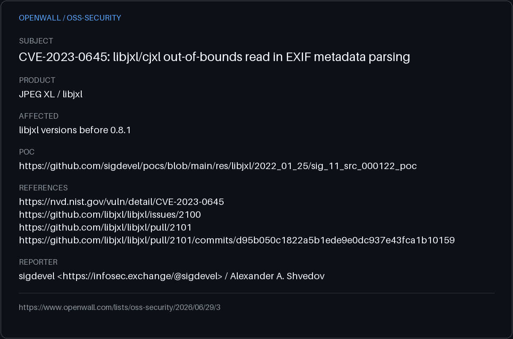](https://www.openwall.com/lists/oss-security/2026/06/29/3)

[Links and details (TXT)](openwall-2026-06-29-3/openwall-2026-06-29-3.txt)

Source: <https://www.openwall.com/lists/oss-security/2026/06/29/3>

**PoC:**

- <https://github.com/sigdevel/pocs/blob/main/res/libjxl/2022_01_25/sig_11_src_000122_poc>

**References:**

- <https://nvd.nist.gov/vuln/detail/CVE-2023-0645>
- <https://github.com/libjxl/libjxl/issues/2100>
- <https://github.com/libjxl/libjxl/pull/2101>
- <https://github.com/libjxl/libjxl/pull/2101/commits/d95b050c1822a5b1ede9e0dc937e43fca1b10159>

## CVE-2025-70103: Heap-based Buffer Overflow in libjxl/cjxl via jxl::extras::DecodeImagePNM on crafted PBM file

[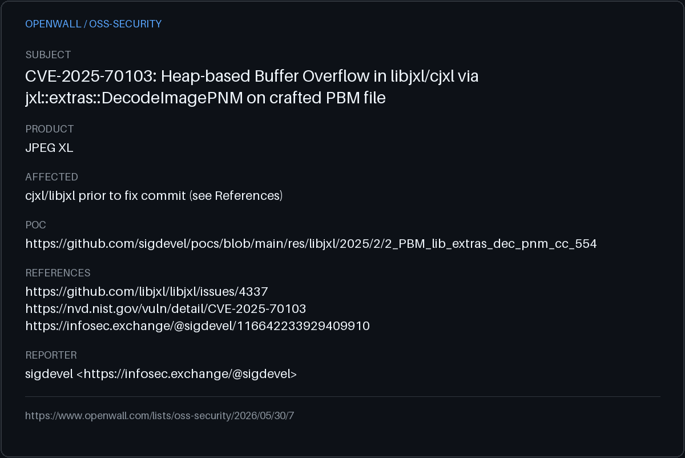](https://www.openwall.com/lists/oss-security/2026/05/30/7)

[Links and details (TXT)](openwall-2026-05-30-7/openwall-2026-05-30-7.txt)

Source: <https://www.openwall.com/lists/oss-security/2026/05/30/7>

**PoC:**

- <https://github.com/sigdevel/pocs/blob/main/res/libjxl/2025/2/2_PBM_lib_extras_dec_pnm_cc_554>

**References:**

- <https://github.com/libjxl/libjxl/issues/4337>
- <https://nvd.nist.gov/vuln/detail/CVE-2025-70103>
- <https://infosec.exchange/@sigdevel/116642233929409910>

## CVE-2025-70099: lwext4 NULL pointer dereference in ext4_dir_en_get_name_len

[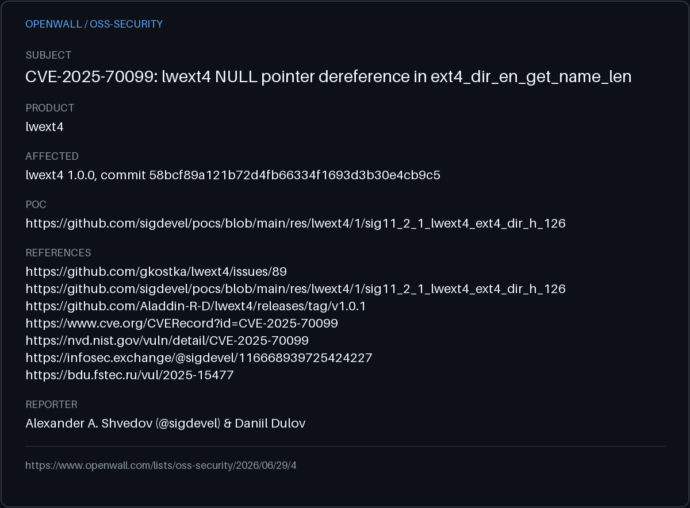](https://www.openwall.com/lists/oss-security/2026/06/29/4)

[Links and details (TXT)](openwall-2026-06-29-4/openwall-2026-06-29-4.txt)

Source: <https://www.openwall.com/lists/oss-security/2026/06/29/4>

**PoC:**

- <https://github.com/sigdevel/pocs/blob/main/res/lwext4/1/sig11_2_1_lwext4_ext4_dir_h_126>

**References:**

- <https://github.com/gkostka/lwext4/issues/89>
- <https://github.com/sigdevel/pocs/blob/main/res/lwext4/1/sig11_2_1_lwext4_ext4_dir_h_126>
- <https://github.com/Aladdin-R-D/lwext4/releases/tag/v1.0.1>
- <https://www.cve.org/CVERecord?id=CVE-2025-70099>
- <https://nvd.nist.gov/vuln/detail/CVE-2025-70099>
- <https://infosec.exchange/@sigdevel/116668939725424227>
- <https://bdu.fstec.ru/vul/2025-15477>

## CVE-2025-70100: lwext4 divide-by-zero in ext4_block_set_lb_size

[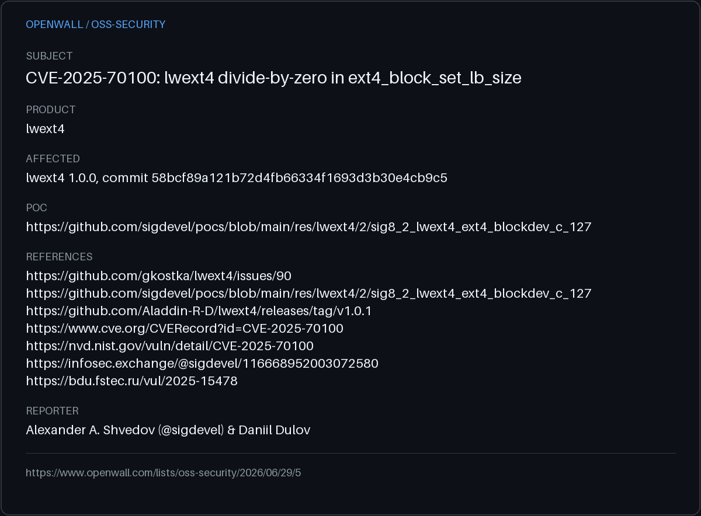](https://www.openwall.com/lists/oss-security/2026/06/29/5)

[Links and details (TXT)](openwall-2026-06-29-5/openwall-2026-06-29-5.txt)

Source: <https://www.openwall.com/lists/oss-security/2026/06/29/5>

**PoC:**

- <https://github.com/sigdevel/pocs/blob/main/res/lwext4/2/sig8_2_lwext4_ext4_blockdev_c_127>

**References:**

- <https://github.com/gkostka/lwext4/issues/90>
- <https://github.com/sigdevel/pocs/blob/main/res/lwext4/2/sig8_2_lwext4_ext4_blockdev_c_127>
- <https://github.com/Aladdin-R-D/lwext4/releases/tag/v1.0.1>
- <https://www.cve.org/CVERecord?id=CVE-2025-70100>
- <https://nvd.nist.gov/vuln/detail/CVE-2025-70100>
- <https://infosec.exchange/@sigdevel/116668952003072580>
- <https://bdu.fstec.ru/vul/2025-15478>

## CVE-2025-70101: lwext4 out-of-bounds read in ext4_ext_binsearch_idx

[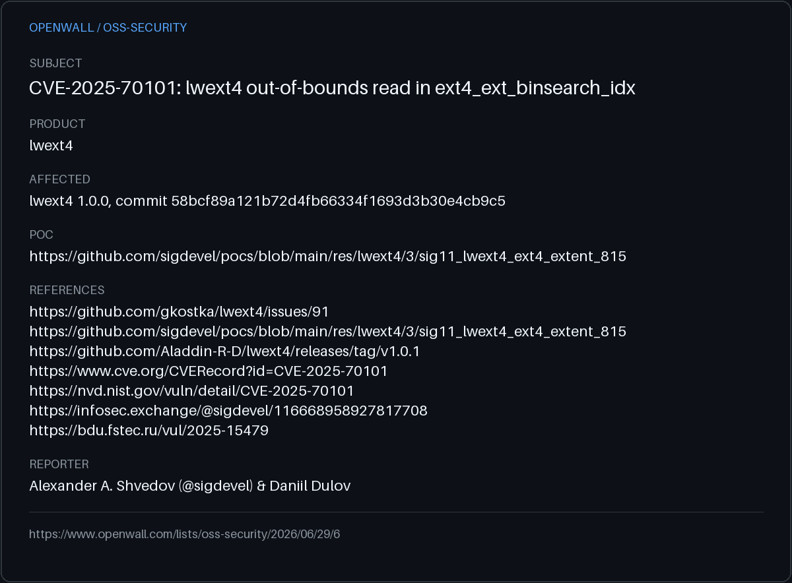](https://www.openwall.com/lists/oss-security/2026/06/29/6)

[Links and details (TXT)](openwall-2026-06-29-6/openwall-2026-06-29-6.txt)

Source: <https://www.openwall.com/lists/oss-security/2026/06/29/6>

**PoC:**

- <https://github.com/sigdevel/pocs/blob/main/res/lwext4/3/sig11_lwext4_ext4_extent_815>

**References:**

- <https://github.com/gkostka/lwext4/issues/91>
- <https://github.com/sigdevel/pocs/blob/main/res/lwext4/3/sig11_lwext4_ext4_extent_815>
- <https://github.com/Aladdin-R-D/lwext4/releases/tag/v1.0.1>
- <https://www.cve.org/CVERecord?id=CVE-2025-70101>
- <https://nvd.nist.gov/vuln/detail/CVE-2025-70101>
- <https://infosec.exchange/@sigdevel/116668958927817708>
- <https://bdu.fstec.ru/vul/2025-15479>

## CVE-2025-55639: NULL Pointer Dereference in GPAC/MP4Box via gf_isom_add_track_kind on crafted MP4 file

[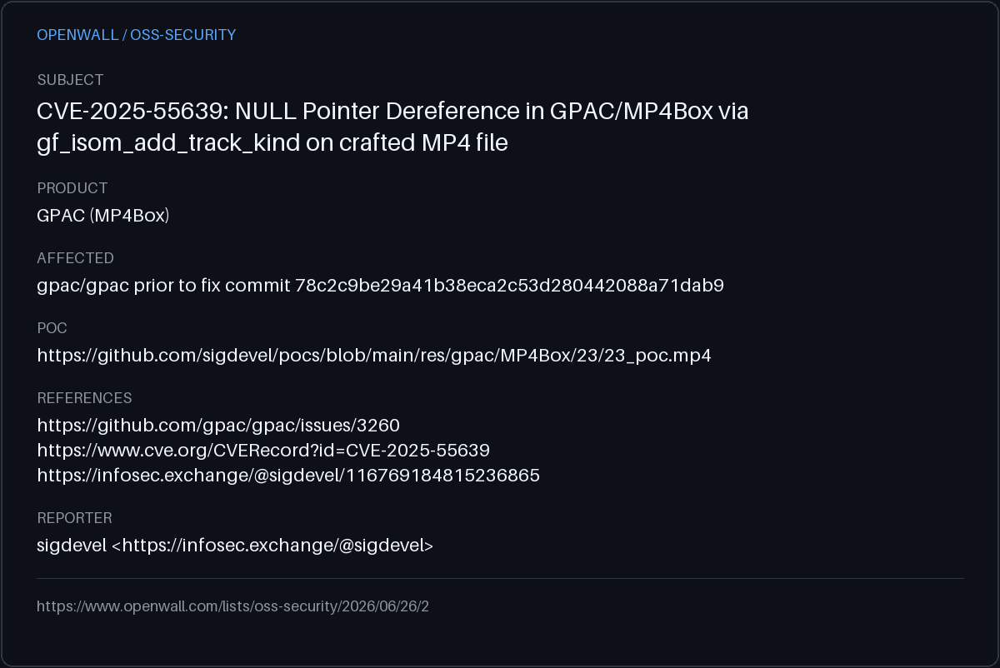](https://www.openwall.com/lists/oss-security/2026/06/26/2)

[Links and details (TXT)](openwall-2026-06-26-2/openwall-2026-06-26-2.txt)

Source: <https://www.openwall.com/lists/oss-security/2026/06/26/2>

**PoC:**

- <https://github.com/sigdevel/pocs/blob/main/res/gpac/MP4Box/23/23_poc.mp4>

**References:**

- <https://github.com/gpac/gpac/issues/3260>
- <https://www.cve.org/CVERecord?id=CVE-2025-55639>
- <https://infosec.exchange/@sigdevel/116769184815236865>

## CVE-2025-60471: Use-After-Free in GPAC/MP4Box via gf_filter_pid_reconfigure_task_discard on crafted MPEG-2 TS file

[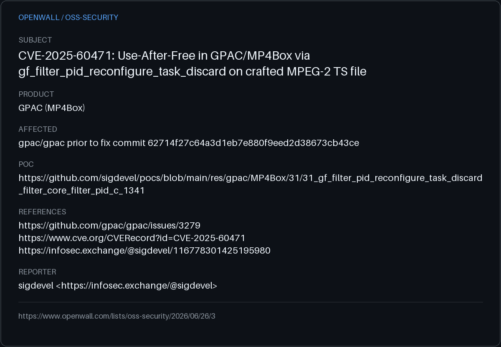](https://www.openwall.com/lists/oss-security/2026/06/26/3)

[Links and details (TXT)](openwall-2026-06-26-3/openwall-2026-06-26-3.txt)

Source: <https://www.openwall.com/lists/oss-security/2026/06/26/3>

**PoC:**

- <https://github.com/sigdevel/pocs/blob/main/res/gpac/MP4Box/31/31_gf_filter_pid_reconfigure_task_discard_filter_core_filter_pid_c_1341>

**References:**

- <https://github.com/gpac/gpac/issues/3279>
- <https://www.cve.org/CVERecord?id=CVE-2025-60471>
- <https://infosec.exchange/@sigdevel/116778301425195980>

## CVE-2025-60464: NULL Pointer Dereference in GPAC/MP4Box via gf_sei_load_from_state_internal on crafted MPEG-2 TS file

[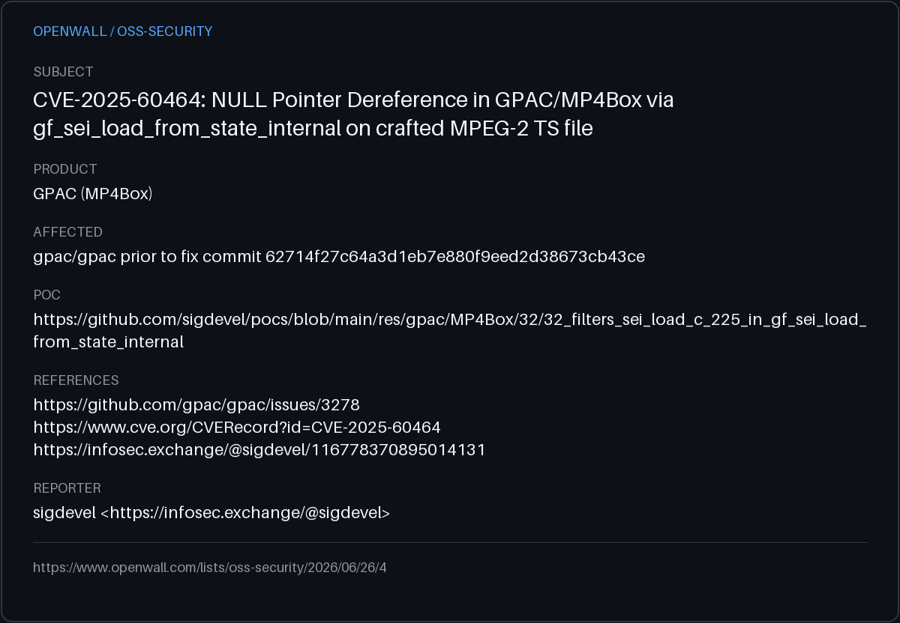](https://www.openwall.com/lists/oss-security/2026/06/26/4)

[Links and details (TXT)](openwall-2026-06-26-4/openwall-2026-06-26-4.txt)

Source: <https://www.openwall.com/lists/oss-security/2026/06/26/4>

**PoC:**

- <https://github.com/sigdevel/pocs/blob/main/res/gpac/MP4Box/32/32_filters_sei_load_c_225_in_gf_sei_load_from_state_internal>

**References:**

- <https://github.com/gpac/gpac/issues/3278>
- <https://www.cve.org/CVERecord?id=CVE-2025-60464>
- <https://infosec.exchange/@sigdevel/116778370895014131>

## CVE-2025-60474: Heap-based Buffer Overflow in GPAC/MP4Box via gf_media_import on crafted MPEG-2 TS file

[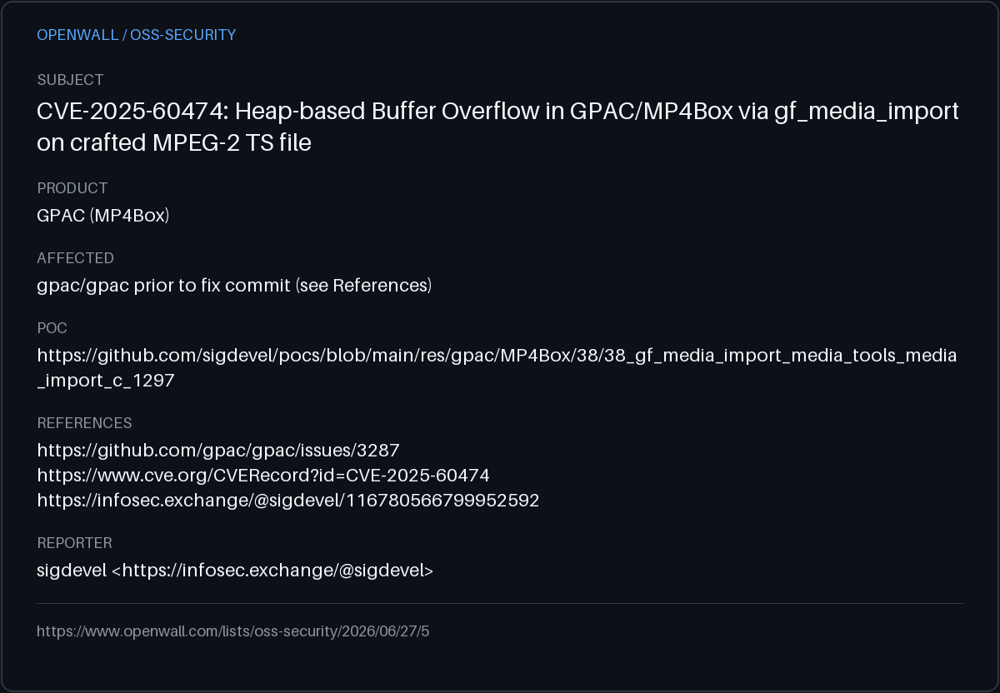](https://www.openwall.com/lists/oss-security/2026/06/27/5)

[Links and details (TXT)](openwall-2026-06-27-5/openwall-2026-06-27-5.txt)

Source: <https://www.openwall.com/lists/oss-security/2026/06/27/5>

**PoC:**

- <https://github.com/sigdevel/pocs/blob/main/res/gpac/MP4Box/38/38_gf_media_import_media_tools_media_import_c_1297>

**References:**

- <https://github.com/gpac/gpac/issues/3287>
- <https://www.cve.org/CVERecord?id=CVE-2025-60474>
- <https://infosec.exchange/@sigdevel/116780566799952592>

## CVE-2025-60466: Expired Pointer Dereference in GPAC/MP4Box via gf_filter_pid_get_packet on crafted MPEG-2 TS file

[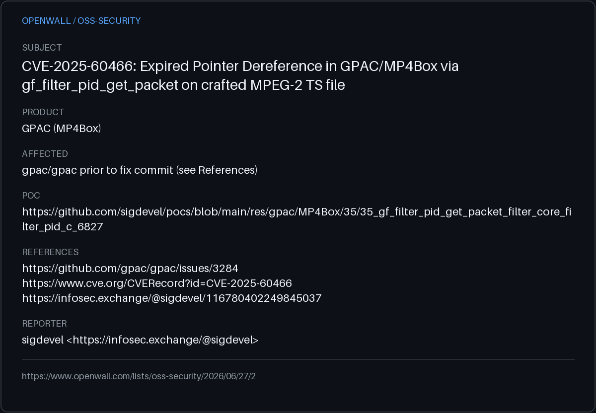](https://www.openwall.com/lists/oss-security/2026/06/27/2)

[Links and details (TXT)](openwall-2026-06-27-2/openwall-2026-06-27-2.txt)

Source: <https://www.openwall.com/lists/oss-security/2026/06/27/2>

**PoC:**

- <https://github.com/sigdevel/pocs/blob/main/res/gpac/MP4Box/35/35_gf_filter_pid_get_packet_filter_core_filter_pid_c_6827>

**References:**

- <https://github.com/gpac/gpac/issues/3284>
- <https://www.cve.org/CVERecord?id=CVE-2025-60466>
- <https://infosec.exchange/@sigdevel/116780402249845037>

## CVE-2025-60473: NULL Pointer Dereference in GPAC/MP4Box via gf_filter_in_parent_chain on crafted MPEG-2 TS file

[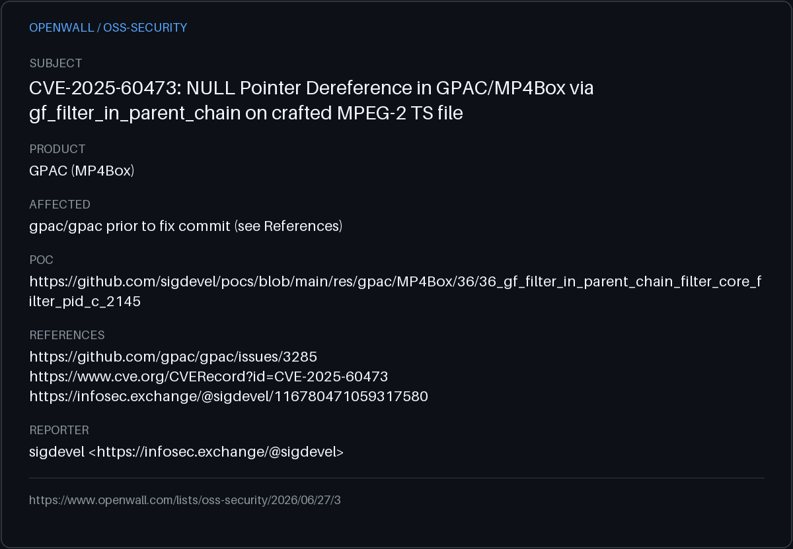](https://www.openwall.com/lists/oss-security/2026/06/27/3)

[Links and details (TXT)](openwall-2026-06-27-3/openwall-2026-06-27-3.txt)

Source: <https://www.openwall.com/lists/oss-security/2026/06/27/3>

**PoC:**

- <https://github.com/sigdevel/pocs/blob/main/res/gpac/MP4Box/36/36_gf_filter_in_parent_chain_filter_core_filter_pid_c_2145>

**References:**

- <https://github.com/gpac/gpac/issues/3285>
- <https://www.cve.org/CVERecord?id=CVE-2025-60473>
- <https://infosec.exchange/@sigdevel/116780471059317580>

## CVE-2025-60467: Use-After-Free in GPAC/MP4Box via gf_filter_pid_inst_swap_delete_task on crafted MPEG-2 TS file

[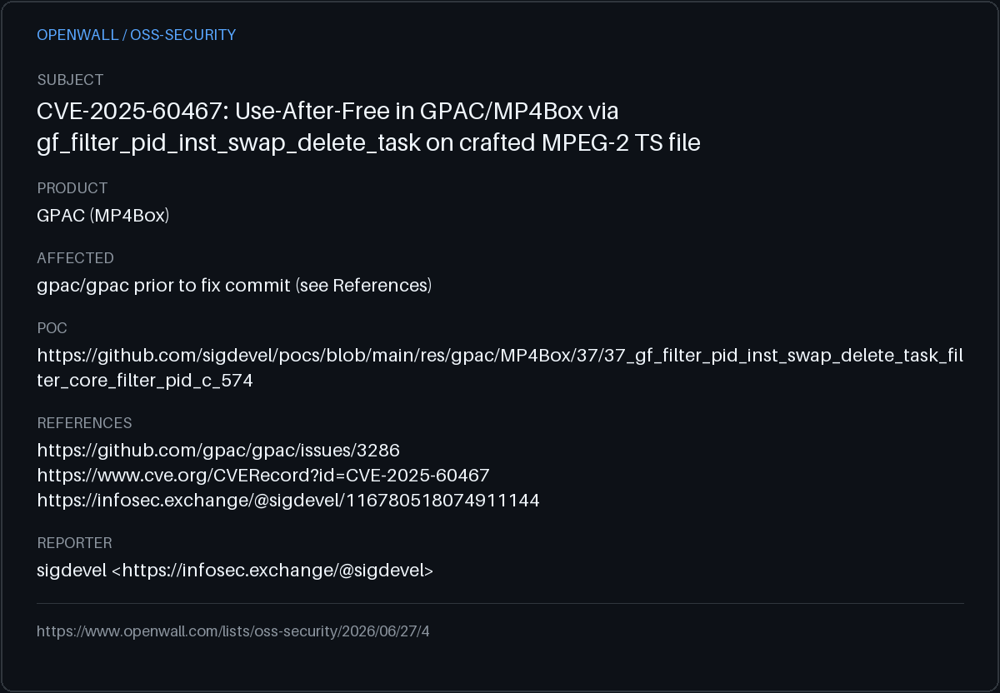](https://www.openwall.com/lists/oss-security/2026/06/27/4)

[Links and details (TXT)](openwall-2026-06-27-4/openwall-2026-06-27-4.txt)

Source: <https://www.openwall.com/lists/oss-security/2026/06/27/4>

**PoC:**

- <https://github.com/sigdevel/pocs/blob/main/res/gpac/MP4Box/37/37_gf_filter_pid_inst_swap_delete_task_filter_core_filter_pid_c_574>

**References:**

- <https://github.com/gpac/gpac/issues/3286>
- <https://www.cve.org/CVERecord?id=CVE-2025-60467>
- <https://infosec.exchange/@sigdevel/116780518074911144>

## CVE-2025-52292: Stack-based Buffer Overflow in GPAC/MP4Box via filein_process on crafted MP4 file during DASH segmentation

[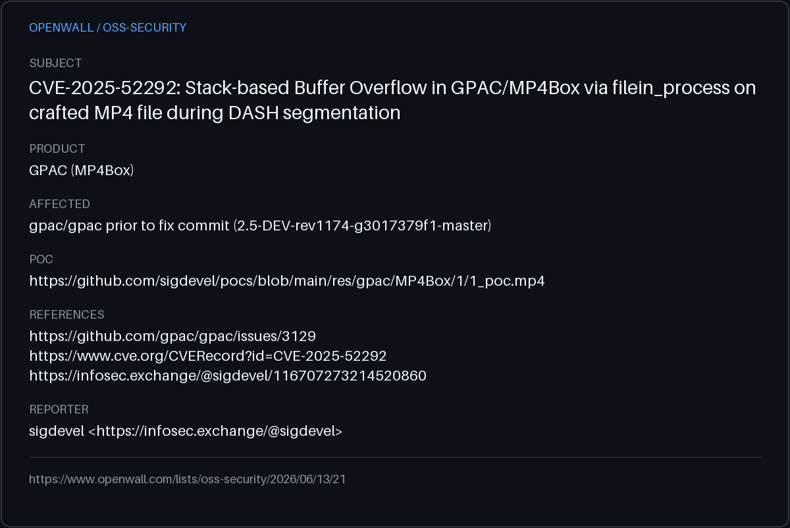](https://www.openwall.com/lists/oss-security/2026/06/13/21)

[Links and details (TXT)](openwall-2026-06-13-21/openwall-2026-06-13-21.txt)

Source: <https://www.openwall.com/lists/oss-security/2026/06/13/21>

**PoC:**

- <https://github.com/sigdevel/pocs/blob/main/res/gpac/MP4Box/1/1_poc.mp4>

**References:**

- <https://github.com/gpac/gpac/issues/3129>
- <https://www.cve.org/CVERecord?id=CVE-2025-52292>
- <https://infosec.exchange/@sigdevel/116707273214520860>

## CVE-2025-55662: Divide by Zero in GPAC/MP4Box via gf_opus_parse_packet_header on crafted MP4 file with malformed Opus header

[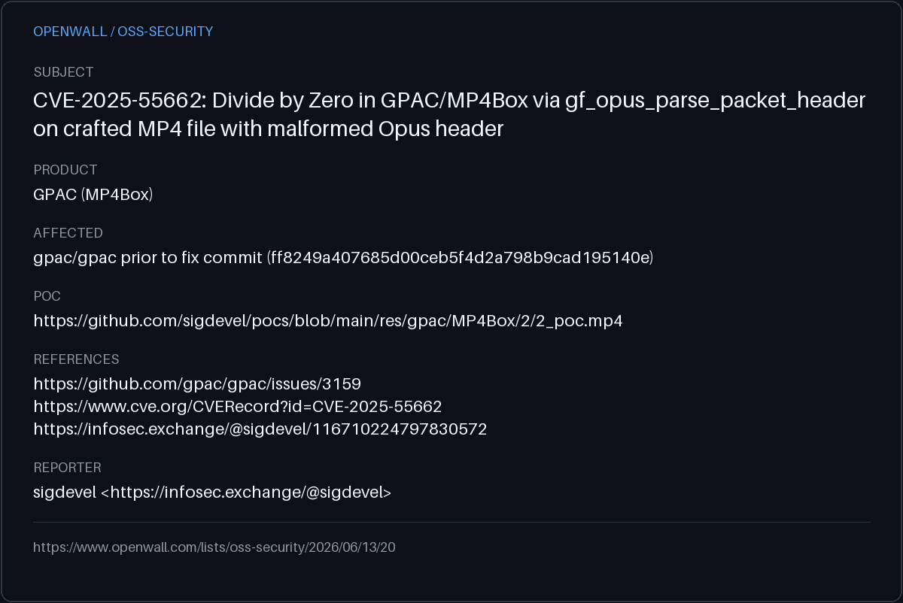](https://www.openwall.com/lists/oss-security/2026/06/13/20)

[Links and details (TXT)](openwall-2026-06-13-20/openwall-2026-06-13-20.txt)

Source: <https://www.openwall.com/lists/oss-security/2026/06/13/20>

**PoC:**

- <https://github.com/sigdevel/pocs/blob/main/res/gpac/MP4Box/2/2_poc.mp4>

**References:**

- <https://github.com/gpac/gpac/issues/3159>
- <https://www.cve.org/CVERecord?id=CVE-2025-55662>
- <https://infosec.exchange/@sigdevel/116710224797830572>

## CVE-2025-52293: Out-of-bounds Read in GPAC/MP4Box via gf_hevc_read_sps_bs_internal on crafted HEVC SPS in MP4 file

[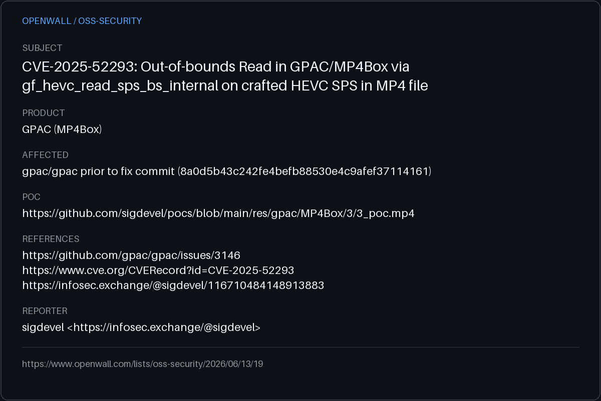](https://www.openwall.com/lists/oss-security/2026/06/13/19)

[Links and details (TXT)](openwall-2026-06-13-19/openwall-2026-06-13-19.txt)

Source: <https://www.openwall.com/lists/oss-security/2026/06/13/19>

**PoC:**

- <https://github.com/sigdevel/pocs/blob/main/res/gpac/MP4Box/3/3_poc.mp4>

**References:**

- <https://github.com/gpac/gpac/issues/3146>
- <https://www.cve.org/CVERecord?id=CVE-2025-52293>
- <https://infosec.exchange/@sigdevel/116710484148913883>

## CVE-2025-55651: NULL Pointer Dereference in GPAC/MP4Box via gf_isom_get_user_data_count on truncated MP4 input

[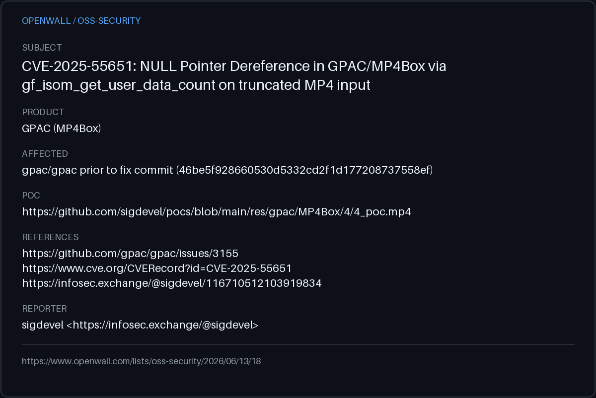](https://www.openwall.com/lists/oss-security/2026/06/13/18)

[Links and details (TXT)](openwall-2026-06-13-18/openwall-2026-06-13-18.txt)

Source: <https://www.openwall.com/lists/oss-security/2026/06/13/18>

**PoC:**

- <https://github.com/sigdevel/pocs/blob/main/res/gpac/MP4Box/4/4_poc.mp4>

**References:**

- <https://github.com/gpac/gpac/issues/3155>
- <https://www.cve.org/CVERecord?id=CVE-2025-55651>
- <https://infosec.exchange/@sigdevel/116710512103919834>

## CVE-2025-55659: NULL Pointer Dereference in GPAC/MP4Box via ctts_box_write on crafted MP4 file with negative timestamps

[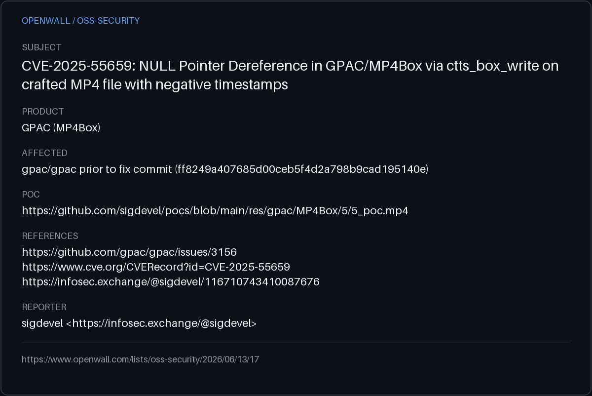](https://www.openwall.com/lists/oss-security/2026/06/13/17)

[Links and details (TXT)](openwall-2026-06-13-17/openwall-2026-06-13-17.txt)

Source: <https://www.openwall.com/lists/oss-security/2026/06/13/17>

**PoC:**

- <https://github.com/sigdevel/pocs/blob/main/res/gpac/MP4Box/5/5_poc.mp4>

**References:**

- <https://github.com/gpac/gpac/issues/3156>
- <https://www.cve.org/CVERecord?id=CVE-2025-55659>
- <https://infosec.exchange/@sigdevel/116710743410087676>

## CVE-2025-55657: NULL Pointer Dereference in GPAC/MP4Box via gf_odf_vvc_cfg_write_bs on crafted MP4 file with unsupported vvc16 box

[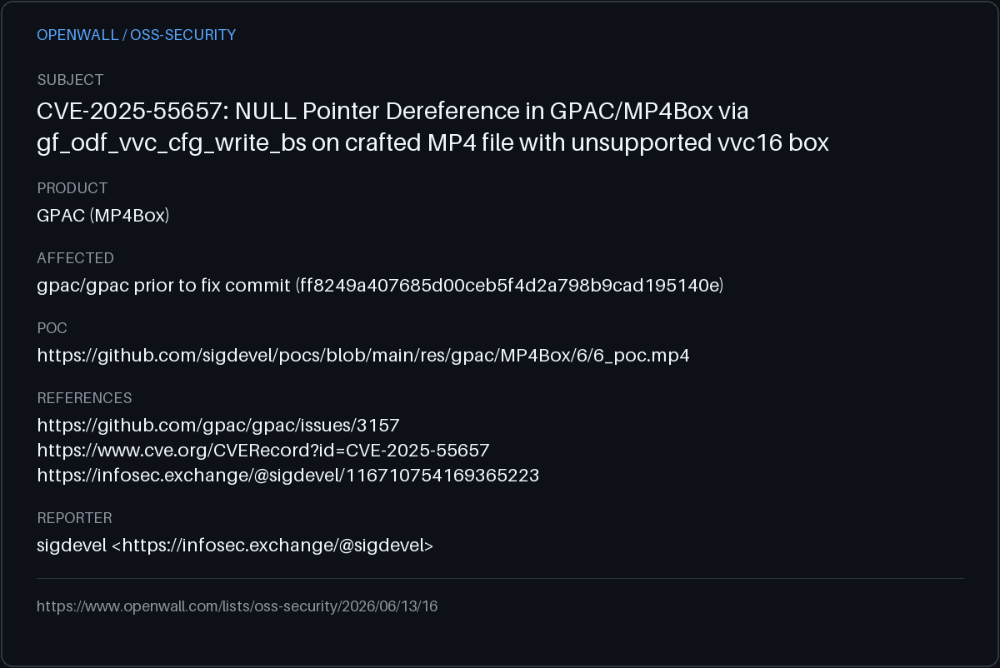](https://www.openwall.com/lists/oss-security/2026/06/13/16)

[Links and details (TXT)](openwall-2026-06-13-16/openwall-2026-06-13-16.txt)

Source: <https://www.openwall.com/lists/oss-security/2026/06/13/16>

**PoC:**

- <https://github.com/sigdevel/pocs/blob/main/res/gpac/MP4Box/6/6_poc.mp4>

**References:**

- <https://github.com/gpac/gpac/issues/3157>
- <https://www.cve.org/CVERecord?id=CVE-2025-55657>
- <https://infosec.exchange/@sigdevel/116710754169365223>

## CVE-2025-55660: Stack-based Buffer Overflow in GPAC/MP4Box via gf_opus_read_length on crafted MP4 file with malformed Opus packet

[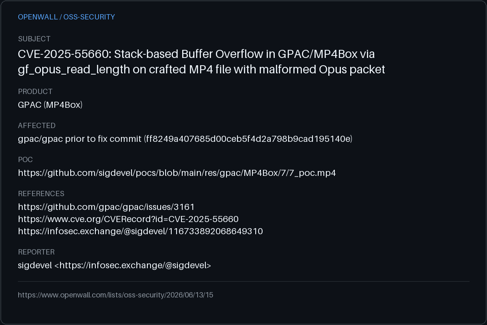](https://www.openwall.com/lists/oss-security/2026/06/13/15)

[Links and details (TXT)](openwall-2026-06-13-15/openwall-2026-06-13-15.txt)

Source: <https://www.openwall.com/lists/oss-security/2026/06/13/15>

**PoC:**

- <https://github.com/sigdevel/pocs/blob/main/res/gpac/MP4Box/7/7_poc.mp4>

**References:**

- <https://github.com/gpac/gpac/issues/3161>
- <https://www.cve.org/CVERecord?id=CVE-2025-55660>
- <https://infosec.exchange/@sigdevel/116733892068649310>

## CVE-2025-55663: NULL Pointer Dereference in GPAC/MP4Box via Track_SetStreamDescriptor on crafted MP4 with unknown svcC box in av01

[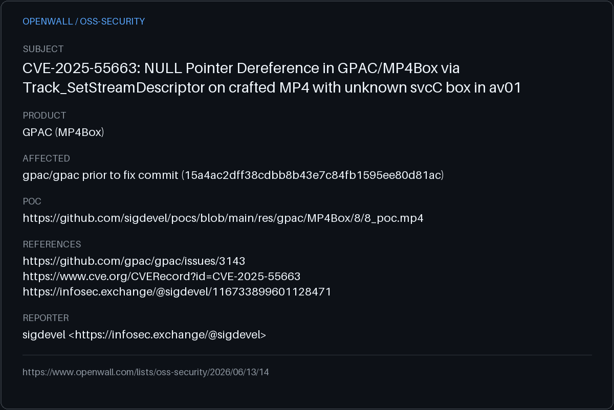](https://www.openwall.com/lists/oss-security/2026/06/13/14)

[Links and details (TXT)](openwall-2026-06-13-14/openwall-2026-06-13-14.txt)

Source: <https://www.openwall.com/lists/oss-security/2026/06/13/14>

**PoC:**

- <https://github.com/sigdevel/pocs/blob/main/res/gpac/MP4Box/8/8_poc.mp4>

**References:**

- <https://github.com/gpac/gpac/issues/3143>
- <https://www.cve.org/CVERecord?id=CVE-2025-55663>
- <https://infosec.exchange/@sigdevel/116733899601128471>

## CVE-2025-55661: Heap-based Buffer Overflow in GPAC/MP4Box via gf_opus_parse_packet_header on crafted MP4 file with malformed Opus packet

[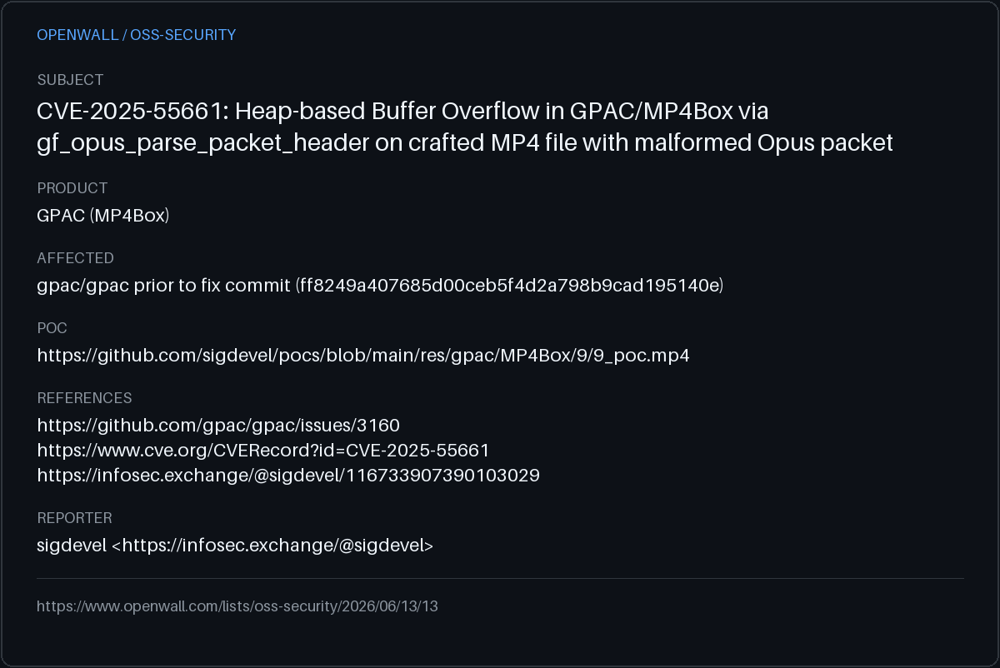](https://www.openwall.com/lists/oss-security/2026/06/13/13)

[Links and details (TXT)](openwall-2026-06-13-13/openwall-2026-06-13-13.txt)

Source: <https://www.openwall.com/lists/oss-security/2026/06/13/13>

**PoC:**

- <https://github.com/sigdevel/pocs/blob/main/res/gpac/MP4Box/9/9_poc.mp4>

**References:**

- <https://github.com/gpac/gpac/issues/3160>
- <https://www.cve.org/CVERecord?id=CVE-2025-55661>
- <https://infosec.exchange/@sigdevel/116733907390103029>

## CVE-2025-55650: Use-After-Free in GPAC/MP4Box via gf_svg_node_del on crafted MP4 file processed with -svg

[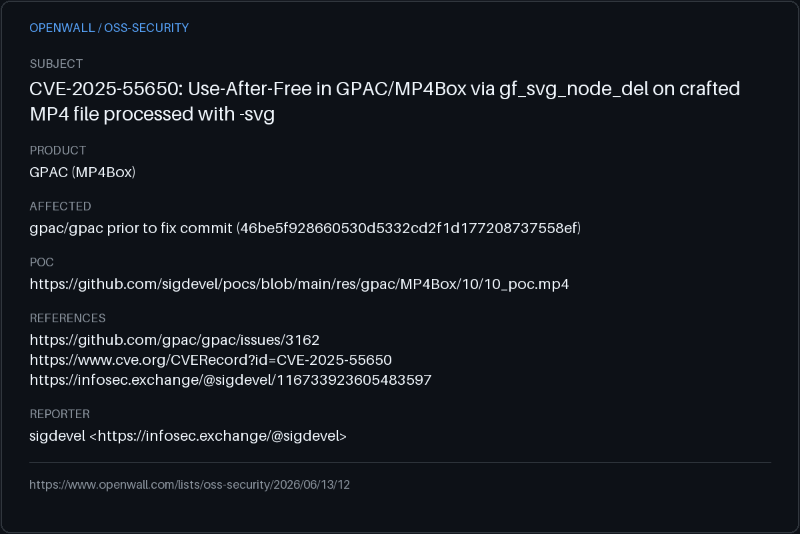](https://www.openwall.com/lists/oss-security/2026/06/13/12)

[Links and details (TXT)](openwall-2026-06-13-12/openwall-2026-06-13-12.txt)

Source: <https://www.openwall.com/lists/oss-security/2026/06/13/12>

**PoC:**

- <https://github.com/sigdevel/pocs/blob/main/res/gpac/MP4Box/10/10_poc.mp4>

**References:**

- <https://github.com/gpac/gpac/issues/3162>
- <https://www.cve.org/CVERecord?id=CVE-2025-55650>
- <https://infosec.exchange/@sigdevel/116733923605483597>

## CVE-2025-55649: NULL Pointer Dereference in GPAC/MP4Box via gf_media_map_esd on crafted MP4 with corrupted ESD data

[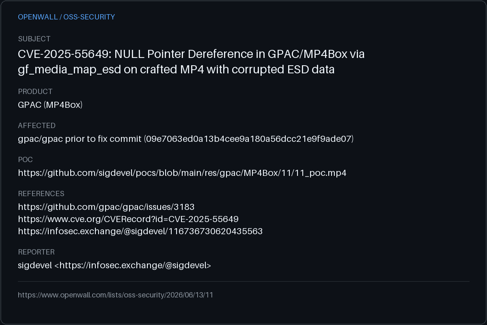](https://www.openwall.com/lists/oss-security/2026/06/13/11)

[Links and details (TXT)](openwall-2026-06-13-11/openwall-2026-06-13-11.txt)

Source: <https://www.openwall.com/lists/oss-security/2026/06/13/11>

**PoC:**

- <https://github.com/sigdevel/pocs/blob/main/res/gpac/MP4Box/11/11_poc.mp4>

**References:**

- <https://github.com/gpac/gpac/issues/3183>
- <https://www.cve.org/CVERecord?id=CVE-2025-55649>
- <https://infosec.exchange/@sigdevel/116736730620435563>

## CVE-2025-55648: Heap-based Buffer Overflow in GPAC/MP4Box via gf_opus_parse_packet_header on crafted MP4 with corrupted stsz data

[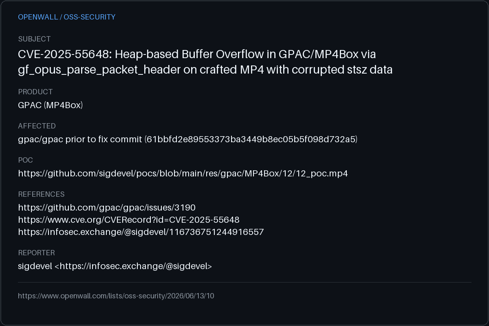](https://www.openwall.com/lists/oss-security/2026/06/13/10)

[Links and details (TXT)](openwall-2026-06-13-10/openwall-2026-06-13-10.txt)

Source: <https://www.openwall.com/lists/oss-security/2026/06/13/10>

**PoC:**

- <https://github.com/sigdevel/pocs/blob/main/res/gpac/MP4Box/12/12_poc.mp4>

**References:**

- <https://github.com/gpac/gpac/issues/3190>
- <https://www.cve.org/CVERecord?id=CVE-2025-55648>
- <https://infosec.exchange/@sigdevel/116736751244916557>

## CVE-2025-55641: NULL Pointer Dereference in GPAC/MP4Box via gf_isom_copy_sample_info on crafted MP4 file with corrupted SAI metadata

[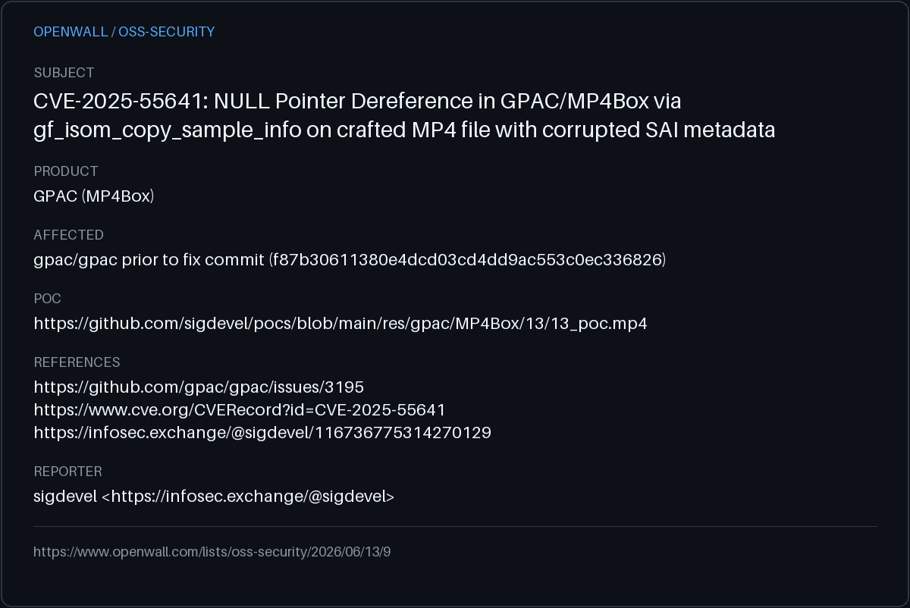](https://www.openwall.com/lists/oss-security/2026/06/13/9)

[Links and details (TXT)](openwall-2026-06-13-9/openwall-2026-06-13-9.txt)

Source: <https://www.openwall.com/lists/oss-security/2026/06/13/9>

**PoC:**

- <https://github.com/sigdevel/pocs/blob/main/res/gpac/MP4Box/13/13_poc.mp4>

**References:**

- <https://github.com/gpac/gpac/issues/3195>
- <https://www.cve.org/CVERecord?id=CVE-2025-55641>
- <https://infosec.exchange/@sigdevel/116736775314270129>

## CVE-2025-55642: Divide by Zero in GPAC/MP4Box via avidmx_process on crafted AVI input with zero declared frames

[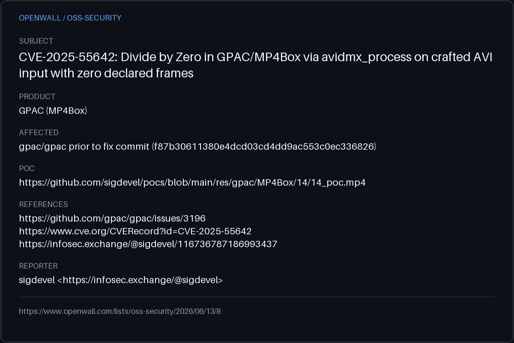](https://www.openwall.com/lists/oss-security/2026/06/13/8)

[Links and details (TXT)](openwall-2026-06-13-8/openwall-2026-06-13-8.txt)

Source: <https://www.openwall.com/lists/oss-security/2026/06/13/8>

**PoC:**

- <https://github.com/sigdevel/pocs/blob/main/res/gpac/MP4Box/14/14_poc.mp4>

**References:**

- <https://github.com/gpac/gpac/issues/3196>
- <https://www.cve.org/CVERecord?id=CVE-2025-55642>
- <https://infosec.exchange/@sigdevel/116736787186993437>

## CVE-2025-55647: Integer Overflow in GPAC/MP4Box via mp4_mux_cenc_insert_pssh on crafted MP4 with oversized PSSH metadata

[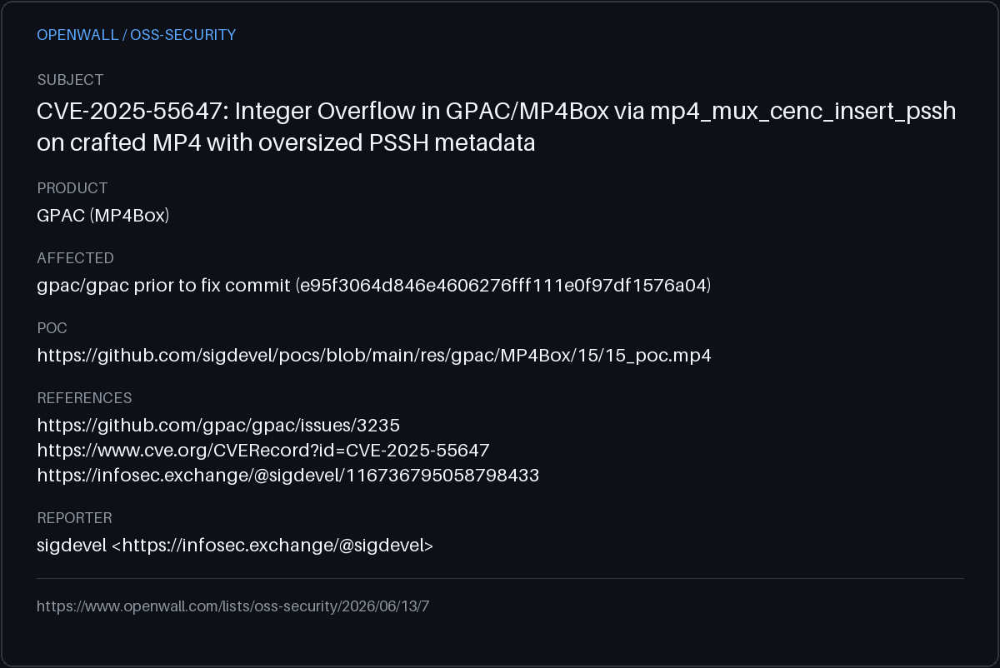](https://www.openwall.com/lists/oss-security/2026/06/13/7)

[Links and details (TXT)](openwall-2026-06-13-7/openwall-2026-06-13-7.txt)

Source: <https://www.openwall.com/lists/oss-security/2026/06/13/7>

**PoC:**

- <https://github.com/sigdevel/pocs/blob/main/res/gpac/MP4Box/15/15_poc.mp4>

**References:**

- <https://github.com/gpac/gpac/issues/3235>
- <https://www.cve.org/CVERecord?id=CVE-2025-55647>
- <https://infosec.exchange/@sigdevel/116736795058798433>

## CVE-2025-55645: Heap-based Buffer Overflow in GPAC/MP4Box via gf_cenc_set_pssh on crafted MP4 with oversized PSSH payload

[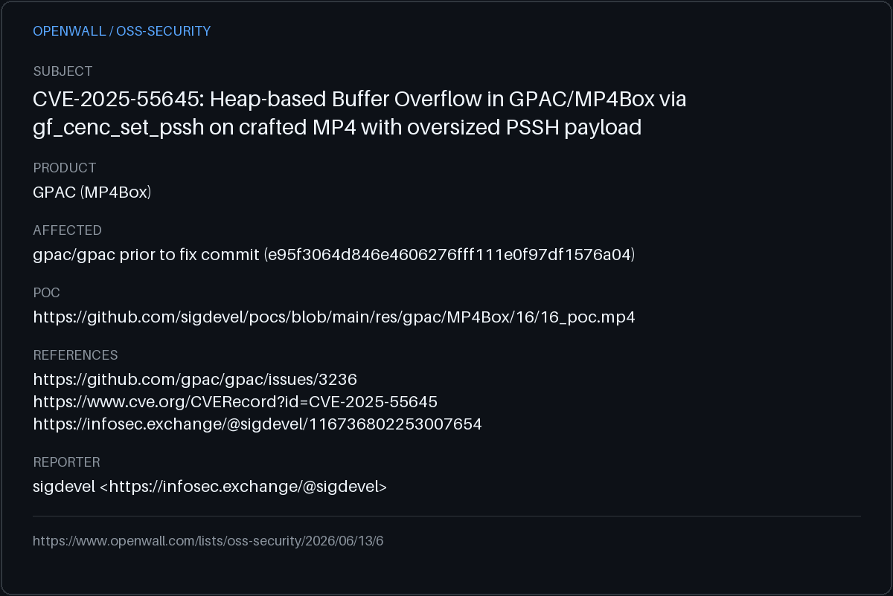](https://www.openwall.com/lists/oss-security/2026/06/13/6)

[Links and details (TXT)](openwall-2026-06-13-6/openwall-2026-06-13-6.txt)

Source: <https://www.openwall.com/lists/oss-security/2026/06/13/6>

**PoC:**

- <https://github.com/sigdevel/pocs/blob/main/res/gpac/MP4Box/16/16_poc.mp4>

**References:**

- <https://github.com/gpac/gpac/issues/3236>
- <https://www.cve.org/CVERecord?id=CVE-2025-55645>
- <https://infosec.exchange/@sigdevel/116736802253007654>

## CVE-2025-55643: NULL Pointer Dereference in GPAC/MP4Box via TrackWriter handling on crafted MP4 with malformed mvcC/stsz metadata during DASH segmentation

[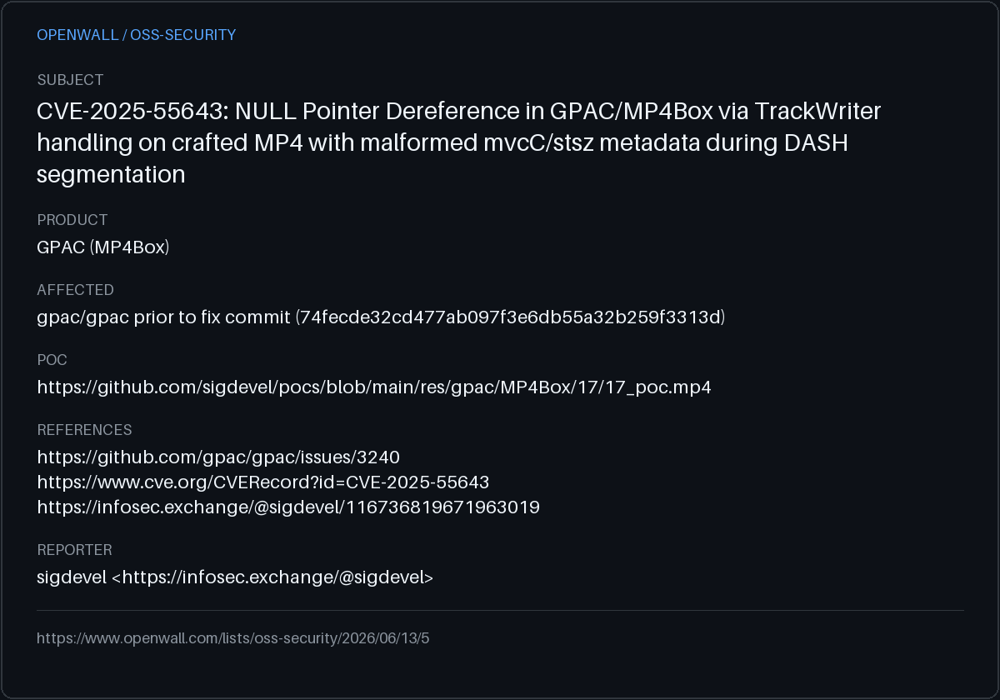](https://www.openwall.com/lists/oss-security/2026/06/13/5)

[Links and details (TXT)](openwall-2026-06-13-5/openwall-2026-06-13-5.txt)

Source: <https://www.openwall.com/lists/oss-security/2026/06/13/5>

**PoC:**

- <https://github.com/sigdevel/pocs/blob/main/res/gpac/MP4Box/17/17_poc.mp4>

**References:**

- <https://github.com/gpac/gpac/issues/3240>
- <https://www.cve.org/CVERecord?id=CVE-2025-55643>
- <https://infosec.exchange/@sigdevel/116736819671963019>

## CVE-2025-55652: Heap-based Buffer Overflow in GPAC/MP4Box via gf_isom_vp_config_new on crafted MP4 with malformed VP codec configuration

[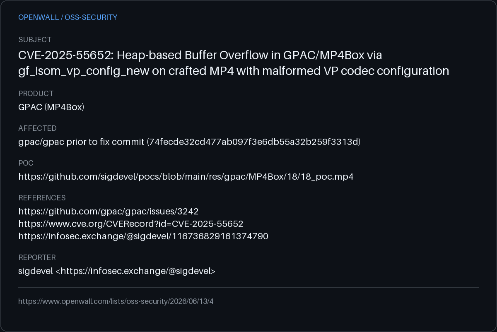](https://www.openwall.com/lists/oss-security/2026/06/13/4)

[Links and details (TXT)](openwall-2026-06-13-4/openwall-2026-06-13-4.txt)

Source: <https://www.openwall.com/lists/oss-security/2026/06/13/4>

**PoC:**

- <https://github.com/sigdevel/pocs/blob/main/res/gpac/MP4Box/18/18_poc.mp4>

**References:**

- <https://github.com/gpac/gpac/issues/3242>
- <https://www.cve.org/CVERecord?id=CVE-2025-55652>
- <https://infosec.exchange/@sigdevel/116736829161374790>

## CVE-2025-55644: Use-After-Free in GPAC/MP4Box via gf_node_get_tag on crafted MP4 file with invalid BIFS GlobalQuantizer command

[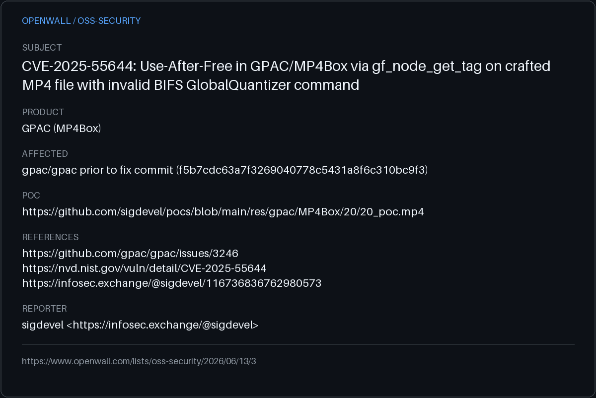](https://www.openwall.com/lists/oss-security/2026/06/13/3)

[Links and details (TXT)](openwall-2026-06-13-3/openwall-2026-06-13-3.txt)

Source: <https://www.openwall.com/lists/oss-security/2026/06/13/3>

**PoC:**

- <https://github.com/sigdevel/pocs/blob/main/res/gpac/MP4Box/20/20_poc.mp4>

**References:**

- <https://github.com/gpac/gpac/issues/3246>
- <https://nvd.nist.gov/vuln/detail/CVE-2025-55644>
- <https://infosec.exchange/@sigdevel/116736836762980573>

## CVE-2025-70116: NULL Pointer Dereference in GPAC/MP4Box via gf_media_map_esd on truncated MP4 input

[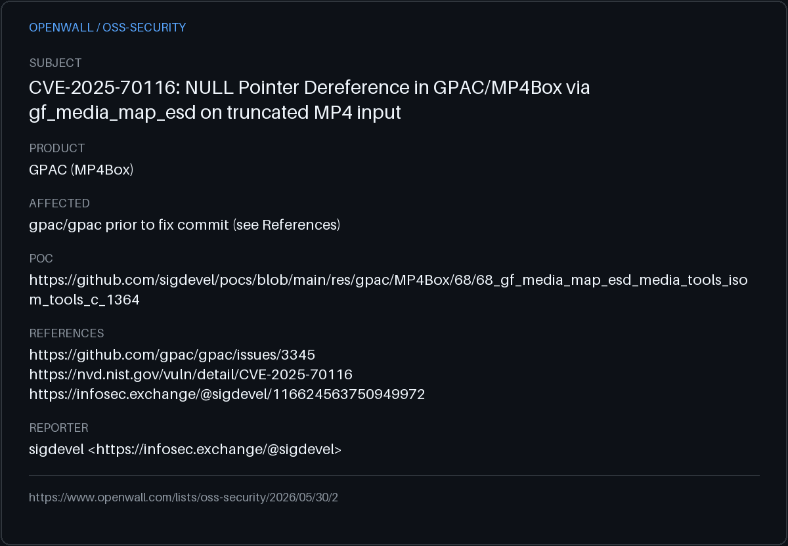](https://www.openwall.com/lists/oss-security/2026/05/30/2)

[Links and details (TXT)](openwall-2026-05-30-2/openwall-2026-05-30-2.txt)

Source: <https://www.openwall.com/lists/oss-security/2026/05/30/2>

**PoC:**

- <https://github.com/sigdevel/pocs/blob/main/res/gpac/MP4Box/68/68_gf_media_map_esd_media_tools_isom_tools_c_1364>

**References:**

- <https://github.com/gpac/gpac/issues/3345>
- <https://nvd.nist.gov/vuln/detail/CVE-2025-70116>
- <https://infosec.exchange/@sigdevel/116624563750949972>

## CVE-2025-60481: NULL Pointer Dereference in GPAC/MP4Box via gf_odf_ac4_cfg_dsi_v1 on crafted AC-4 stream

[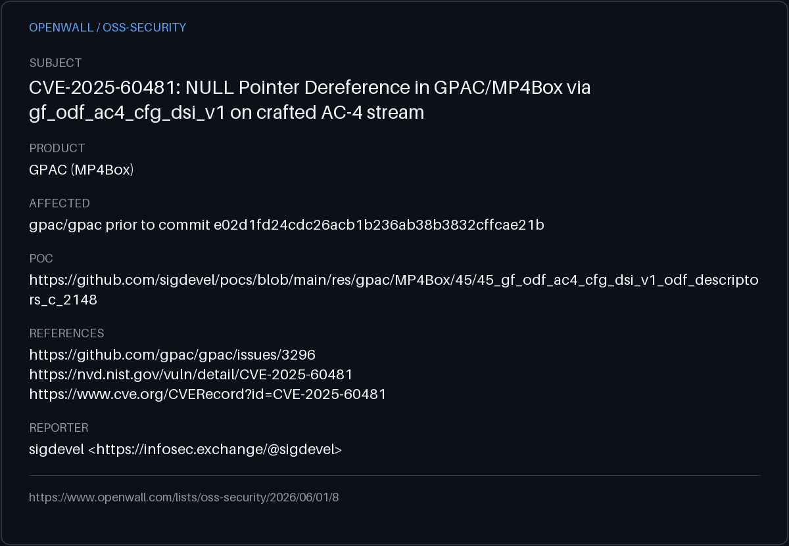](https://www.openwall.com/lists/oss-security/2026/06/01/8)

[Links and details (TXT)](openwall-2026-06-01-8/openwall-2026-06-01-8.txt)

Source: <https://www.openwall.com/lists/oss-security/2026/06/01/8>

**PoC:**

- <https://github.com/sigdevel/pocs/blob/main/res/gpac/MP4Box/45/45_gf_odf_ac4_cfg_dsi_v1_odf_descriptors_c_2148>

**References:**

- <https://github.com/gpac/gpac/issues/3296>
- <https://nvd.nist.gov/vuln/detail/CVE-2025-60481>
- <https://www.cve.org/CVERecord?id=CVE-2025-60481>

## CVE-2025-60483: NULL Pointer Dereference in GPAC/MP4Box via gf_ac4_pres_b_4_back_channels_present on crafted AC-4 stream

[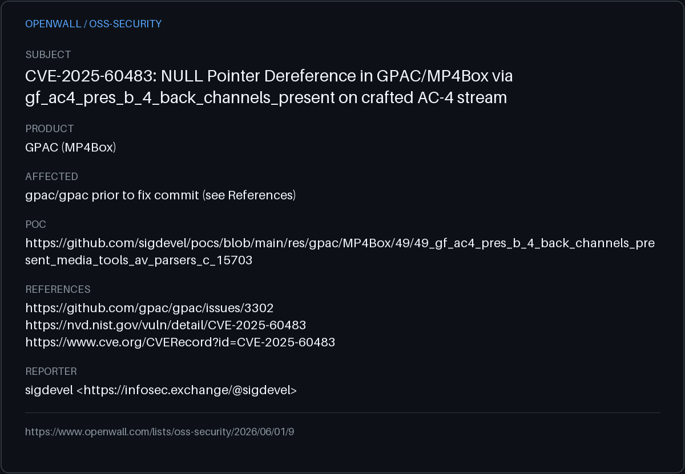](https://www.openwall.com/lists/oss-security/2026/06/01/9)

[Links and details (TXT)](openwall-2026-06-01-9/openwall-2026-06-01-9.txt)

Source: <https://www.openwall.com/lists/oss-security/2026/06/01/9>

**PoC:**

- <https://github.com/sigdevel/pocs/blob/main/res/gpac/MP4Box/49/49_gf_ac4_pres_b_4_back_channels_present_media_tools_av_parsers_c_15703>

**References:**

- <https://github.com/gpac/gpac/issues/3302>
- <https://nvd.nist.gov/vuln/detail/CVE-2025-60483>
- <https://www.cve.org/CVERecord?id=CVE-2025-60483>

## CVE-2025-55664: Heap-based Buffer Overflow in GPAC/MP4Box via m2tsdmx_send_packet on crafted MPEG-2 TS file

[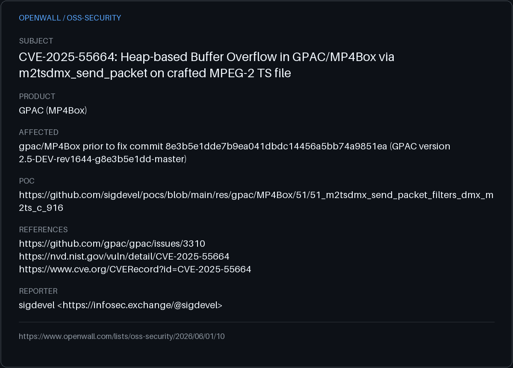](https://www.openwall.com/lists/oss-security/2026/06/01/10)

[Links and details (TXT)](openwall-2026-06-01-10/openwall-2026-06-01-10.txt)

Source: <https://www.openwall.com/lists/oss-security/2026/06/01/10>

**PoC:**

- <https://github.com/sigdevel/pocs/blob/main/res/gpac/MP4Box/51/51_m2tsdmx_send_packet_filters_dmx_m2ts_c_916>

**References:**

- <https://github.com/gpac/gpac/issues/3310>
- <https://nvd.nist.gov/vuln/detail/CVE-2025-55664>
- <https://www.cve.org/CVERecord?id=CVE-2025-55664>

## CVE-2025-60485: NULL Pointer Dereference in GPAC/MP4Box via gf_isom_apple_set_tag_ex on crafted MP4 with corrupted esds box

[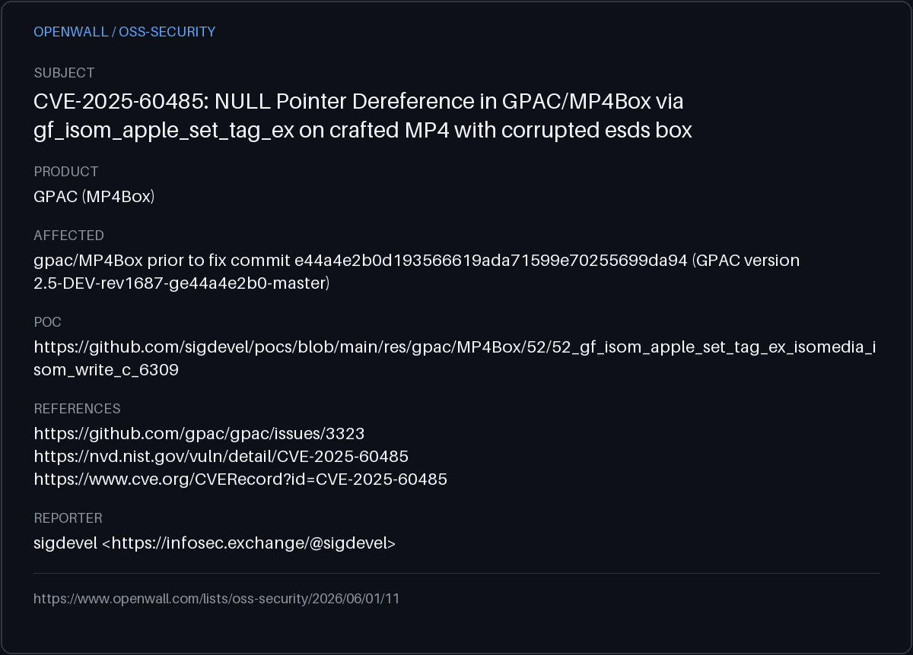](https://www.openwall.com/lists/oss-security/2026/06/01/11)

[Links and details (TXT)](openwall-2026-06-01-11/openwall-2026-06-01-11.txt)

Source: <https://www.openwall.com/lists/oss-security/2026/06/01/11>

**PoC:**

- <https://github.com/sigdevel/pocs/blob/main/res/gpac/MP4Box/52/52_gf_isom_apple_set_tag_ex_isomedia_isom_write_c_6309>

**References:**

- <https://github.com/gpac/gpac/issues/3323>
- <https://nvd.nist.gov/vuln/detail/CVE-2025-60485>
- <https://www.cve.org/CVERecord?id=CVE-2025-60485>

## CVE-2025-60486: Use-After-Free in GPAC/MP4Box via dasher_process on crafted MPEG-2 TS file

[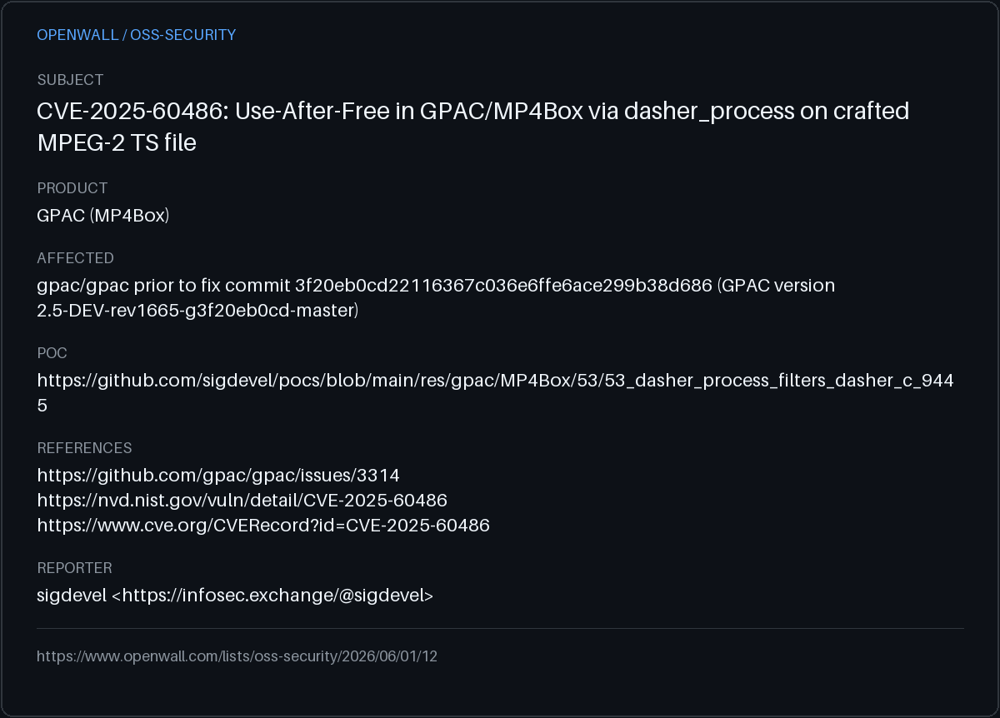](https://www.openwall.com/lists/oss-security/2026/06/01/12)

[Links and details (TXT)](openwall-2026-06-01-12/openwall-2026-06-01-12.txt)

Source: <https://www.openwall.com/lists/oss-security/2026/06/01/12>

**PoC:**

- <https://github.com/sigdevel/pocs/blob/main/res/gpac/MP4Box/53/53_dasher_process_filters_dasher_c_9445>

**References:**

- <https://github.com/gpac/gpac/issues/3314>
- <https://nvd.nist.gov/vuln/detail/CVE-2025-60486>
- <https://www.cve.org/CVERecord?id=CVE-2025-60486>

## CVE-2025-60495: NULL Pointer Dereference in GPAC/MP4Box via gf_media_get_color_info on crafted MP4 with inconsistent sample entry

[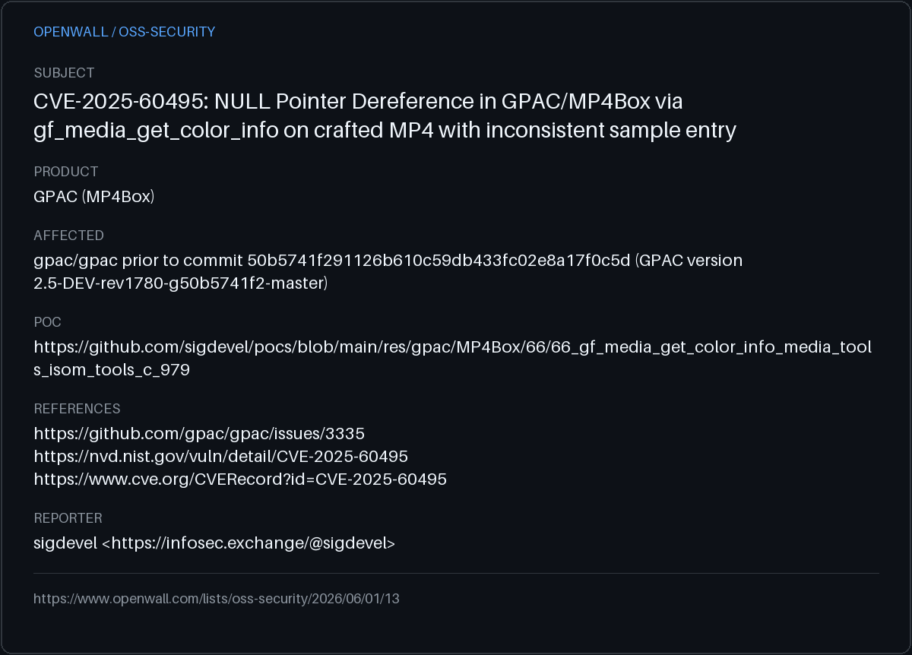](https://www.openwall.com/lists/oss-security/2026/06/01/13)

[Links and details (TXT)](openwall-2026-06-01-13/openwall-2026-06-01-13.txt)

Source: <https://www.openwall.com/lists/oss-security/2026/06/01/13>

**PoC:**

- <https://github.com/sigdevel/pocs/blob/main/res/gpac/MP4Box/66/66_gf_media_get_color_info_media_tools_isom_tools_c_979>

**References:**

- <https://github.com/gpac/gpac/issues/3335>
- <https://nvd.nist.gov/vuln/detail/CVE-2025-60495>
- <https://www.cve.org/CVERecord?id=CVE-2025-60495>

## CVE-2025-55640: Heap Buffer Overflow in GPAC/MP4Box via stbl_AddSize on crafted MP4 with corrupted sample metadata

[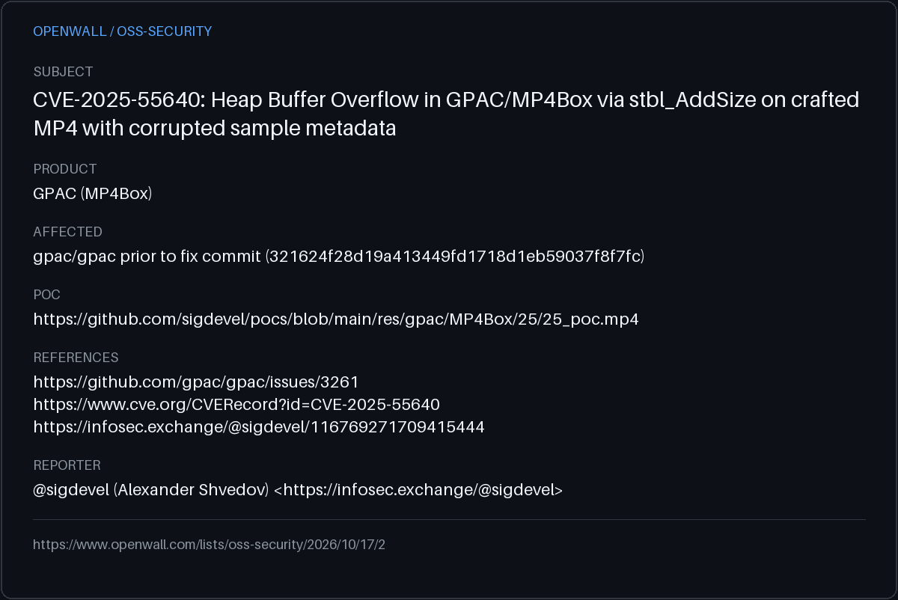](https://www.openwall.com/lists/oss-security/2026/10/17/2)

[Links and details (TXT)](openwall-2026-10-17-2/openwall-2026-10-17-2.txt)

Source: <https://www.openwall.com/lists/oss-security/2026/10/17/2>

**PoC:**

- <https://github.com/sigdevel/pocs/blob/main/res/gpac/MP4Box/25/25_poc.mp4>

**References:**

- <https://github.com/gpac/gpac/issues/3261>
- <https://www.cve.org/CVERecord?id=CVE-2025-55640>
- <https://infosec.exchange/@sigdevel/116769271709415444>

## CVE-2025-55653: Divide by Zero in GPAC/MP4Box via gf_parse_lfrac on crafted MP4 with zero-denominator fraction

[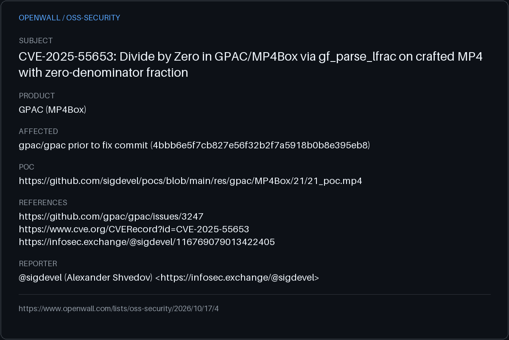](https://www.openwall.com/lists/oss-security/2026/10/17/4)

[Links and details (TXT)](openwall-2026-10-17-4/openwall-2026-10-17-4.txt)

Source: <https://www.openwall.com/lists/oss-security/2026/10/17/4>

**PoC:**

- <https://github.com/sigdevel/pocs/blob/main/res/gpac/MP4Box/21/21_poc.mp4>

**References:**

- <https://github.com/gpac/gpac/issues/3247>
- <https://www.cve.org/CVERecord?id=CVE-2025-55653>
- <https://infosec.exchange/@sigdevel/116769079013422405>
